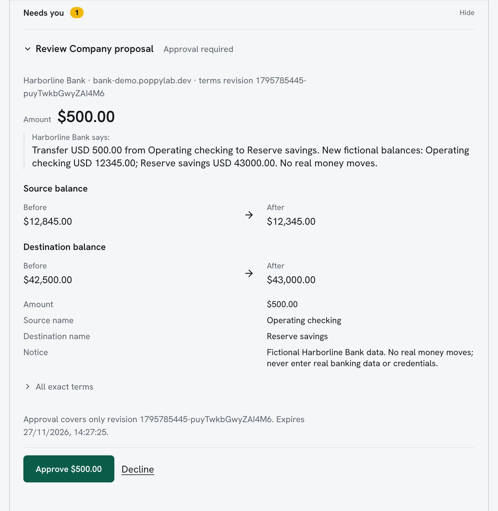

# Poppy Lab

**An open-source test bench for [Personal Agent Protocol 1.0](https://personalagentprotocol.org)** — featuring **Iris**, a Personal Agent you can run with a free built-in model or your own LLM key, and five independent fictional Companies it can discover, sign in to, and transact with.

[](https://github.com/mpuig/poppylab/actions/workflows/check.yml)
[](https://github.com/mpuig/poppylab/actions/workflows/spec-drift.yml)
[](LICENSE)
[](https://poppylab.dev/playground)

**[Live Playground](https://poppylab.dev/playground)** · **[Learn the Protocol](https://poppylab.dev/learn)** · **[Developer Guide](https://poppylab.dev/developers)** · **[Agent API Reference](https://poppylab.dev/developers/api)** · **[Validator Results](docs/learn/validator.md)**

<p align="center">
  
</p>

> [!NOTE]
> **Independent & fictional.** Poppy Lab is an independent project and is not affiliated with or endorsed by the Personal Agent Protocol authors ("Personal Agent Protocol" and "Poppy" are their names). All five Companies are fictional: nothing is sold, charged, shipped, or transferred. Never enter real banking, payment, passenger, or account credentials anywhere in the demo.

---

## Live Demo & Five Fictional Companies

Try Iris immediately at **[poppylab.dev/playground](https://poppylab.dev/playground)** — no account or API key required — or inspect any of the five standalone Companies directly:

| Company                    | Live site                                                      | Local dev                         | What it demonstrates                                                      | Domain extension                                               |
| -------------------------- | -------------------------------------------------------------- | --------------------------------- | ------------------------------------------------------------------------- | -------------------------------------------------------------- |
| **Juniper Market**         | [grocery-demo.poppylab.dev](https://grocery-demo.poppylab.dev) | `http://juniper.localhost:4100`   | Grocery orders, recurring delivery changes, full customer portal          | —                                                              |
| **Lantern Noodle Bar**     | [food-demo.poppylab.dev](https://food-demo.poppylab.dev)       | `http://noodles.localhost:4200`   | Scheduled orders, Company-agent refund proposals (`§8`)                   | —                                                              |
| **Harborline Bank**        | [bank-demo.poppylab.dev](https://bank-demo.poppylab.dev)       | `http://harbor.localhost:4300`    | Accounts, transfers, bill payments, narrow banking scopes                 | `poppylab.dev/fdx` (read-only FDX-shaped, uncertified)         |
| **Northwind Air**          | [airline-demo.poppylab.dev](https://airline-demo.poppylab.dev) | `http://northwind.localhost:4400` | Flight search, loyalty, approval-gated upgrades & stale-revision handling | —                                                              |
| **Fernwick Power & Light** | [energy-demo.poppylab.dev](https://energy-demo.poppylab.dev)   | `http://fernwick.localhost:4500`  | Hourly meter readings, bills, rate-plan switches, cross-company bill pay  | `poppylab.dev/espi` (read-only NAESB ESPI-shaped, uncertified) |

Also live on **[poppylab.dev](https://poppylab.dev)**:

- **[/](https://poppylab.dev)** — Plain-language introduction to Personal Agent Protocol and its benefits.
- **[/learn](https://poppylab.dev/learn)** — Interactive walkthroughs, request-by-request traces, protocol comparisons, and implementation guides.
- **[/developers](https://poppylab.dev/developers)** — Endpoints, scopes, OpenAPI spec ([`/api/v1/openapi.json`](packages/pap-agent/openapi.json)), and native-client guide.
- **[/playground](https://poppylab.dev/playground)** — Iris with live protocol Inspector and multi-company chat.

---

## What Poppy Lab Implements

Built against **Personal Agent Protocol 1.0** and **Operations v3** (the same codebase runs on Cloudflare Workers and Node.js):

- **Discovery, Identity & Versions (`§3`, `§4.1`):** `/.well-known/poppy.json` 1.0 with `supported_versions`, per-request extension negotiation, OAuth protected-resource & authorization-server metadata, and HTTPS `client_id` metadata + JWKS (`ES256` / `PS384`).
- **Sessions & DPoP (`§5`):** Delegated `ES256` `Poppy-Session` and `Poppy-Version: 1.0` headers on every request, `session_ended` handling, DPoP-bound access tokens, sender-constrained refresh, and revocation.
- **Direct & Device Sign-In (`§4.2`, `§4.3`):** Pushed Authorization Requests (PAR) with `prompt=consent` on each Company's own consent page — read-only first, with step-up consent to propose changes — plus device-code sign-in where offered.
- **Browser Session Joining & Tools (`§6`, `§7`, `§9`):** Read-only browser session joining, OpenAPI tools, Streamable HTTP MCP tools, and per-session excluded tasks (`§9`).
- **Operations v3 Approvals:** State-changing actions return `approval_required` with authoritative server-computed terms and a revision token. Changes execute at most once only after the user approves via `Poppy-Approval` (or under an explicit standing instruction limit).
- **Company-Agent Conversations (`§8`):** Each Company runs a deterministic agent that exchanges structured `data`, requests sign-in via authorization events, raises Operations v3 proposals inside messages, and supports human handoff (`§8.9`) and Direct Conversations (`§8.10`). See [docs/conversations.md](docs/conversations.md).
- **Multi-Company Conversations:** Connect up to three Companies in one conversation (for example, _"Pay my Fernwick bill from checking"_ across Fernwick and Harborline), each with isolated Sessions, grants, and proposals.
- **Channel-Neutral Agent API (`/api/v1`):** OpenAPI 3.1 HTTP API with Server-Sent Events (`/events`), passkey-backed multi-device agent accounts, rotating app tokens, and one-time Company sign-in links for native clients.
- **Inspector & Validator:** Every step in the playground Inspector maps to its spec section and exports a sanitized interop trace. On 26 November 2026, all five Companies passed the official Company implementation kit validator with zero failures ([results](docs/learn/validator.md); passing is not a certification).

---

## Quick Start

### Prerequisites

- **Node.js** `>= 22.18`
- **pnpm** `>= 11`

### Run locally

```sh
pnpm install
pnpm dev
```

Open **[http://localhost:3000/playground](http://localhost:3000/playground)** and pick any Company (sign in as fictional test customers **Elena** or **Robin**; changes appear on the Company's `/account` portal within two seconds).

### Model modes

| Mode               | Where it runs        | Key required? | Behavior                                                                                                                                                                                                                               |
| ------------------ | -------------------- | ------------- | -------------------------------------------------------------------------------------------------------------------------------------------------------------------------------------------------------------------------------------- |
| **Free model**     | `poppylab.dev`       | No            | Built-in Cloudflare Workers AI model behind Cloudflare Turnstile, subject to per-visitor, per-network, and daily Neuron caps ([details](docs/chat-workspace.md#the-free-model)).                                                       |
| **Demo mode**      | Local dev & fallback | No            | Deterministic rules execute scripted tasks across all five Companies (including FDX/ESPI reads, approval-gated changes, and the Fernwick + Harborline two-company bill payment).                                                       |
| **Your own model** | Anywhere             | Yes           | Paste an OpenAI, Anthropic, or Google key in **Model settings**, or copy `apps/playground/.env.example` to `apps/playground/.env.local` (`OPENAI_API_KEY`, `ANTHROPIC_API_KEY`, `GOOGLE_GENERATIVE_AI_API_KEY`, or `OLLAMA_BASE_URL`). |

---

## Workspace Architecture

```text
apps/playground  ──▶ pap-agent   ──▶ pap-client / llm-adapters ──▶ pap-core
apps/{5 sites}   ──▶ pap-company ──▶ pap-client                ──▶ pap-core
```

| Path                                             | Description                                                                                                                                                                                              |
| ------------------------------------------------ | -------------------------------------------------------------------------------------------------------------------------------------------------------------------------------------------------------- |
| [`apps/playground`](apps/playground)             | Next.js web channel (OpenNext on Cloudflare Workers or Node): home page, `/learn`, `/developers`, `/playground`, `/api/v1`, and Durable Object visitor/account storage.                                  |
| [`apps/juniper`](apps/juniper)                   | Juniper Market — grocery Company and customer portal.                                                                                                                                                    |
| [`apps/lantern`](apps/lantern)                   | Lantern Noodle Bar — restaurant Company with refund proposals.                                                                                                                                           |
| [`apps/harborline`](apps/harborline)             | Harborline Bank — fictional banking Company with narrow scopes and `poppylab.dev/fdx`.                                                                                                                   |
| [`apps/northwind`](apps/northwind)               | Northwind Air — airline Company with booking changes and stale-revision handling.                                                                                                                        |
| [`apps/fernwick`](apps/fernwick)                 | Fernwick Power & Light — electricity utility with `poppylab.dev/espi` Atom XML readings.                                                                                                                 |
| [`packages/pap-agent`](packages/pap-agent)       | Personal Agent core (conversations, routing, approvals, passkey accounts, SSE) and OpenAPI 3.1 contract ([`openapi.json`](packages/pap-agent/openapi.json)). See [docs/pap-agent.md](docs/pap-agent.md). |
| [`packages/pap-company`](packages/pap-company)   | Hono Company gateway (discovery, PAR sign-in, DPoP tokens, Sessions, conversations, Operations v3, per-visitor tenancy) powering all five Companies.                                                     |
| [`packages/pap-client`](packages/pap-client)     | Discovery, SSRF-safe transport, Session/DPoP cryptography, and tool builders for OpenAPI, MCP, FDX, and ESPI.                                                                                            |
| [`packages/pap-core`](packages/pap-core)         | Personal Agent Protocol 1.0 schemas, shared types, spec anchor links, and shared Company UI components.                                                                                                  |
| [`packages/llm-adapters`](packages/llm-adapters) | Provider-neutral model adapter (Workers AI, OpenAI-compatible, Anthropic, Google, Ollama).                                                                                                               |

---

## Verification & Scripts

```sh
pnpm lint                  # ESLint across apps, packages, and scripts
pnpm format:check          # Prettier formatting check
pnpm typecheck             # TypeScript checks across all workspaces + smoke scripts
pnpm test                  # Vitest unit & integration test suites
pnpm scenarios             # End-to-end multi-company protocol scenarios
pnpm learn:diagrams:check  # Verify generated Learn & Post SVG diagrams are up to date
pnpm spec:drift            # Check pinned spec/1.0/ against personalagentprotocol.org
pnpm build                 # Build all apps and packages
```

---

## Security & Isolation

- **Secrets stay below the model:** API keys, OAuth tokens, DPoP keys, Session tokens, and one-time codes never enter model prompts, Company requests, logs, or Worker bundles (`build:worker` fails if a local secret leaks into the bundle).
- **Per-visitor & per-tenant isolation:** On Workers, each visitor's state lives in its own Durable Object sealed at rest (`POPPY_STATE_KEY`), and each Company isolates fictional customer state per agent user with per-visitor, per-IP, and global rate limits.
- **Strict transport guards:** Outbound Company fetches enforce SSRF protections, redirect checks, and `global_fetch_strictly_public` on Workers.
- See **[poppylab.dev/privacy](https://poppylab.dev/privacy)** for full data-retention details.

---

## Deployment (Cloudflare Workers)

Poppy Lab deploys as six Cloudflare Workers via Wrangler (see [docs/portable-runtime.md](docs/portable-runtime.md)):

```sh
# Deploy the five fictional Companies
for app in juniper lantern harborline northwind fernwick; do
  pnpm --filter "@poppy-lab/$app" run deploy
done

# Build and deploy Poppy Lab (playground + /api/v1)
pnpm --filter @poppy-lab/playground build:worker
pnpm --filter @poppy-lab/playground deploy:worker
```

Required Wrangler secrets on `apps/playground`:

- `POPPY_IDENTITY` — JSON agent signing key pair.
- `POPPY_STATE_KEY` — 32 random bytes (base64url) sealing per-visitor and account Durable Object state at rest.
- `TURNSTILE_SECRET_KEY` — Cloudflare Turnstile secret guarding the Workers AI (`AI` binding) free model (capped by `FREE_MODEL_DAILY_NEURONS`).

---

## Documentation & Contributing

- **Learn guides:** [`docs/learn/`](docs/learn/README.md) (rendered directly to [poppylab.dev/learn](https://poppylab.dev/learn)).
- **Architecture & design notes:** [`docs/`](docs/README.md), [`docs/poppy-1.0.md`](docs/poppy-1.0.md), [`docs/coverage.md`](docs/coverage.md), [`DESIGN.md`](DESIGN.md), and [`PRODUCT.md`](PRODUCT.md).
- **Contributions:** Issues and pull requests are welcome. Please run `pnpm lint`, `pnpm format:check`, `pnpm typecheck`, and `pnpm test` before opening a PR.

---

## License

Licensed under the **Apache License 2.0** — see [LICENSE](LICENSE) and [NOTICE](NOTICE).

The pinned Personal Agent Protocol 1.0 specification files under [`spec/1.0/`](spec/1.0/) belong to the protocol authors and are distributed under the same license.
