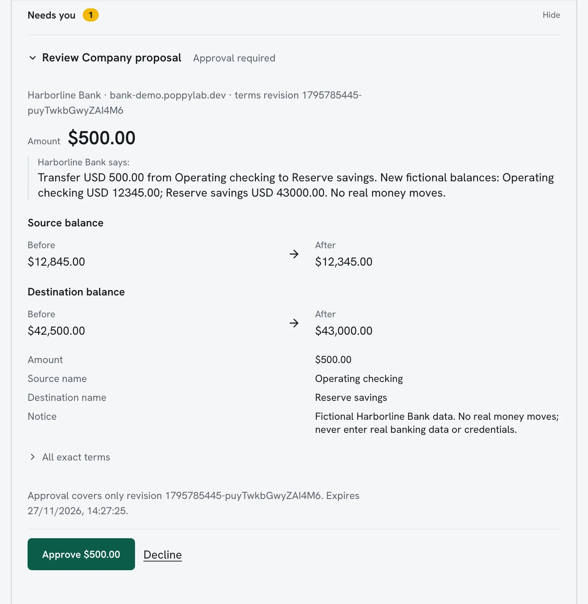

I almost scrolled past Personal Agent Protocol (Poppy, PAP 1.0) when it came out. Another week, another agent spec. Then I opened the [official introduction](https://personalagentprotocol.org/docs/introduction) and saw some of the names listed as design partners: Bank of America, Wells Fargo, Visa, Mastercard, Stripe, Walmart, Target, Shopify, Delta Air Lines, United Airlines, Cloudflare, Okta, and OpenAI.

That is not the logo list of a weekend experiment. It does not guarantee how the market plays out, but it does mean Poppy has a real chance of becoming an important layer of the agentic stack. And because version 1.0 is brand new, there were barely any live, public sites a product or CX lead could actually click through to see what it feels like.

So I spent the last couple of months building [Poppy Lab](https://poppylab.dev) in my spare time: an independent test bench for PAP 1.0. I did not write the protocol and I am not affiliated with its authors. I built it because reading a spec is never the same thing as watching real requests move between an agent and a server that has to protect a customer's account. You can open [the playground](https://poppylab.dev/playground), pick from five fictional companies, and watch a full protocol exchange in about thirty seconds without bringing an API key.

## Starting with a bank transfer

The easiest place to start is Harborline Bank ([bank-demo.poppylab.dev](https://bank-demo.poppylab.dev)). In the playground you can pick the keyless protocol demo mode (or plug in your own OpenAI, Anthropic, or Google key) and try "Transfer $500 from checking to savings."

The fictional customer is Elena Maren (the other test customer is Robin Ito). On Harborline's books, Elena holds $12,845 in Operating checking and $42,500 in Reserve savings. Iris, the playground's personal agent, starts with nothing except Harborline's domain name: no Harborline plugin, no saved password.

Iris fetches `/.well-known/poppy.json` ([spec §3](https://personalagentprotocol.org/docs/1.0/spec#discovery)), learns Harborline's endpoints, OAuth server, and scopes, and opens Harborline's own sign-in and consent page ([spec §4.2](https://personalagentprotocol.org/docs/1.0/spec#direct-sign-in)). You sign in as Elena on Harborline's domain, choose what Iris may do, and return to the playground. Iris receives a short-lived, DPoP key-bound access token ([spec §4.5](https://personalagentprotocol.org/docs/1.0/spec#access-tokens)) that ordinary code keeps out of the model's context ([spec §10.2](https://personalagentprotocol.org/docs/1.0/spec#secrets)).

Iris then reads Elena's balances. Once you also allow it to propose changes (a second, separate consent), it requests the $500 transfer. Harborline does not move the money. It replies with `approval_required` and an operation listing the exact terms: source account, destination account, amount, and resulting balances ([Operations v3, §4](https://personalagentprotocol.org/docs/1.0/extensions/operations#approval-required)). Iris renders an approval card. Nothing happens until Elena clicks approve, at which point Iris resends the request with her approval and Harborline executes the transfer once ([Operations v3, §7](https://personalagentprotocol.org/docs/1.0/extensions/operations#at-most-once)).

Watching that once tends to shift the conversation for product and digital teams. Instead of debating vague ideas about "agentic commerce," you are immediately looking at familiar product questions: which scopes do we even want to expose, what should our consent page explain, and where do we require a human click?

## Why five companies instead of one

Because PAP 1.0 is so new, a single toy store demo hides too much of what the protocol can actually do. Moving a grocery delivery day is reversible and low risk; moving money out of a checking account, upgrading a flight, or reading hourly electricity meters each exercise different parts of the spec. I built five fictional companies on the same portable gateway code, each on its own domain, to showcase different use cases and features side by side:

- **Juniper Market** ([grocery-demo.poppylab.dev](https://grocery-demo.poppylab.dev)), a grocery shop with a basket, recurring weekly delivery, orders, and support cases.
- **Lantern Noodle Bar** ([food-demo.poppylab.dev](https://food-demo.poppylab.dev)), a restaurant with scheduled deliveries and a deterministic support agent that handles missing-item refunds.
- **Harborline Bank** ([bank-demo.poppylab.dev](https://bank-demo.poppylab.dev)), with accounts, cards, saved recipients, and read-only FDX-shaped banking endpoints.
- **Northwind Air** ([airline-demo.poppylab.dev](https://airline-demo.poppylab.dev)), with bookings, seat selection, and paid cabin upgrades.
- **Fernwick Power & Light** ([energy-demo.poppylab.dev](https://energy-demo.poppylab.dev)), an electricity utility with hourly meters, rate plans, bills, and an ESPI-shaped Atom XML feed.

![You talk to Iris, the playground's agent, as one of two fictional customers, Elena or Robin. Iris connects to five fictional companies, each exercising a different part of the protocol: Juniper Market a reversible delivery move, Lantern Noodle Bar a support conversation, Harborline Bank moving money, Northwind Air a paid cabin upgrade, and Fernwick Power & Light hourly meter readings. Every request and answer between Iris and the companies passes through the Inspector, where it can be read as it was sent.](../../public/posts/what-is-poppy-lab/five-companies.svg "One agent and five fictional companies, each exercising a different part of the protocol, with every request between them readable in the Inspector.")

Each company also has its own customer website. If you keep Juniper or Harborline open in a second tab while you approve a change in Iris, the website updates a couple of seconds later and records which agent made the change. Everything is fictional, nothing is charged or shipped, and each visitor gets an isolated copy of the state.

## The Inspector matters more than the chat

If you only look at the chat bubbles, Poppy Lab looks like another AI chat demo. The part I actually built it for is the Inspector, one tab away from the conversation. Every discovery document, signed `Poppy-Session` header, OAuth metadata fetch, `403` refusal, `approval_required` payload, and tool argument is right there to read.

To keep myself honest about spec compliance rather than inventing convenient shortcuts, I run the official Company implementation kit's validator against all five live deployments. All five pass 124 to 126 checks with zero failures (up from the 120 to 121 pre-MCP baseline documented on [Validator results](https://poppylab.dev/learn/validator)), with the remaining skipped checks covering optional features they do not implement such as Mediated Sign-In or multiple protocol versions.

## Why look at a fictional lab now?

A reasonable objection from any busy product lead is simple: customer-owned agents are not hitting our APIs in volume yet, so why spend time on a fictional test bench for a protocol that just shipped?

Two honest answers. First, personal agents are already reaching company websites today through browser automation and stored passwords, which leaves security and CX teams stuck between blocking legitimate customers and letting an opaque script run with full account access. Spending five minutes seeing a structured alternative is cheap. Second, with that list of banks, retailers, airlines, and infrastructure providers already listed as design partners, ignoring PAP 1.0 until it shows up in a vendor RFP is probably waiting too long. And even if another standard eventually wins, the design questions this lab surfaces (separating read scopes from irreversible writes, binding approvals to server-computed terms, revoking an agent without changing a password) are not going away.

Poppy Lab is not a production blueprint, and a list of design partners is not proof of finished rollouts. The five companies here are small sandboxes with fictional data, no real settlement, and no fraud engine. I built it because the best way to understand a new protocol is to implement both ends of it and let people try it.

If you want guided walkthroughs, start at [Learn](https://poppylab.dev/learn). If you just want to see a transfer happen, open [the playground](https://poppylab.dev/playground) and run one keyless request against Harborline or Lantern.

_Poppy Lab is a personal project; views are my own._
