# Changing a trip

Elena is flying with [Northwind Air](https://airline-demo.poppylab.dev) on
18 May 2027, on two flights: Port Aurora to Cinder Bay, then on to Northhaven.
She asks Iris, her personal agent, whether an upgrade is available, takes the
one Northwind offers on the second flight and adds a checked bag to the first.
Both changes cost money. Northwind sets each price and its conditions, and it
makes each change after Elena has read the terms and approved them.

This page follows those requests screen by screen, on Iris's side and on
Northwind's. Every screenshot is from the live lab, taken on 25 November 2026.

## Who does what

| Who                    | What they do in this process                                                                                       |
| ---------------------- | ------------------------------------------------------------------------------------------------------------------ |
| Elena, the customer    | Asks in her own words, says which flight she means when Iris asks, and approves each paid change after reading it. |
| Iris, her agent        | Reads the booking, asks Elena when a request could mean two things, and asks Northwind for each change.            |
| Northwind, the company | Decides what agents may do, sets the price and the conditions of each change, and makes the changes it approved.   |

## Step by step

### 1. The trip at Northwind

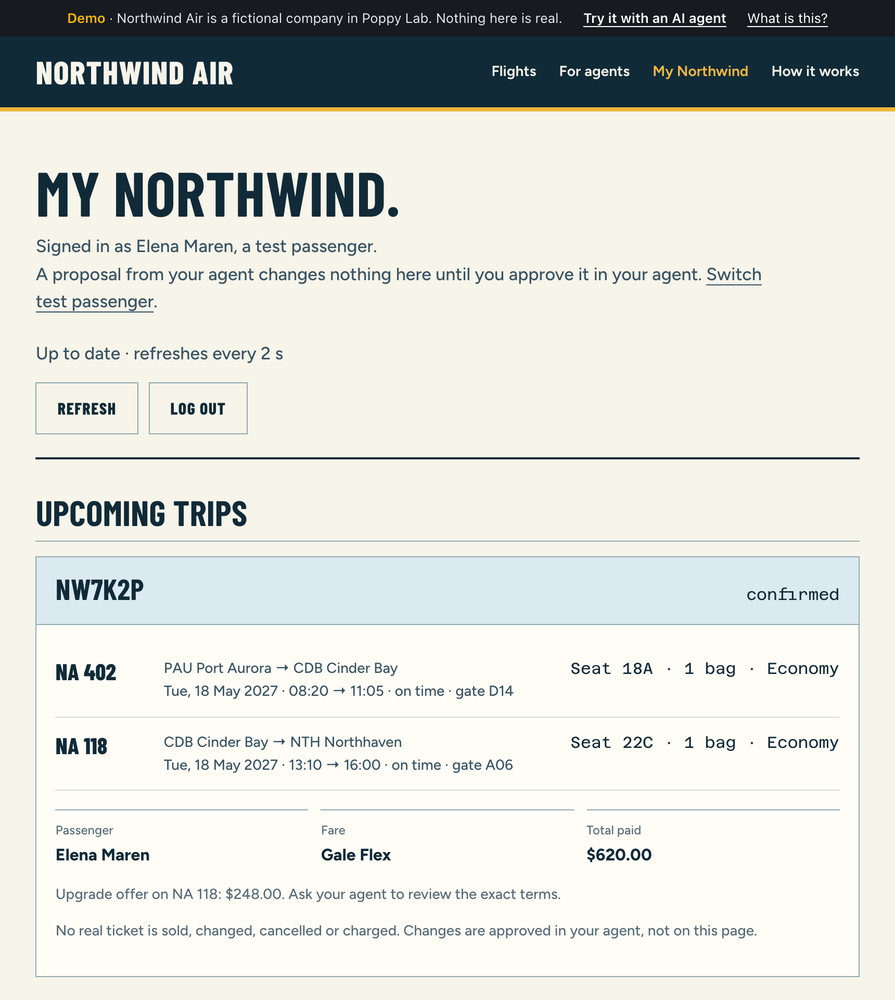

Northwind's website shows Elena her booking: two flights on the same day, a
seat and one checked bag on each, both in Economy, and 620 dollars paid. Under
the flights Northwind mentions an offer of its own, an upgrade on flight
NA 118 for 248 dollars.

Northwind keeps this record. In the steps that follow, Iris reads this booking
from Northwind each time it needs it and asks Northwind to change it.

### 2. Let Iris propose changes

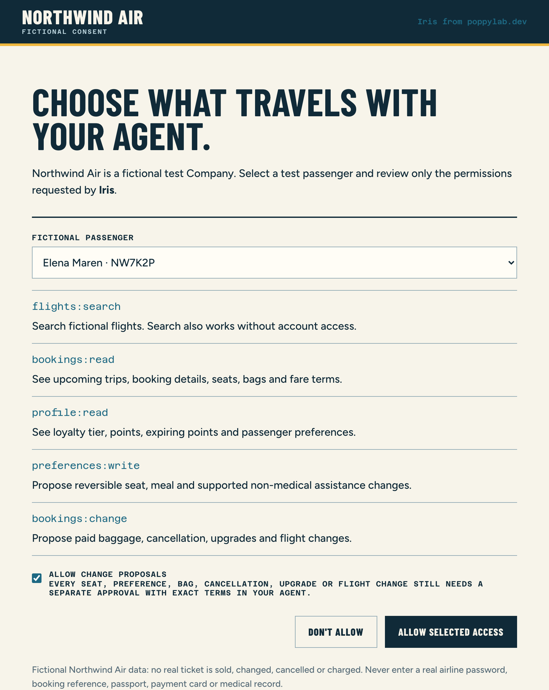

Elena signs in on Northwind's own page and sees what Iris would be allowed to
do. Under Read, Northwind lists three things: flight search, her trips, and
her profile with its loyalty points and preferences. Under Propose changes it
lists one, with a ticked box: her trips and preferences. Northwind's
description says what that covers, from a seat or a meal to paid baggage,
cancellation, upgrades and flight changes.

The line beside Propose changes says what proposing means: each one waits for
her approval. Iris may ask for a change, and every change still needs a
separate approval with exact terms. In the lab Elena reaches this page in two
visits, first for read-only access and then for the permission to propose
changes.
[Changing an order](changing-an-order.md#3-sign-in-at-lantern) follows the
sign-in and both consents one screen at a time.

<details>
<summary>What travelled</summary>

After Elena allowed it, Iris held an access token for these five scopes, and
the conversation showed them under each answer:

```text
Reading and change proposals · flights:search, bookings:read, profile:read, preferences:write, bookings:change
```

The ticked box stands for the last two. Northwind describes
`preferences:write` as changes that can be undone and `bookings:change` as
changes that can cost money or cannot be undone.

Before the second consent, with read-only access, the same request for an
upgrade got this answer from Iris: nothing was sent to the company, because
Elena's access did not include the permission the change needs. The steps
under that answer said so too:

```text
Read /api/account/bookings
Did not ask for /api/account/bookings/NW7K2P/upgrade (permission not granted); nothing was sent
```

</details>

### 3. Ask a question

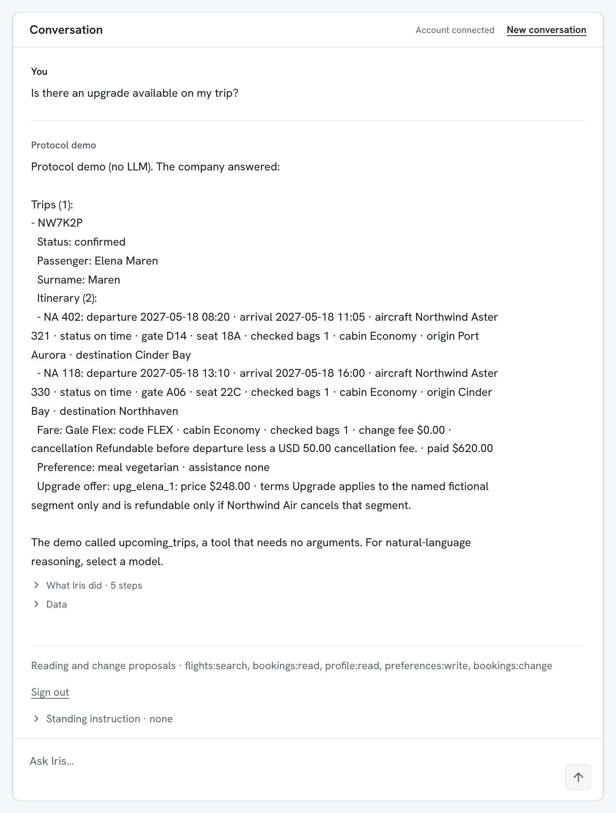

Elena asks: "Is there an upgrade available on my trip?" Iris reads her trips
from Northwind and shows them. The answer is in the last line of the booking:
an upgrade offer for 248 dollars, for that flight only, refundable only if
Northwind cancels the flight.

Iris answered by reading and asked Northwind for nothing else. Elena has
already allowed change proposals, as the line under the answer says, and her
question still bought nothing and put nothing in front of her to approve.

The lab runs here in demo mode, without an AI model, so the answer is the
whole booking set out as plain lines. With a model connected Iris would answer
in a sentence, from the same data.

<details>
<summary>What travelled</summary>

```text
Started a Poppy Session, signed in
Found 15 API tools at the Company
Read /api/account/bookings
```

The offer, as Northwind sent it inside the booking:

```json
{
  "upgrade_offer": {
    "id": "upg_elena_1",
    "flight_id": "flt_na118_20270518",
    "price_cents": 24800,
    "currency": "USD",
    "terms": "Upgrade applies to the named fictional segment only and is refundable only if Northwind Air cancels that segment."
  }
}
```

</details>

### 4. Ask for the upgrade

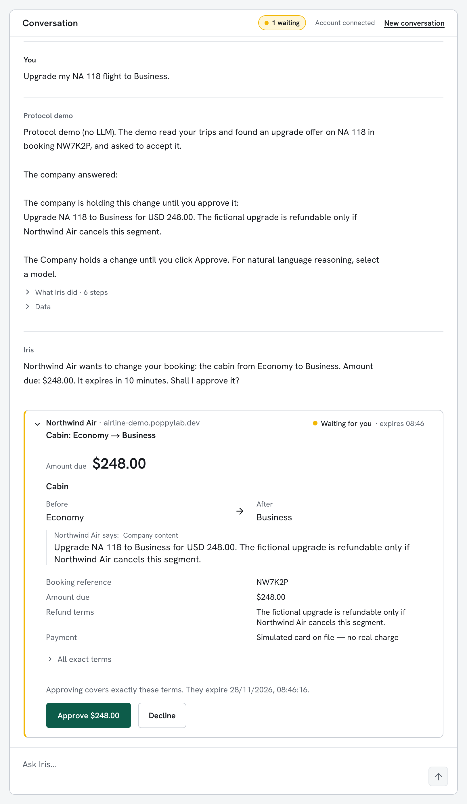

Now Elena asks for it: "Upgrade my NA 118 flight to Business." Iris reads the
booking again, finds Northwind's offer for that flight and asks Northwind to
accept it.

Northwind does not upgrade her yet. It answers that this change needs the
customer's approval and sends back the terms it would apply. Iris shows them
in a panel called Needs you.

<details>
<summary>What travelled</summary>

```text
Read /api/account/bookings
Sent a request to /api/account/bookings/NW7K2P/upgrade
Asked for your approval; nothing was done yet
```

Iris sent the booking reference and the identifier of the offer. Northwind's
answer, as Iris received it:

```json
{
  "status": "approval_required",
  "operation_id": "op_aAlzftB53KD09ggOO1h4FImT",
  "summary": "Upgrade NA 118 to Business for USD 248.00. The fictional upgrade is refundable only if Northwind Air cancels this segment.",
  "terms": {
    "booking_reference": "NW7K2P",
    "booking_version": 1,
    "offer_id": "upg_elena_1",
    "flight_id": "flt_na118_20270518",
    "inventory_version": 1,
    "from_cabin": "Economy",
    "to_cabin": "Business",
    "amount_due_cents": 24800,
    "currency": "USD",
    "refund_terms": "The fictional upgrade is refundable only if Northwind Air cancels this segment.",
    "payment": "Simulated card on file — no real charge"
  },
  "expires_at": "2026-11-25T20:53:49.029Z"
}
```

</details>

### 5. Read the price and the conditions

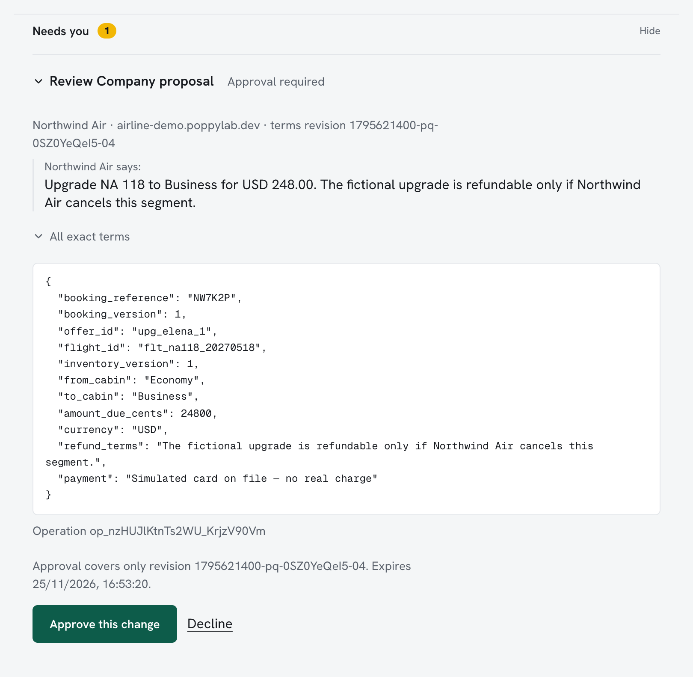

The panel shows what Northwind will do if Elena approves. The amount due
comes first, 248 dollars, and the button repeats it: "Approve $248.00". The
sentence that begins "Northwind Air says" is the airline's own description:
flight NA 118, Business, refundable only if Northwind cancels the flight.

Below it the terms are set out as rows: the cabin she has and the cabin she
gets, the booking reference, the amount due, the refund terms and the
payment. All exact terms, one click away, holds everything Northwind sent,
including the flight, the offer and the version of the booking the terms were
worked out for. Northwind wrote every one of these values. Iris named the
booking and the offer, and its request had no field for a price.

An approval covers this revision of the terms and no other, and it expires.
This one was good for ten minutes. Because the terms name the version of the
booking, the approval is for the booking as it stood when Northwind made the
offer.

<details>
<summary>What travelled</summary>

No request was made in this step. The terms were already in Northwind's answer
in step 4, and they stay on Elena's screen until she decides.
[Approvals with Operations](../operations.md#what-an-operation-holds) explains each
part of that answer.

</details>

### 6. Approve the upgrade

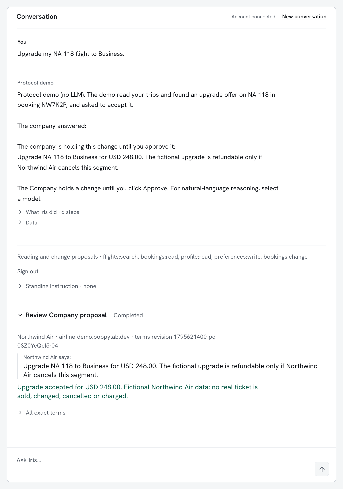

Elena presses the Approve button. Iris sends Northwind the same request
again, this time with her approval attached. Northwind checks that the
approval matches the terms it offered, upgrades the flight and confirms it:
upgrade accepted for 248 dollars. The proposal stays in the conversation as a
finished entry, with that confirmation and the line "Approved by you."

The lab charges nothing. The terms say so themselves, in the line "Simulated
card on file".

<details>
<summary>What travelled</summary>

The same request as in step 4, with a `Poppy-Approval` header that names the
operation, the terms revision and who approved.
[Approvals with Operations](../operations.md#what-an-approval-carries)
describes the header and what the company checks.

</details>

### 7. Ask for a bag

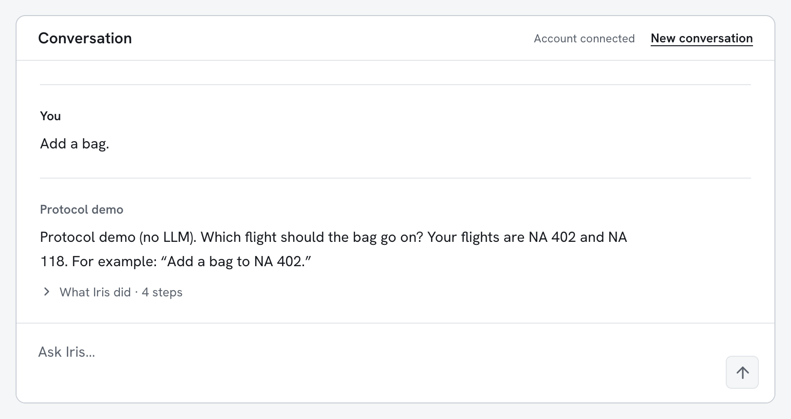

Next Elena writes: "Add a bag." Her booking has two flights, and Northwind
sells a checked bag for one flight at a time. Iris asks which flight she
means and names both, because choosing one for her would be a guess about
what she wants to buy.

Iris read the booking to find the flights and sent Northwind nothing else. A
request that could mean two different purchases goes back to Elena as a
question.

<details>
<summary>What travelled</summary>

```text
Read /api/account/bookings
```

Three more requests were tried at this point in the run. None of them reached
Northwind as a request for a change.

| Elena wrote                      | Iris answered                                                                                              |
| -------------------------------- | ---------------------------------------------------------------------------------------------------------- |
| add 3 bags to NA 402             | The demo adds 1 or 2 checked bags at a time; you asked for 3.                                              |
| Add a bag to my flight on 18 May | Which flight should the bag go on? Your flights are NA 402 and NA 118. For example: “Add a bag to NA 402.” |
| upgrade NA 999                   | NA 999 isn't in your bookings. Your flights are NA 402 and NA 118.                                         |

</details>

### 8. Name the flight

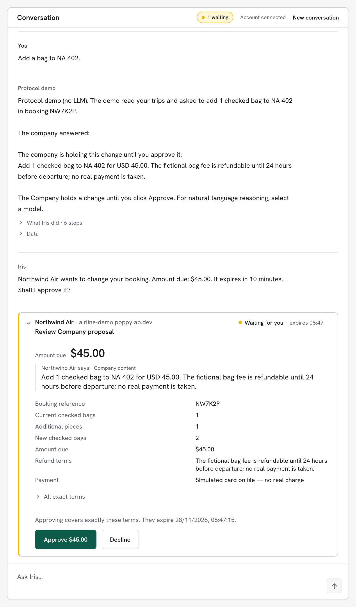

Elena answers: "Add a bag to NA 402." Iris asks Northwind for one more checked
bag on that flight, and Northwind answers with new terms: 45 dollars,
refundable until 24 hours before departure.

This is a second proposal, separate from the first, with its own amount due
and its own Approve button. The upgrade Elena approved is listed above it as
Completed, and that approval does not extend to the bag. Each paid change
waits for an approval of its own.

<details>
<summary>What travelled</summary>

```text
Read /api/account/bookings
Sent a request to /api/account/bookings/NW7K2P/baggage
Asked for your approval; nothing was done yet
```

Iris sent the flight and the number of bags. Northwind's answer:

```json
{
  "status": "approval_required",
  "operation_id": "op_KhCre0Gwd4OxhMHb_RAzHF6M",
  "summary": "Add 1 checked bag to NA 402 for USD 45.00. The fictional bag fee is refundable until 24 hours before departure; no real payment is taken.",
  "terms": {
    "booking_reference": "NW7K2P",
    "booking_version": 2,
    "flight_id": "flt_na402_20270518",
    "current_checked_bags": 1,
    "additional_pieces": 1,
    "new_checked_bags": 2,
    "amount_due_cents": 4500,
    "currency": "USD",
    "refund_terms": "The fictional bag fee is refundable until 24 hours before departure; no real payment is taken.",
    "payment": "Simulated card on file — no real charge"
  },
  "expires_at": "2026-11-25T20:55:58.013Z"
}
```

`booking_version` is now 2, because the upgrade changed the booking.

</details>

### 9. Approve the bag

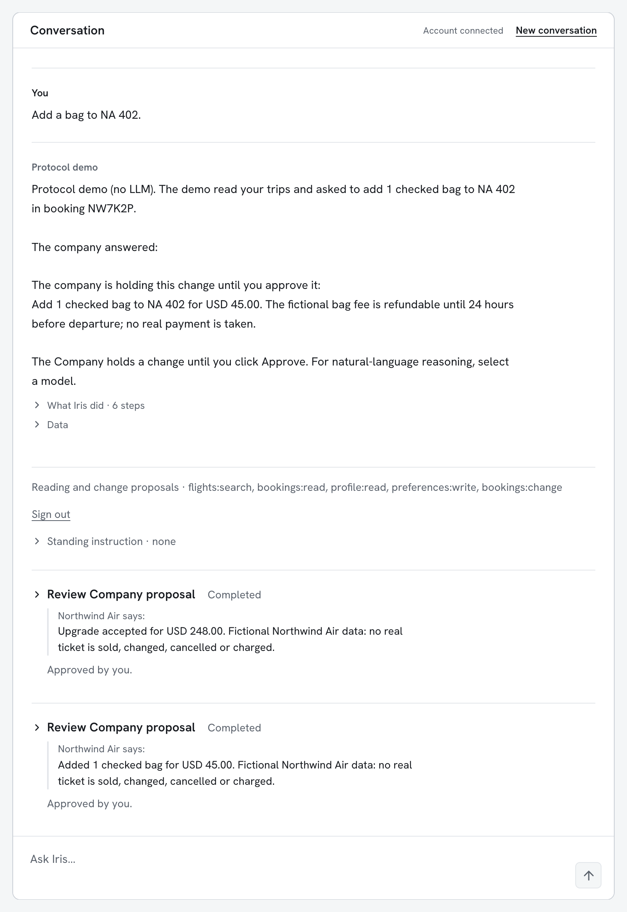

Elena approves, and Northwind confirms that it added one checked bag for 45
dollars. The conversation now holds two finished proposals. Each one shows the
confirmation Northwind sent and the line "Approved by you", and opens to the
terms Northwind set.

While the bag was waiting for her decision, Northwind's website listed it as
awaiting approval, said until when it would wait, and still showed one bag on
that flight.

### 10. The trip at Northwind afterwards

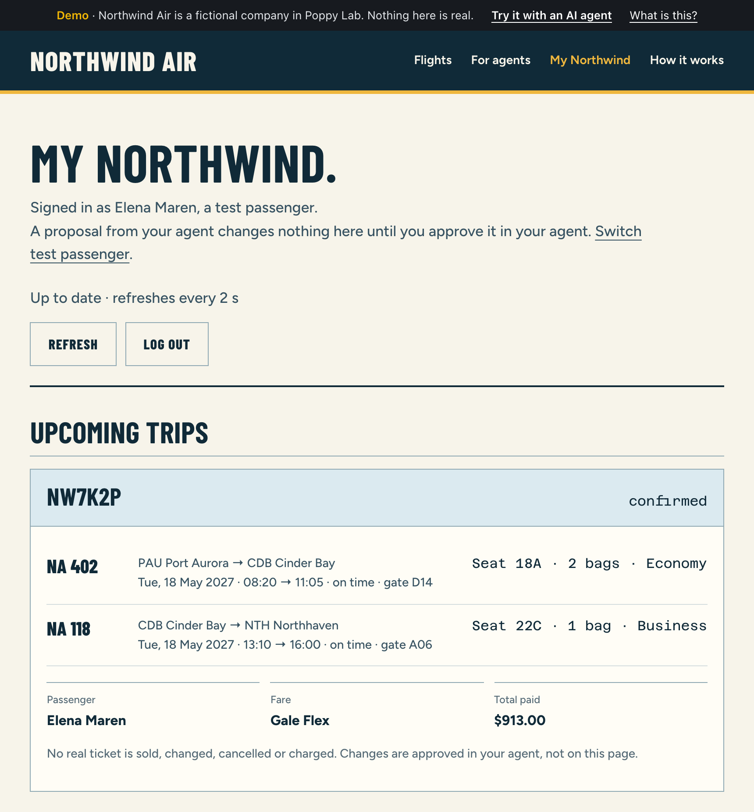

Northwind's website shows the booking as it now stands: two bags on NA 402,
Business on NA 118, and 913 dollars paid. That is the 620 dollars from before,
plus 248 for the upgrade and 45 for the bag. The upgrade offer is no longer
shown, because Elena took it.

### 11. Northwind's record of the agent

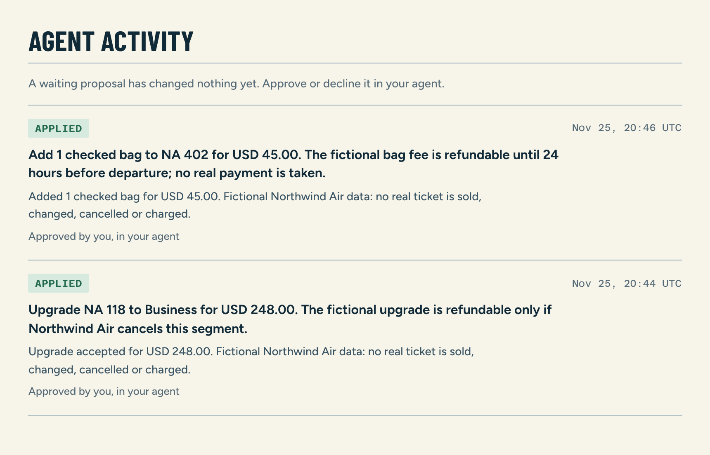

Lower on the same page, Northwind lists what Elena's agent has done on her
behalf. Each entry carries Northwind's description of the change, what
Northwind did, at what time, and who approved it. A traveller who wonders why
a booking costs more than it did finds the answer on the airline's site.
Northwind keeps the entries: the screenshot is from twelve minutes after the
bag was added, after Iris had read the booking once more.

## What Northwind controls

Northwind stays in charge of its own business throughout.

- It decides which permissions an agent can be given, and it keeps reading
  apart from proposing changes.
- The sign-in and the consents happen on its own pages, with its own wording.
- It sets the price and the conditions of every change and puts them in the
  terms. The agent names the offer, or the flight and the number of bags.
- It makes a paid change only when the customer's approval arrives, only for
  the terms it offered, and one change at a time.
- It shows the customer what the agent asked for recently, what was applied
  and who approved it.

## For the technical reader

The Inspector view of the playground lists every check and every call behind
the screens above, and the trace can be downloaded.
[Approvals with Operations](../operations.md) explains the terms, the revision
and the approval. Northwind also accepts seat changes, flight changes and
cancellations from agents, each with terms of its own. The lab's demo mode has
no way to ask for those, so this page does not show them.
