# Changing an order

Elena has a noodle order scheduled for Friday at
[Lantern Noodle Bar](https://food-demo.poppylab.dev). She asks Iris, her
personal agent, to add a dessert and move the delivery to Sunday. Lantern
makes the change after Elena has read the exact terms and approved them, and
at no point does Iris hold her password or decide for her.

This page follows that request screen by screen, on Iris's side and on
Lantern's. Every screenshot is from the live lab, taken on 25 November 2026.

## Who does what

| Who                  | What they do in this process                                                                                         |
| -------------------- | -------------------------------------------------------------------------------------------------------------------- |
| Elena, the customer  | Says what she wants in her own words, signs in on Lantern's page, and approves the change once she has read it.      |
| Iris, her agent      | Reads what Lantern publishes, reads the order once Elena allows it, and asks Lantern for the change.                 |
| Lantern, the company | Says what agents may do, shows its own consent page, sets the terms and the price, and makes the change it approved. |

## Step by step

### 1. Pick the company

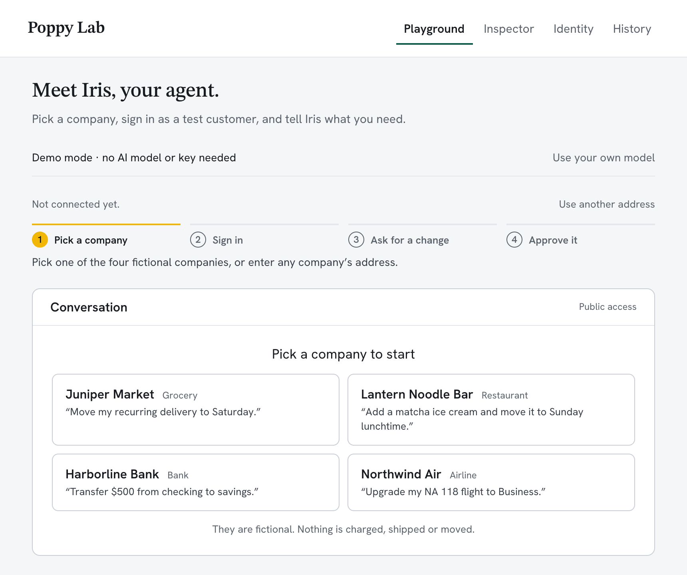

Elena tells Iris which company she wants to deal with. Iris needs only its
web address. From that address it fetches one public file in which Lantern
says who it is, what an agent can do there and how a customer signs in.

Lantern wrote that file. Nothing about Lantern is built into Iris, so the
same agent works with any company that publishes one.

<details>
<summary>What travelled</summary>

Iris made a handful of public requests and sent no credentials with any of
them: the company's description, the description of its sign-in service and
the list of its API operations.

```http
GET https://food-demo.poppylab.dev/.well-known/poppy.json
```

[One task, request by request](../one-task.md#1-find-out-what-the-company-offers)
shows the responses in full.

</details>

### 2. Ask what is public

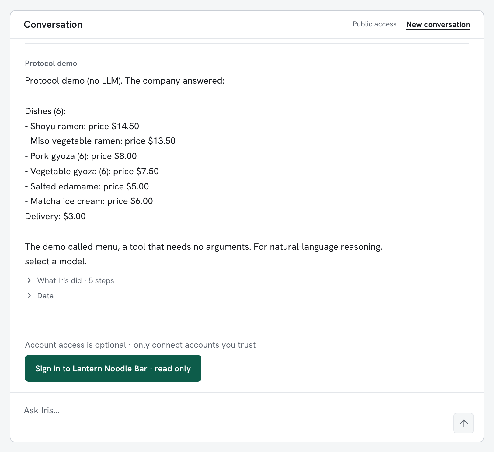

Before she signs in, Elena asks what is on the menu. Lantern answers, because
it decided that the menu and the delivery slots are public. Iris has no access
to her account yet, and the green button under the answer is how she would
give it.

The lab runs here in demo mode, without an AI model, so the answer is the
company's data set out as plain lines. With a model connected Iris would
answer in sentences. The requests to Lantern are the same either way.

<details>
<summary>What travelled</summary>

Iris opened a session with Lantern, which tells the company which agent is
calling and for which of its users, without saying who that user is. Then it
read the menu.

```text
Started a Poppy Session
Read /poppy/tasks
Found 5 API tools at the Company
Read /api/menu
```

</details>

### 3. Sign in at Lantern

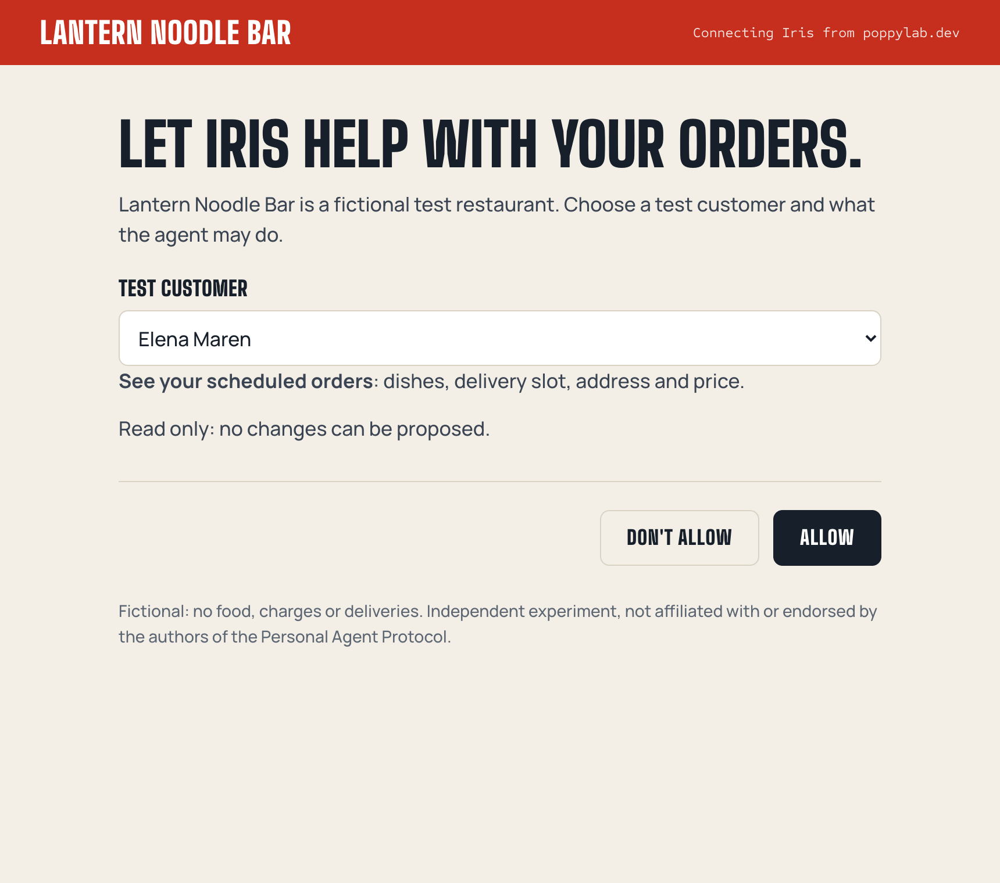

Signing in happens on Lantern's website, in Lantern's design and in its words.
The page says which agent is asking and what it would be allowed to do:
see the scheduled orders, and nothing else. Elena chooses Allow.

Iris never sees a password. What it receives from Lantern is a permission
tied to Iris itself, which Elena can withdraw at Lantern whenever she likes.
The lab's companies have test customers and no passwords, which is why the
page offers a list of names.

<details>
<summary>What travelled</summary>

Iris sent the sign-in request to Lantern directly and opened the consent page
with a reference to it, so the request cannot be altered in the browser. After
Elena allowed it, Lantern sent the browser back to Iris with a one-time code,
and Iris exchanged the code for an access token bound to its own key.

| Request                                | Who makes it |
| -------------------------------------- | ------------ |
| `POST /oauth/par`                      | Iris         |
| `GET /oauth/authorize` and the consent | Elena        |
| `POST /oauth/token`                    | Iris         |

</details>

### 4. Iris reads the order

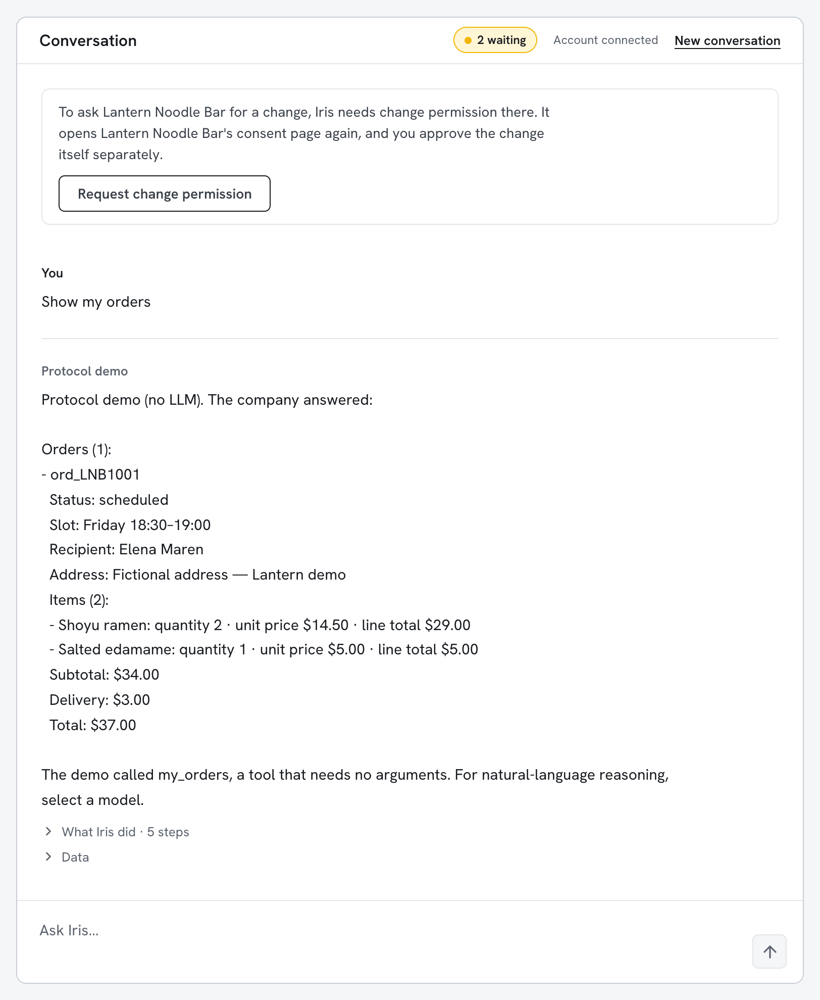

Back in the conversation, Elena asks for her orders and Iris reads them from
Lantern: one order for Friday evening, 37 dollars.

The line under the answer states what Iris may do at this point: read-only
access. To change anything Elena has to give a second, separate permission,
which is what the Request change permission button asks for.

<details>
<summary>What travelled</summary>

```text
Started a Poppy Session, signed in
Read /api/account/orders
```

The request carried the access token from the sign-in. Lantern checked that
the token allows `orders:read` before it answered.

</details>

### 5. The same order at Lantern

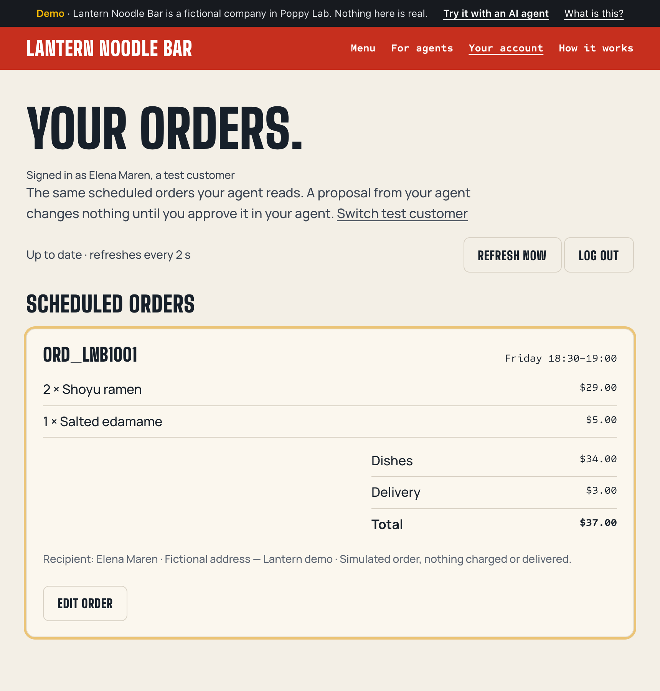

Lantern's website shows Elena the same order. The agent and the website read
one record, kept by Lantern. Iris keeps no copy that could drift from it.

### 6. Allow Iris to propose changes

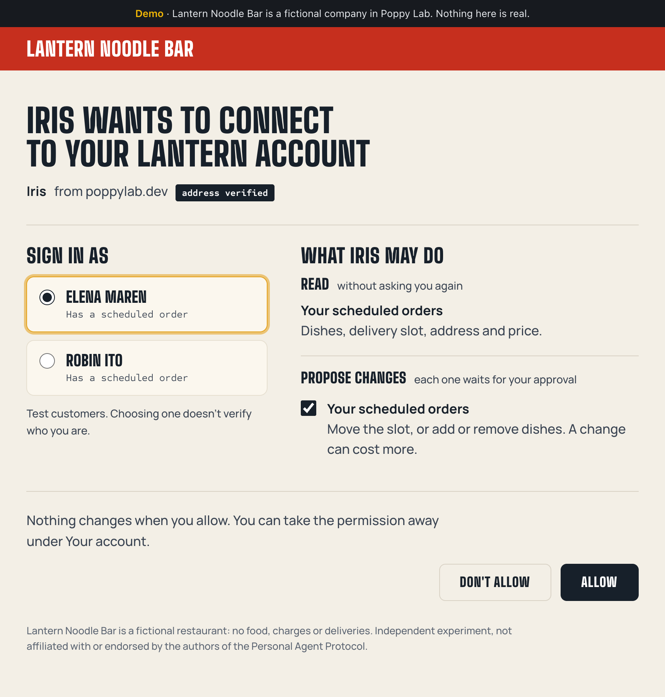

Elena presses Request change permission and Lantern's page opens again. This
time it names one more thing Iris could do: propose changes to scheduled
orders. The permission lets Iris ask. Each change will still need Elena's
approval.

Lantern decides how its permissions are split and how each one is described.
A bank or an airline would draw the lines elsewhere.

### 7. Ask for the change

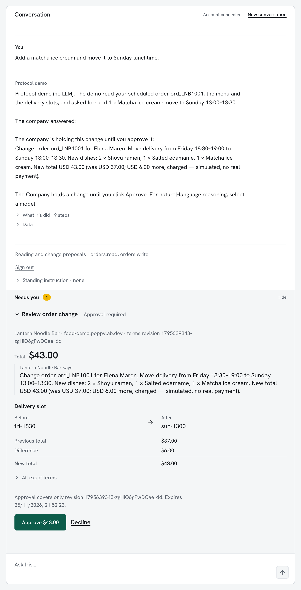

Elena types what she wants: "Add a matcha ice cream and move it to Sunday
lunchtime." Iris reads the menu, the delivery slots and the order, works out
which dish and which slot she means, and asks Lantern for that change.

Lantern does not make it. It answers that the change needs the customer's
approval and sends back the terms it would apply. Iris shows them in a panel
called Needs you.

<details>
<summary>What travelled</summary>

```text
Read /api/menu
Read /api/account/orders
Read /api/delivery-slots
Sent a request to /api/account/orders/ord_LNB1001/changes
Asked for your approval; nothing was done yet
```

Lantern's answer to the request, as Iris received it:

```json
{
  "status": "approval_required",
  "operation_id": "op_tsGMAV_4xPsGTuijbK2s9ovA",
  "summary": "Change order ord_LNB1001 for Elena Maren. Move delivery from Friday 18:30–19:00 to Sunday 13:00–13:30. New dishes: 2 × Shoyu ramen, 1 × Salted edamame, 1 × Matcha ice cream. New total USD 43.00 (was USD 37.00; USD 6.00 more, charged — simulated, no real payment).",
  "terms": {
    "order_id": "ord_LNB1001",
    "order_version": 1,
    "from_slot": "fri-1830",
    "to_slot": "sun-1300",
    "lines": { "shoyu-ramen": 2, "edamame": 1, "matcha-ice": 1 },
    "before_total_cents": 3700,
    "new_total_cents": 4300,
    "price_difference_cents": 600,
    "currency": "USD",
    "payment": "Simulated card on file — no real charge"
  },
  "expires_at": "2026-11-25T15:30:24.094Z"
}
```

</details>

### 8. Read what you are approving

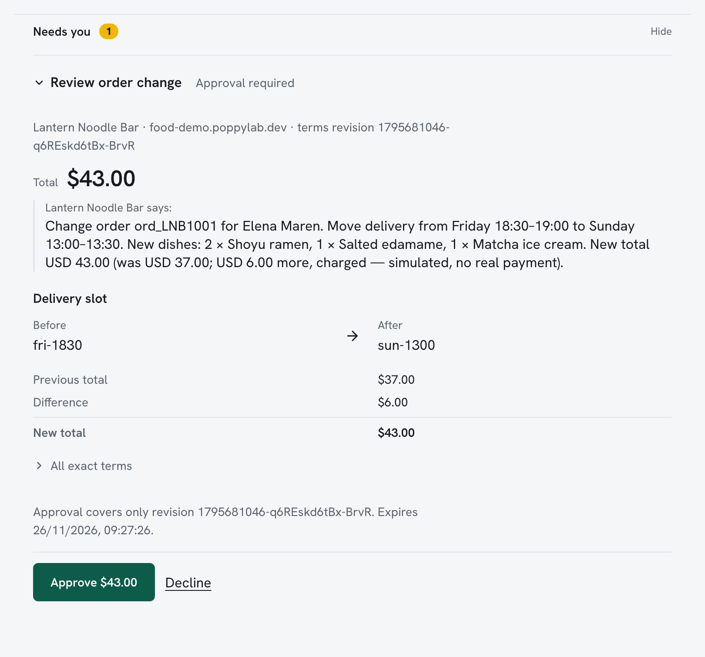

The panel shows what Lantern will do if Elena approves: the new delivery
slot, the dishes, the new total and the difference from the old one. The
paragraph that begins "Lantern Noodle Bar says" is the company's own
description, shown as written.

An approval covers these terms and no others. If Lantern's price or the order
changed in the meantime, Lantern would send new terms and Elena would be asked
again. The approval also expires: this one was good for ten minutes.

<details>
<summary>What travelled</summary>

No request was made in this step. The terms were already in Lantern's answer
in step 7, and they stay on Elena's screen until she decides.

</details>

### 9. Approve

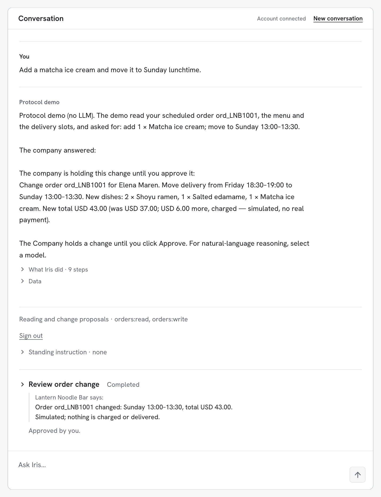

Elena presses Approve. Iris sends Lantern the same request again, this time
with her approval attached. Lantern checks that the approval matches the
terms it offered, makes the change and confirms it: the order is now for
Sunday and costs 43 dollars.

The approval is something Elena gives by pressing the button. A sentence in
the conversation cannot stand in for it, whether Elena writes it or the model
does.

<details>
<summary>What travelled</summary>

The same request as in step 7, with a `Poppy-Approval` header that names the
operation, the terms revision and who approved.
[Approvals with Operations](../operations.md) describes the header and what
the company checks.

</details>

### 10. Check the order at Lantern

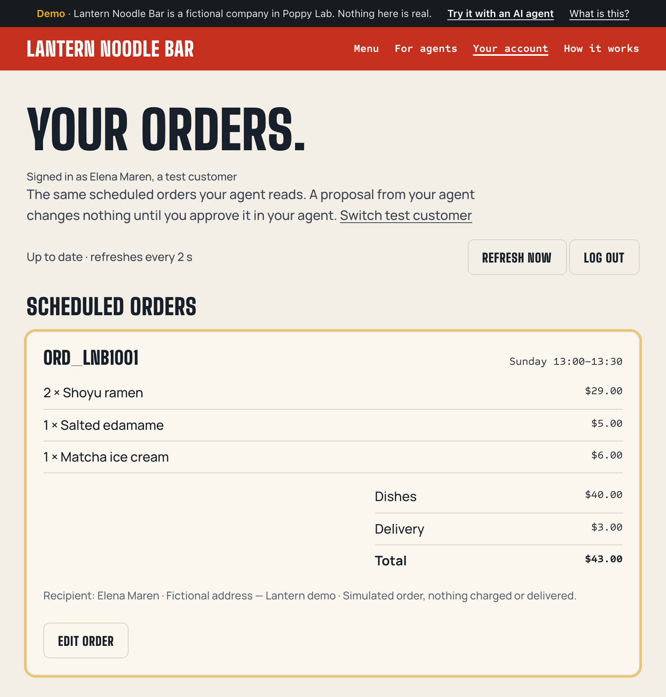

Lantern's website shows the order as it now stands: Sunday lunchtime, three
dishes, 43 dollars.

### 11. See what the agent did

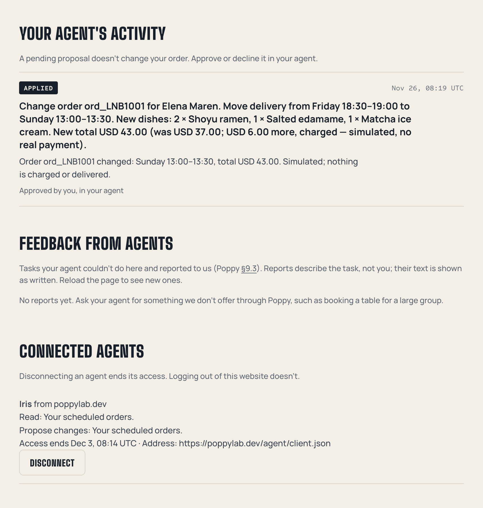

Lower on the same page, Lantern lists what Elena's agent has asked for
recently. The entry for this change says it was applied and that Elena
approved it in her agent. A customer who wonders how an order changed finds
the answer on the company's site while the entry is listed. The order keeps
the change.

## What Lantern controls

Lantern stays in charge of its own business throughout.

- It decides what an agent can read without an account and what needs the
  customer to sign in.
- The sign-in and both consents happen on its own pages, with its own wording.
- It computes the terms and the price. The agent cannot propose a total.
- It makes a change only when the customer's approval arrives, and only for
  the terms it offered.
- It shows the customer what her agent asked for recently, what was applied
  and who approved it.

## For the technical reader

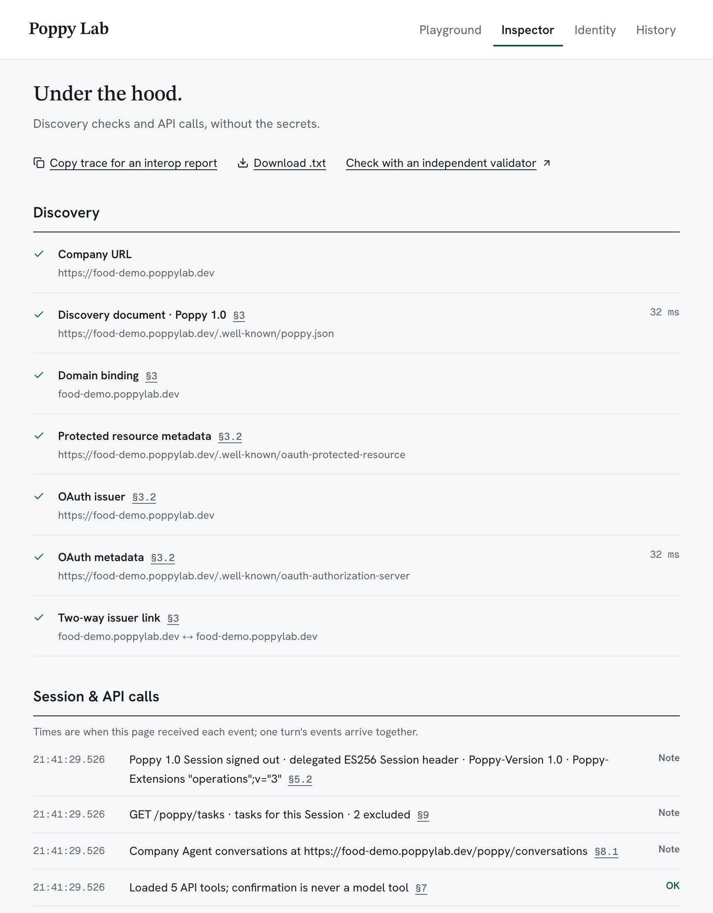

The Inspector view of the playground lists every check and every call behind
the screens above, and the trace can be downloaded.
[One task, request by request](../one-task.md) walks through the same kind of
change with each request and response written out.
