# Connecting to a company

Elena buys her groceries at
[Juniper Market](https://grocery-demo.poppylab.dev) and wants Iris, her
personal agent, to deal with the shop for her. Before her account comes into
it, Iris has to find out what Juniper offers to agents, and Juniper decides
what an agent may see while no customer has signed in.

This page follows that first contact screen by screen, on Juniper's website
and in Iris's conversation. Every screenshot is from the live lab, taken on
25 November 2026.

## Who does what

| Who                  | What they do in this process                                                                                 |
| -------------------- | ------------------------------------------------------------------------------------------------------------ |
| Elena, the customer  | Names the company she wants to deal with and asks her questions. She does not sign in on this page.          |
| Iris, her agent      | Fetches what Juniper publishes for agents, checks it, and asks Juniper for the information that is public.   |
| Juniper, the company | Publishes one description of what agents can do there, and decides what is public and what needs a customer. |

## Step by step

### 1. The company has a website

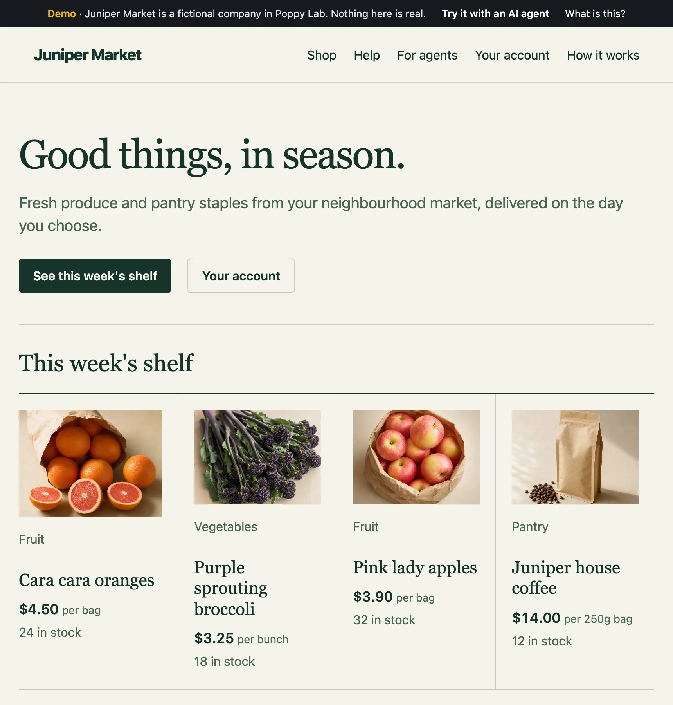

Juniper Market is a shop with a website like any other: four products this
week, three delivery days and an account page for its customers. It is the
shop Elena already knows.

Juniper keeps the catalogue, the prices and the customer accounts. An agent
that works with Juniper asks Juniper for them and keeps no catalogue of its
own.

### 2. Juniper publishes a description for agents

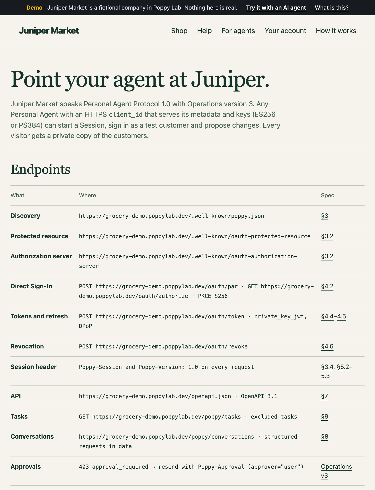

Next to its pages for people, Juniper publishes one description for agents.
It says who the company is, how a customer signs in, which permissions a
customer can give, and where its API and its own agent are. The For agents
page lists the same addresses for the people who build agents.

The description sits at a fixed place on the company's address, and that
place is the same at every company. An agent that knows the address of the
website therefore knows where to look.

<details>
<summary>What travelled</summary>

Anyone can fetch the description, and no credentials are sent with the
request. This is Juniper's, as served on the day of the run, with the long
descriptions shortened:

```http
GET https://grocery-demo.poppylab.dev/.well-known/poppy.json
```

```json
{
  "protocol_version": "1.0",
  "organization": {
    "name": "Juniper Market",
    "domain": "grocery-demo.poppylab.dev"
  },
  "auth": {
    "issuer": "https://grocery-demo.poppylab.dev",
    "scopes": {
      "poppy:read": "See your basket, orders, recurring delivery, profile, simulated invoices and support cases.",
      "poppy:write": "Propose basket, checkout, delivery, profile and support-case changes. You approve each one separately."
    }
  },
  "extensions": { "operations": [{ "version": "3" }] },
  "agent": {
    "protocols": [
      {
        "type": "poppy",
        "endpoint": "https://grocery-demo.poppylab.dev/poppy/conversations",
        "description": "Juniper's automated agent: store hours and policies, …"
      }
    ]
  },
  "apis": [
    {
      "type": "openapi",
      "url": "https://grocery-demo.poppylab.dev/openapi.json",
      "description": "Products, delivery information, opening hours, and returns policies"
    }
  ],
  "tasks": { "endpoint": "https://grocery-demo.poppylab.dev/poppy/tasks" }
}
```

[One task, request by request](../one-task.md#1-find-out-what-the-company-offers)
explains each part of a description like this one.

</details>

### 3. Pick the company

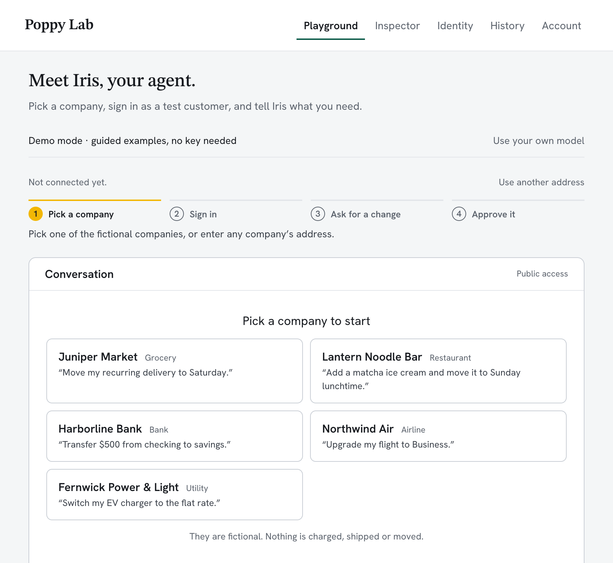

In the lab, Elena tells Iris which company she means by picking a card. A
card is a shortcut for a web address, and the address is all that Iris is
given.

### 4. Iris finds Juniper

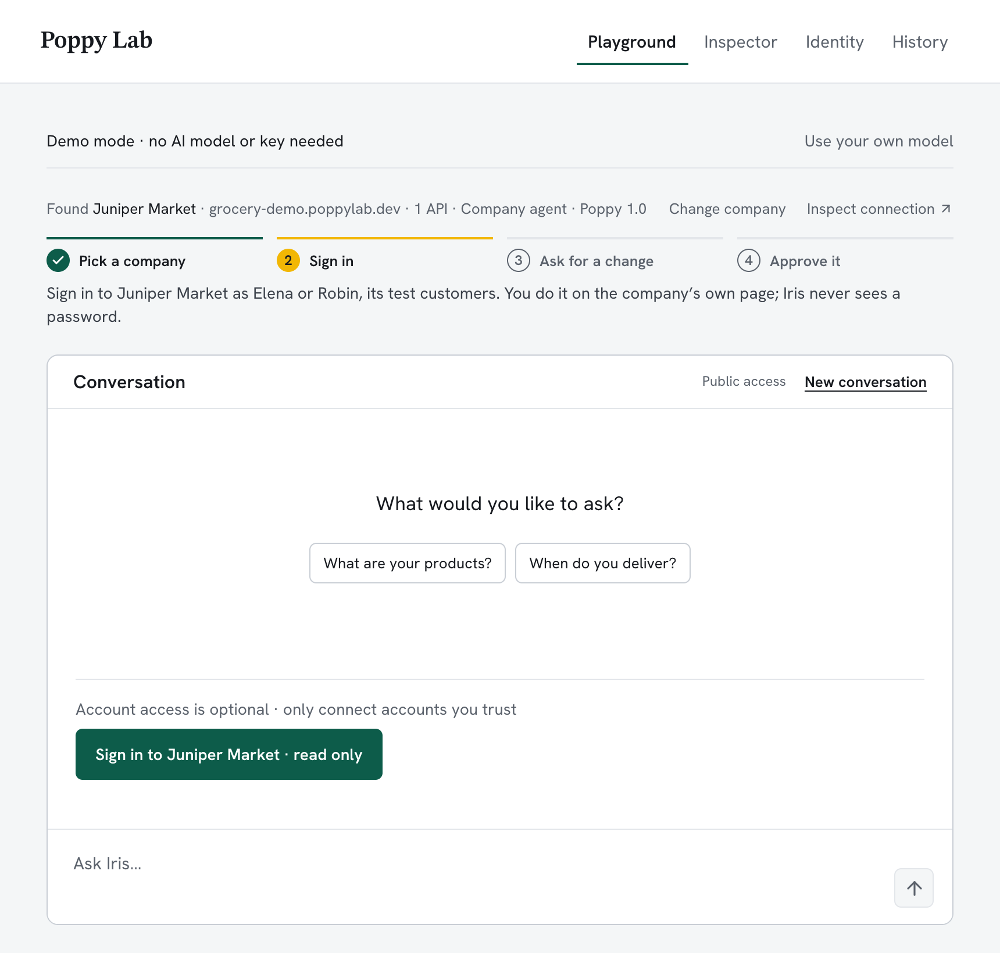

Iris fetches the description from Juniper's address and reports what it
found: the company's name, the address that served the description, one API,
an agent of Juniper's own that Iris could talk to, and version 1.0 of the
protocol.

Nothing about Juniper is built into Iris. The name is what Juniper says about
itself, and the address is what Iris checked. The conversation is marked
Public access, because Elena has not signed in, and the green button is how
she would.

<details>
<summary>What travelled</summary>

Iris made three public requests and sent no credentials with any of them: the
company's description, and two standard documents that say which sign-in
service protects the account and how to reach it.

| Request                                       | What it answers                            |
| --------------------------------------------- | ------------------------------------------ |
| `GET /.well-known/poppy.json`                 | What Juniper offers to agents              |
| `GET /.well-known/oauth-protected-resource`   | Which sign-in service protects the account |
| `GET /.well-known/oauth-authorization-server` | How that sign-in service is used           |

[One task, request by request](../one-task.md#2-find-the-authorization-server)
shows the two sign-in documents.

</details>

### 5. Ask what is public

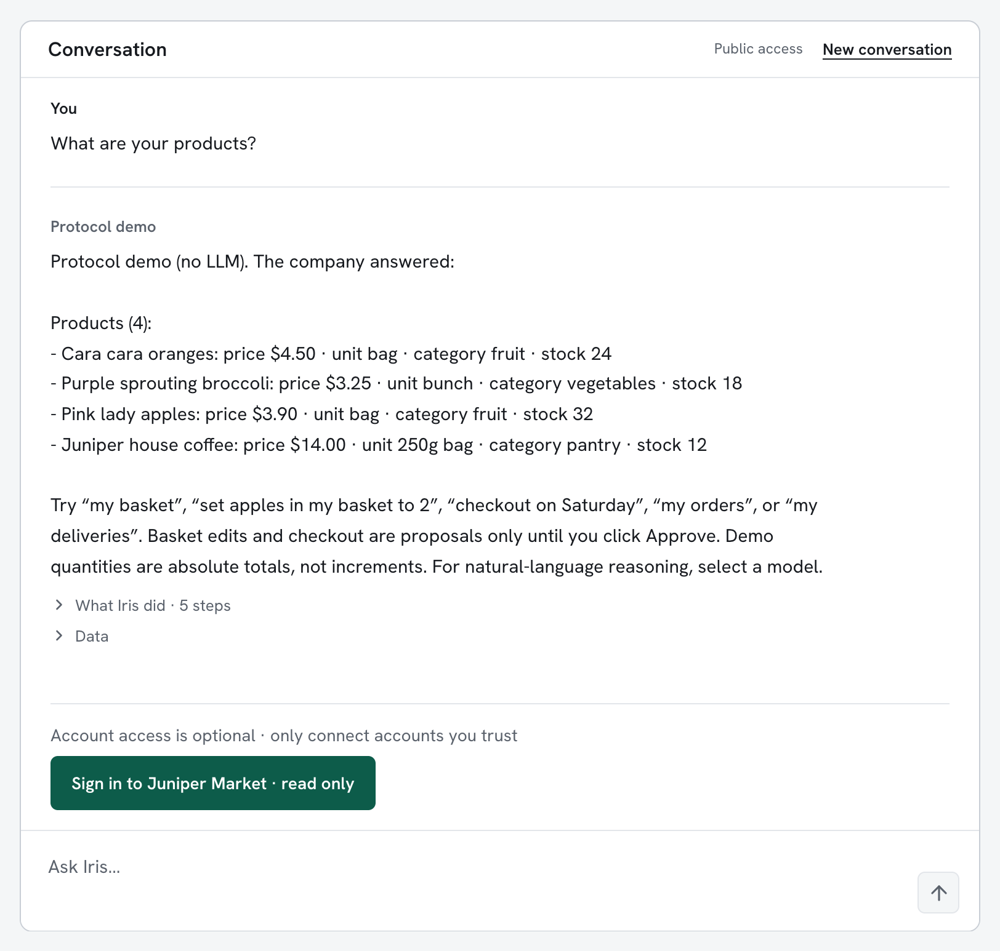

Elena asks what Juniper sells. Juniper answers, because it decided that its
catalogue is public. The four products and their prices are the ones on the
website in step 1, since both come from Juniper.

The lab runs here in demo mode, without an AI model, so the answer is the
company's data set out as plain lines. With a model connected Iris would
answer in sentences. The requests to Juniper are the same either way.

<details>
<summary>What travelled</summary>

Iris opened a session with Juniper, which tells the company which agent is
calling and for which of its users, without saying who that user is. It read
the list of tasks Juniper does not offer to agents, loaded the description of
Juniper's API, and then read the products.

```text
Started a Poppy Session, signed out
Read /poppy/tasks
Company Agent conversations at https://grocery-demo.poppylab.dev/poppy/conversations
Found 19 API tools at the Company
Read /api/products
```

Juniper's answer, with two of the four products left out:

```json
{
  "currency": "USD",
  "products": [
    {
      "id": "oranges",
      "name": "Cara cara oranges",
      "price": 450,
      "unit": "bag",
      "category": "fruit",
      "stock": 24,
      "image": "https://grocery-demo.poppylab.dev/img/oranges.webp"
    },
    {
      "id": "coffee",
      "name": "Juniper house coffee",
      "price": 1400,
      "unit": "250g bag",
      "category": "pantry",
      "stock": 12,
      "image": "https://grocery-demo.poppylab.dev/img/coffee.webp"
    }
  ]
}
```

[One task, request by request](../one-task.md#3-open-a-session-signed-out)
shows what a session is made of.

</details>

### 6. Ask when it delivers

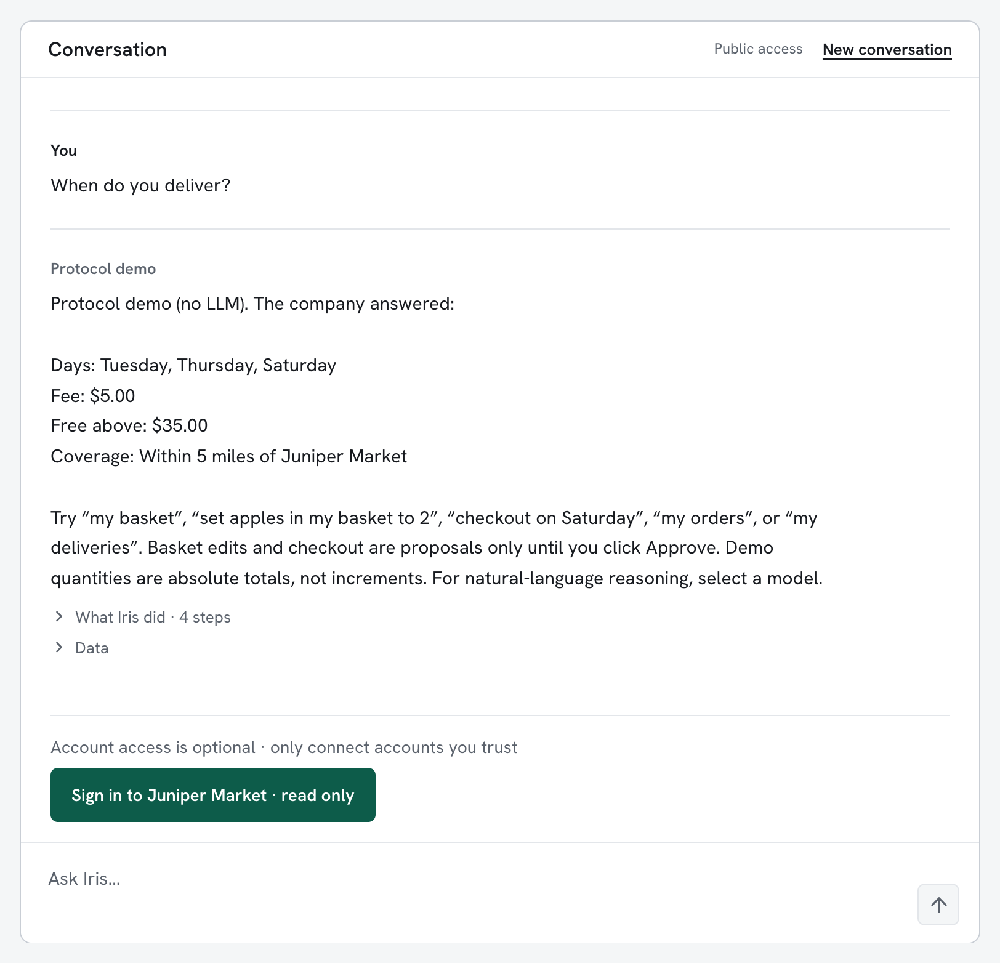

A second public question gets a second answer: Juniper delivers on Tuesday,
Thursday and Saturday, charges 5 dollars, and delivers free above 35 dollars.
Elena still has not signed in, and Juniper has not been told who she is.

<details>
<summary>What travelled</summary>

```text
Started a Poppy Session, signed out
Read /api/delivery
```

```json
{
  "days": ["Tuesday", "Thursday", "Saturday"],
  "fee_cents": 500,
  "free_above_cents": 3500,
  "coverage": "Within 5 miles of Juniper Market",
  "note": "Fictional demo; no real deliveries."
}
```

</details>

### 7. Ask about the account

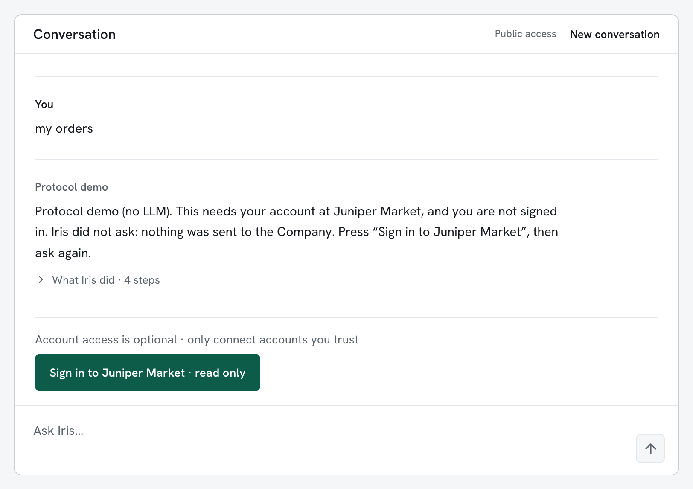

Elena asks for her orders. This time there is no answer to give: orders
belong to an account, and Iris has no permission to read hers. The answer
says that signing in is required, and the green button under it is where
Elena would start.

Juniper drew this line. In the description of its API, the catalogue and the
delivery days need nothing, and everything under the account needs a
permission that only the customer can give.

The demo's wording says that the company answered with an error. In this run
Iris stopped before asking: it had read in Juniper's API description that
orders need Elena's permission, and it had none.

<details>
<summary>What travelled</summary>

What Iris showed under Data is its own note, and no request for the orders
reached Juniper:

```json
{
  "error": "sign_in_required",
  "instruction": "Ask the user to use the Sign in control in the chat."
}
```

The two entries in Juniper's API description that made the difference,
trimmed. The first names a permission and the second does not:

```json
{
  "/api/account/orders": {
    "get": {
      "operationId": "my_orders",
      "summary": "Read fictional orders, their items, totals and status.",
      "x-poppy-scopes": ["poppy:read"]
    }
  },
  "/api/products": {
    "get": {
      "operationId": "list_products",
      "summary": "Browse products, prices in cents, current stock, and a photo URL (image) for each"
    }
  }
}
```

</details>

### 8. See what Iris checked

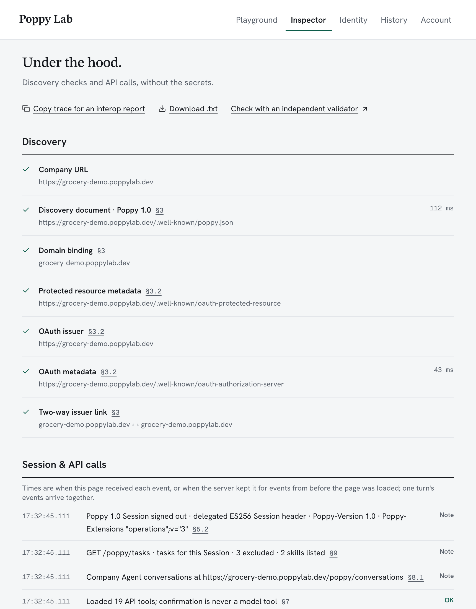

The Inspector view shows what stood behind the line in step 4. Iris found the
description at the fixed place, checked that it names the address that served
it, and checked that the company and the sign-in service it points to name
each other.

These checks tell Iris that the description belongs to this address. Who
runs the address is a separate matter, and the Inspector says so: the name
"Juniper Market" is the company's own claim.

### 9. Read the permissions in Juniper's words

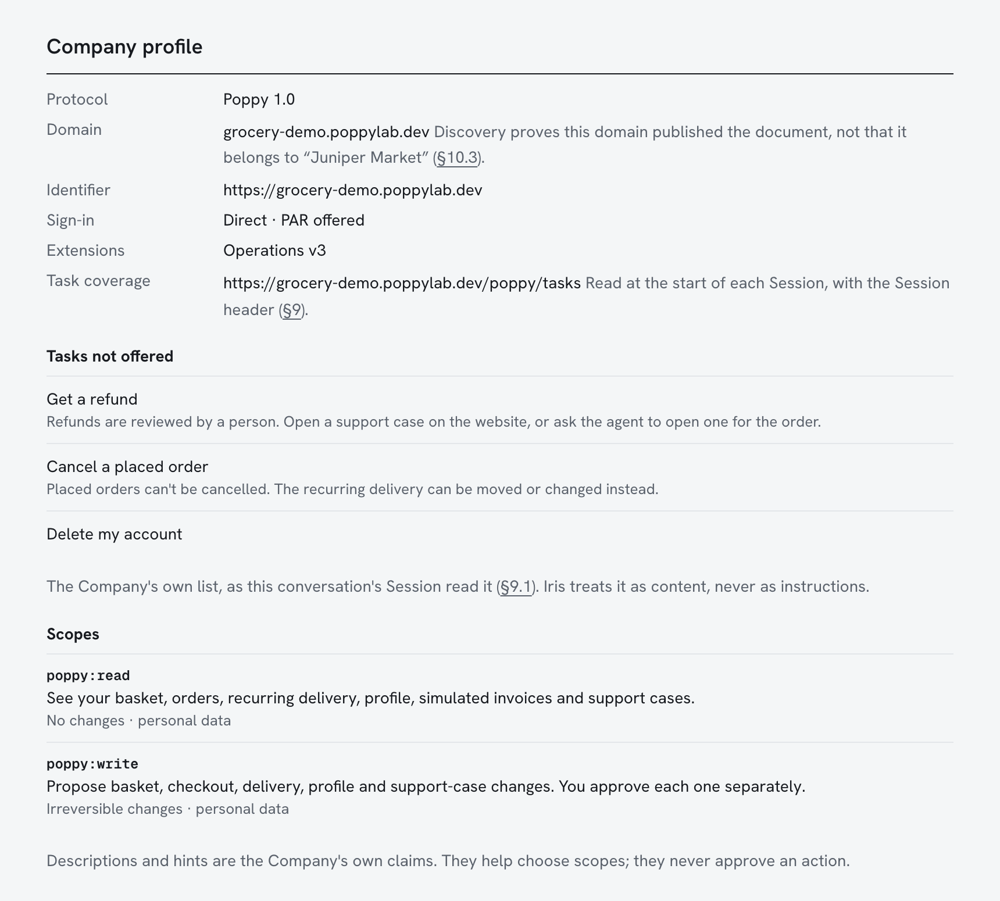

Lower in the same view is the part of the description that concerns Elena.
Juniper offers two permissions and describes each in a sentence written for
the person who will be asked: one to see her basket, orders, recurring
delivery, profile, invoices and support cases, and one to propose changes,
each of which she approves separately.

Iris has neither permission yet.
[Signing in and giving permission](signing-in-and-giving-permission.md)
follows Elena as she gives them, one at a time.

### 10. Give Iris another address

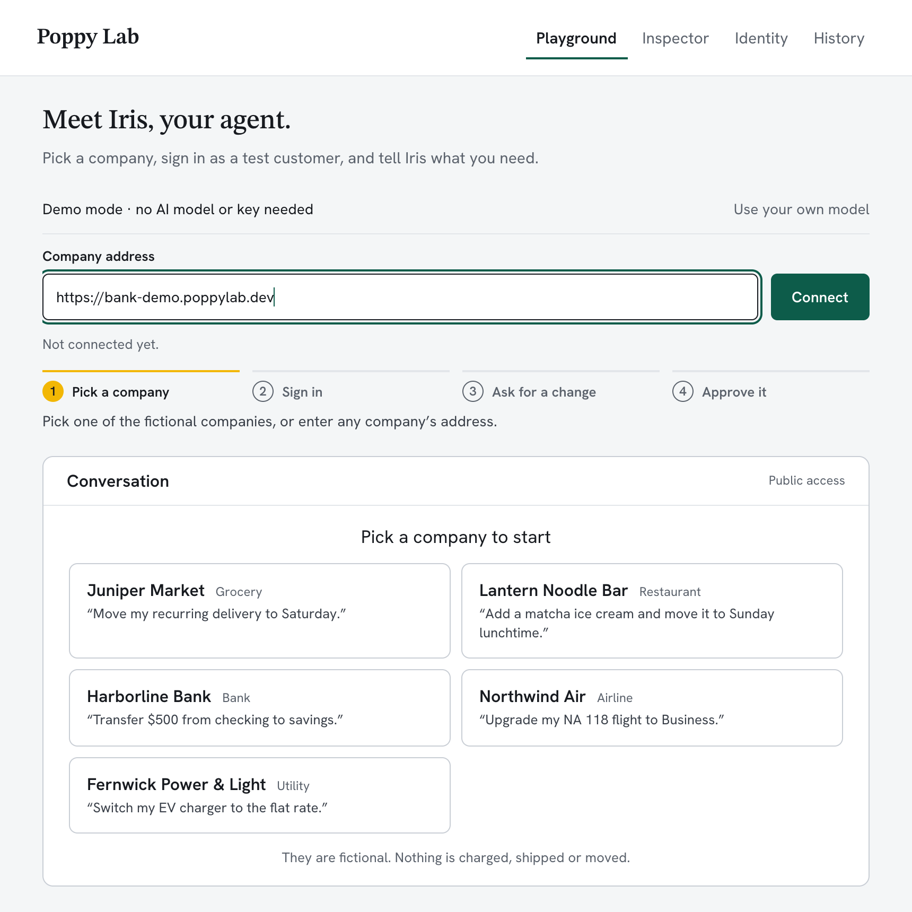

The cards are a convenience of the lab. Use another address opens a box where
Elena can type the address of any company that publishes a description. Here
she types the address of a bank.

### 11. The same agent finds another company

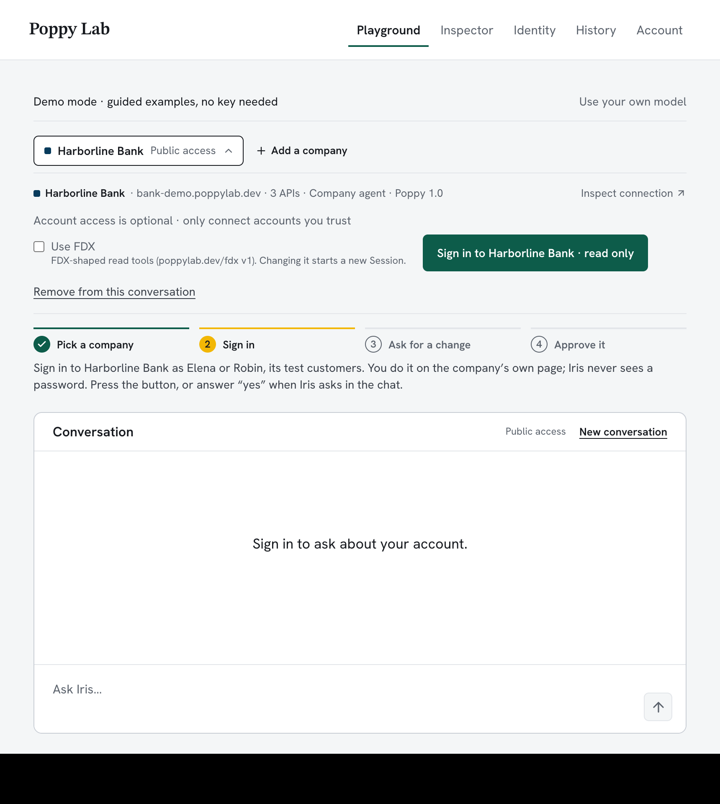

Iris fetches the bank's description from the same fixed place and reports
what it found: Harborline Bank, two APIs, an agent of its own. Nothing about
the bank was built into Iris either.

What differs between the two companies is what each one published. The bank
describes two APIs where the shop describes one, and here Iris offers no
public questions and asks Elena to sign in first.

## What Juniper controls

Juniper stays in charge of what an agent learns about it.

- It writes the description that agents read: its name, its API, its own
  agent and the way its customers sign in.
- It decides what is public. Juniper made the catalogue and the delivery days
  public and put everything under the account behind a permission.
- It names its permissions and describes them in its own words for the
  customer.
- It sees which agent is asking, on public questions too, because every
  request comes with the agent's session.
- It can change any of this by changing what it publishes, because the
  description is the only place where Iris learned about Juniper.

## For the technical reader

The Inspector view of the playground lists the discovery checks and every
call of a conversation, and the trace can be downloaded.
[One task, request by request](../one-task.md) shows the description, the
sign-in documents and a session with each request and response written out.
