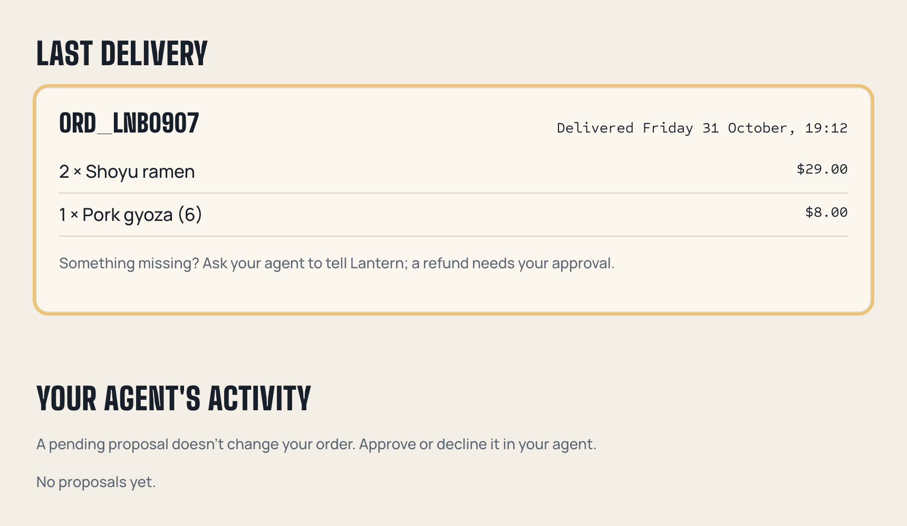
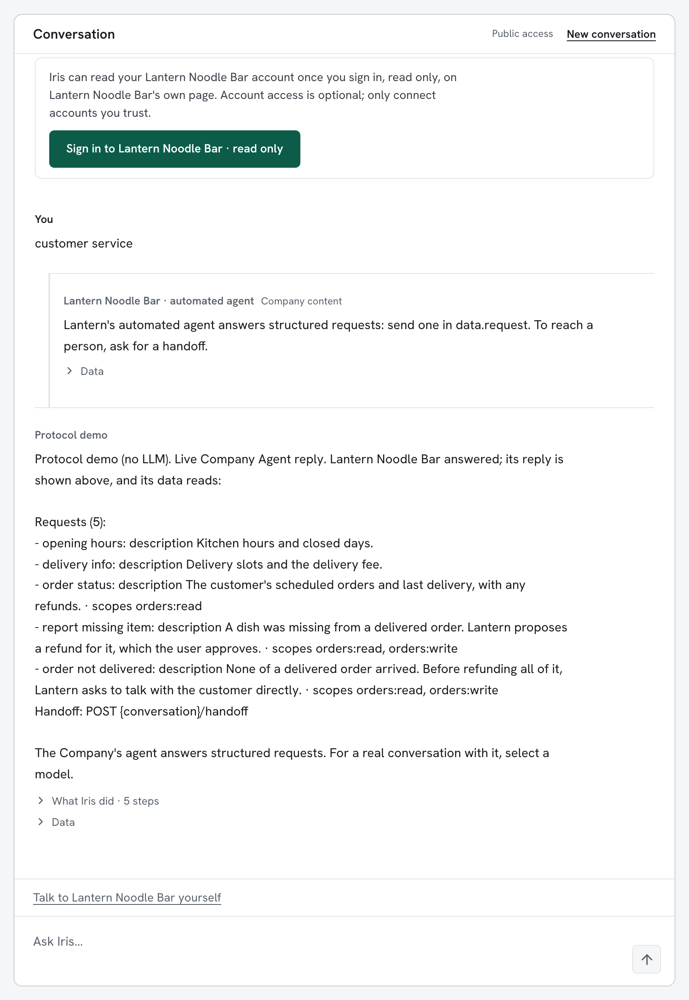
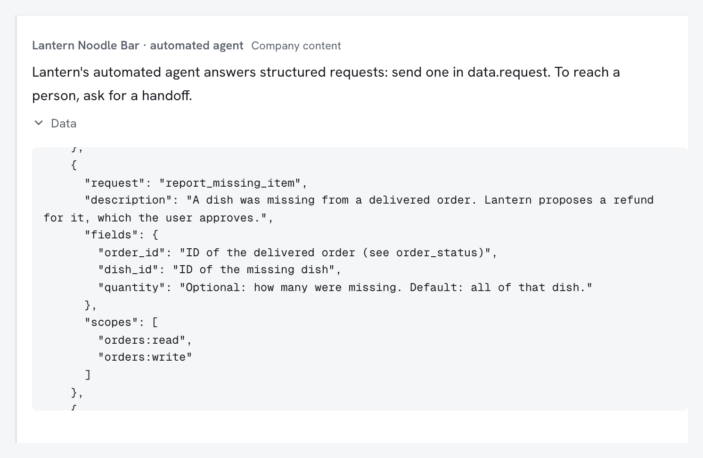
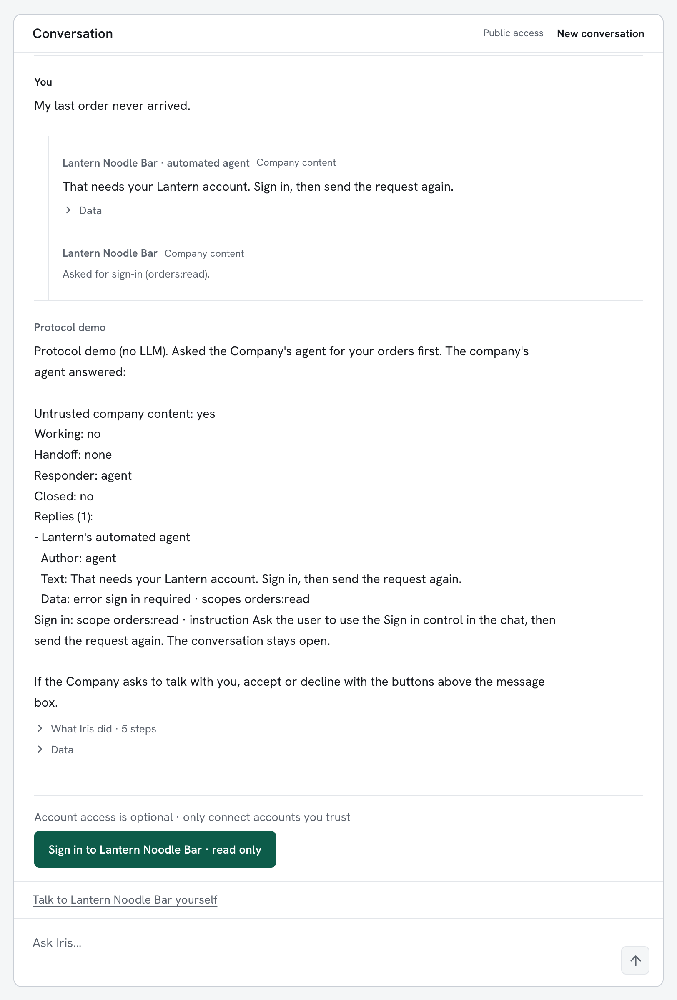
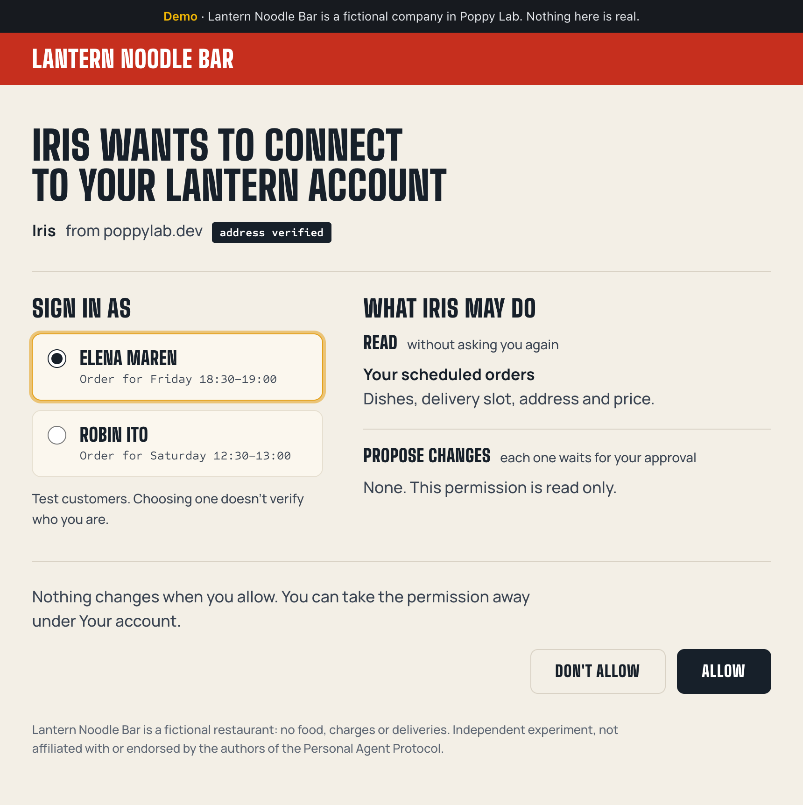
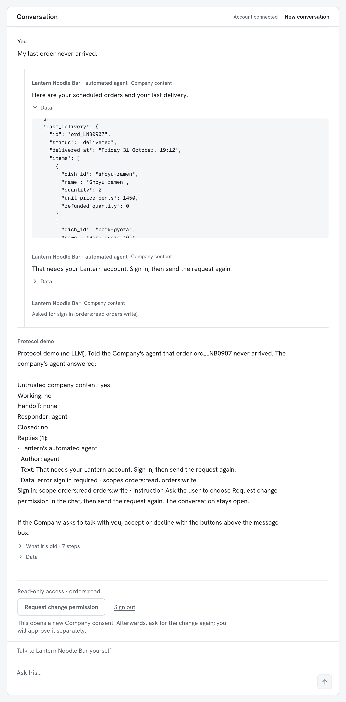
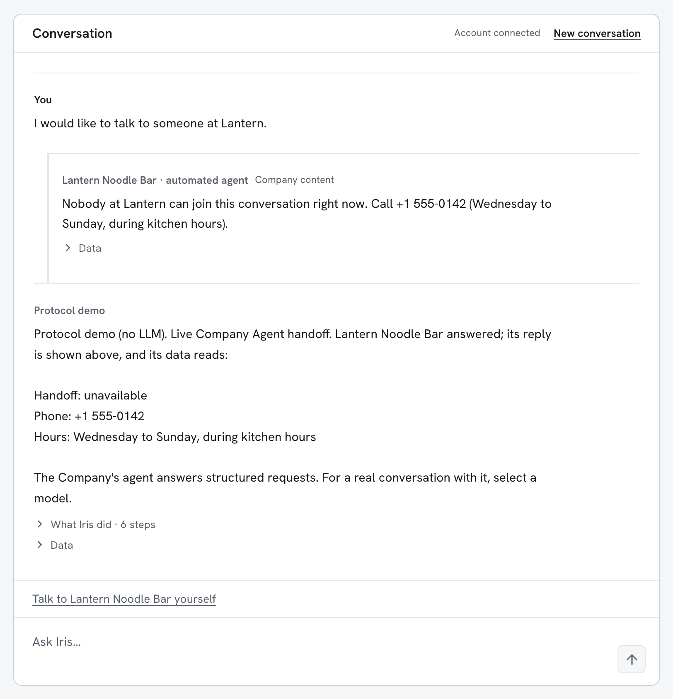
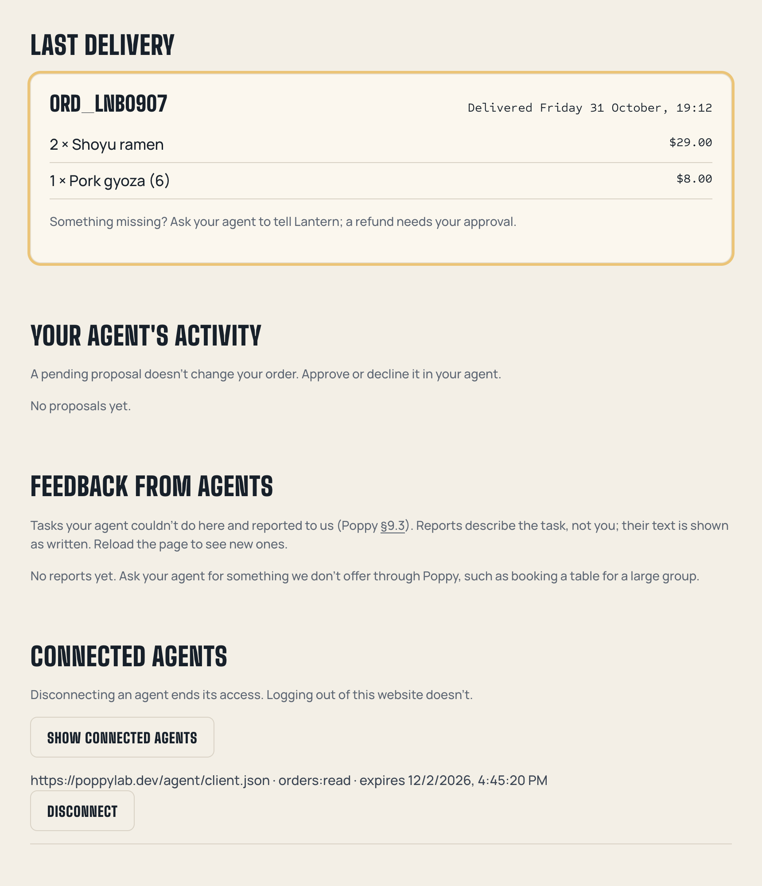
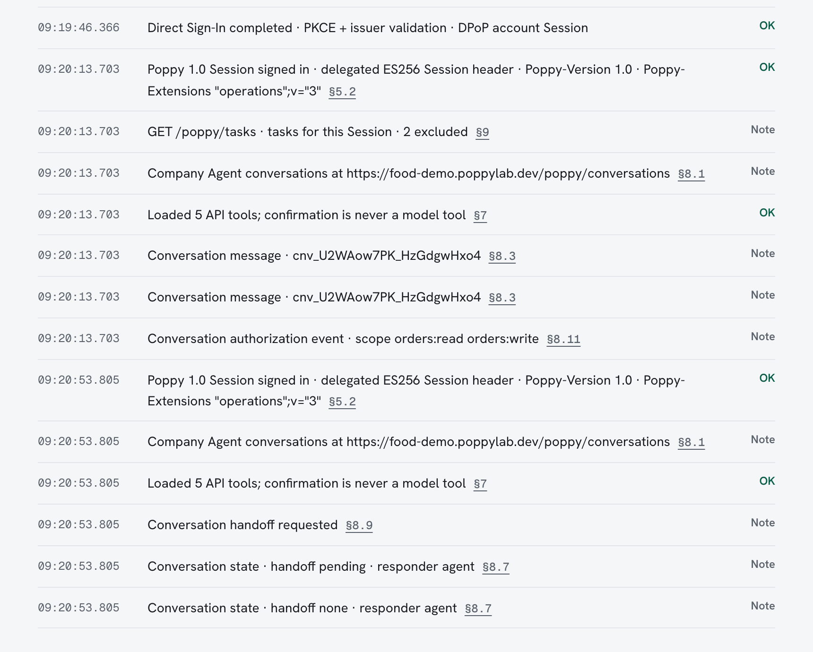

# Getting help from the company

Elena's last delivery from
[Lantern Noodle Bar](https://food-demo.poppylab.dev) went wrong and she wants
help with it. Lantern's API lets an agent read the menu and change a scheduled
order. It has no operation for a refund or for reaching a person. For those
Lantern has its own automated agent, the kind of support chat many companies
already run, and Iris talks to it on Elena's behalf.

This page follows that conversation screen by screen, on Iris's side and on
Lantern's. Every screenshot is from the live lab, taken on 25 November 2026.
The lab ran in demo mode, without an AI model, so Iris sent fixed requests in
answer to Elena's messages, and each step says which. No refund is proposed
on this page. [Talking to the company yourself](talking-to-the-company-yourself.md)
carries on from here to a refund that Elena approves.

## Who does what

| Who                  | What they do in this process                                                                                          |
| -------------------- | --------------------------------------------------------------------------------------------------------------------- |
| Elena, the customer  | Says what she needs, signs in on Lantern's page when Lantern asks for it, and asks for a person.                      |
| Iris, her agent      | Opens a conversation with Lantern's agent, sends it requests, and shows Elena every answer as Lantern's own.          |
| Lantern, the company | Runs its own agent, decides which requests need Elena's account, and says how to reach a person when nobody can join. |

## Step by step

### 1. The last delivery at Lantern



Lantern's website shows Elena her last delivery: two shoyu ramen and a portion
of pork gyoza, delivered on Friday 31 October. Under it Lantern tells
customers what to do when something is wrong with a delivery: ask your agent
to tell Lantern, and any refund will need your approval.

The section below it is where Lantern lists what Elena's agent has done for
her. It is empty.

### 2. Ask for the company's agent



Elena asks Iris for customer service. Iris opens a conversation with Lantern's
agent, at an address Lantern publishes next to its API, and asks what it can
help with.

The answer appears twice. The indented block marked Company content is what
Lantern's agent said, shown as written. Iris treats everything in it as
information from the company. It does not follow it as an instruction. Below
it, demo mode sets out the same answer as plain lines, with the state of the
conversation: Lantern has finished replying, nobody has been asked to hand
over to a person, and the one answering is an automated agent.

<details>
<summary>What travelled</summary>

Elena was not signed in. The session Iris opened tells Lantern which agent is
calling and for which of its users, without saying who that user is.

```text
Started a Poppy Session, signed out
Read /poppy/tasks
Company Agent conversations at https://food-demo.poppylab.dev/poppy/conversations
Found 5 API tools at the Company
Talked to the Company's own agent
```

In demo mode the words "customer service" make Iris send this message:

```json
{ "author": { "type": "agent" }, "data": { "request": "help" } }
```

[Conversations with a Company Agent](../conversations.md#text-for-people-data-for-agents)
shows the request and the response in full.

</details>

### 3. What Lantern's agent handles



Lantern's agent answers with the list of requests it handles. The sentence is
for people and the list is data for the agent, which is why it sits under the
Data disclosure. There are five requests: the opening hours, the delivery
slots and fee, the status of the customer's orders, a dish missing from a
delivery, and an order that never arrived. For each one Lantern says what it
needs to be told and which permissions the customer must have given.

Lantern's agent is fixed code that reads these structured requests and
nothing else. An agent with an AI model reads what the customer wrote and
picks the request that fits. The lab's demo mode has no model, so it sends a
fixed request for a few phrasings: `help` for "customer service", the order
status and then `order_not_delivered` for an order that "never arrived", and a
request for a person for "talk to someone". It does not send
`report_missing_item`, so a refund for one missing dish cannot be reached in
demo mode.
[Conversations with a Company Agent](../conversations.md#a-proposal-inside-a-message)
shows that refund, taken from the lab's tests.

<details>
<summary>What travelled</summary>

No request was made in this step. The list came with the answer in step 2.
Here it is with the descriptions of the fields left out:

```json
{
  "requests": [
    { "request": "opening_hours", "scopes": [] },
    { "request": "delivery_info", "scopes": [] },
    { "request": "order_status", "scopes": ["orders:read"] },
    {
      "request": "report_missing_item",
      "description": "A dish was missing from a delivered order. Lantern proposes a refund for it, which the user approves.",
      "scopes": ["orders:read", "orders:write"]
    },
    {
      "request": "order_not_delivered",
      "description": "None of a delivered order arrived. Before refunding all of it, Lantern asks to talk with the customer directly.",
      "scopes": ["orders:read", "orders:write"]
    }
  ],
  "handoff": "POST {conversation}/handoff"
}
```

</details>

### 4. Lantern asks Elena to sign in



Elena writes: "My last order never arrived." To report it Iris first needs to
know which order she means, so it asks Lantern's agent for her orders. Lantern
answers that this needs her account, and the conversation stays open while it
waits.

Iris turns that answer into its usual Sign in button. The button says what
Lantern asked for: read-only access to her orders.

<details>
<summary>What travelled</summary>

In demo mode the words "never arrived" make Iris send the request
`order_status`. Lantern's agent replied with a message and with an event that
names the permission it needs:

```text
Talked to the Company's own agent
Conversation authorization event · scope orders:read
```

```json
{ "error": "sign_in_required", "scopes": ["orders:read"] }
```

[Asked to sign in, mid-conversation](../conversations.md#signing-in-without-leaving-the-conversation)
describes the event.

</details>

### 5. Sign in at Lantern



Signing in happens on Lantern's website, as it does for any other task. The
page names the agent that is asking and what it would be allowed to do. Elena
chooses Allow, and Iris receives a permission from Lantern that Elena can
withdraw at Lantern whenever she likes. Iris never sees a password.

[Changing an order](changing-an-order.md#3-sign-in-at-lantern) explains this
page and what travels when Elena allows it.

### 6. The order, from Lantern's agent



Back in the conversation, Elena says it again. This time Lantern's agent
answers with her scheduled order and her last delivery. The Data under its
answer is opened in the screenshot: order ord_LNB0907, delivered, nothing
refunded. It is the record Lantern's website showed in step 1.

Iris then reports that this order never arrived. Lantern's agent answers that
this request needs more than Elena has allowed. Its sentence says "Sign in"
although Elena is already signed in. The event that comes with it names the
two permissions the request needs. Elena has given the first, so Iris shows
its Request change permission button for the second. Elena decides not to
give it for the moment.

<details>
<summary>What travelled</summary>

The conversation is the one opened in step 2. Signing in did not start a new
one. In demo mode Iris sent two fixed requests, `order_status` and then
`order_not_delivered` with the order's number:

```text
Started a Poppy Session, signed in
Talked to the Company's own agent
Talked to the Company's own agent
Conversation authorization event · scope orders:read orders:write
```

Part of the first answer:

```json
{
  "last_delivery": {
    "id": "ord_LNB0907",
    "status": "delivered",
    "delivered_at": "Friday 31 October, 19:12",
    "items": [
      { "name": "Shoyu ramen", "quantity": 2, "refunded_quantity": 0 },
      { "name": "Pork gyoza (6)", "quantity": 1, "refunded_quantity": 0 }
    ],
    "refunds": []
  }
}
```

The second answer:

```json
{ "error": "sign_in_required", "scopes": ["orders:read", "orders:write"] }
```

</details>

### 7. Ask for a person



Elena would rather talk to a person: "I would like to talk to someone at
Lantern." Iris asks Lantern to hand the conversation over. Lantern looks for
someone, finds nobody, and its agent says so and gives the phone number and
the hours when it is answered.

The lab's fictional staff are never available, so this is the answer every
time. At a company with people on shift, a person would join the same
conversation, and Iris would label that person's messages as written by a
person. The label in the screenshot says automated agent.

<details>
<summary>What travelled</summary>

A request for a person is its own call in the conversation. The state went to
pending while Lantern looked for someone, and back:

```text
Asked the Company to hand the conversation to a person
Conversation state · handoff pending · responder agent
Conversation state · handoff none · responder agent
```

```json
{
  "handoff": "unavailable",
  "phone": "+1 555-0142",
  "hours": "Wednesday to Sunday, during kitchen hours"
}
```

[Asking for a person](../conversations.md#reaching-a-person) shows the
call. The phone number is fictional.

</details>

### 8. Lantern's website afterwards



Lantern's website shows the same delivery as before, with nothing refunded,
and no proposals from the agent. Asking questions and asking for a person
changed nothing in Elena's account.

One thing is new. Under Connected agents, Lantern lists Iris by the web
address that identifies it, with the one permission Elena gave in step 5.
She can disconnect it there.

## What Lantern controls

Lantern stays in charge of its own support throughout.

- It decides which requests its agent answers and what each one needs.
- It decides when a request needs the customer's account, and asks for it in
  the middle of the conversation, on its own sign-in page.
- Its agent is fixed code. It answers the requests on its list and sends the
  list back for anything else.
- It decides whether a person joins, and what the customer is told when
  nobody can.
- A refund is Lantern's to propose. It would reach Elena as terms to approve,
  as any other change does.

## For the technical reader



The Inspector view of the playground lists every call behind the screens
above. [Conversations with a Company Agent](../conversations.md) walks through
a conversation with each request and response written out, including the
refund for a missing dish that demo mode does not reach.
