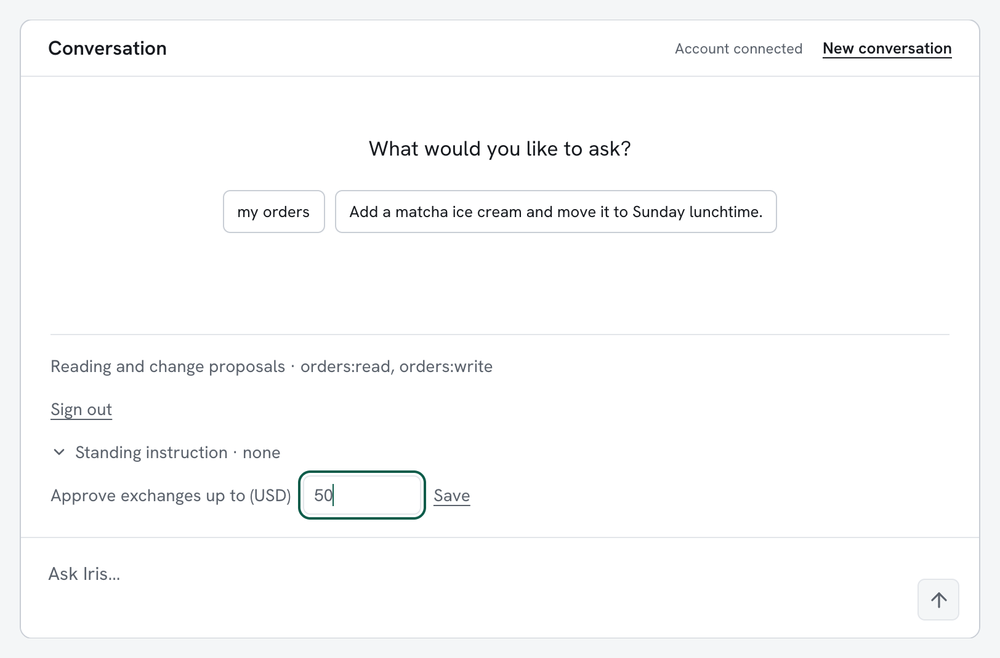
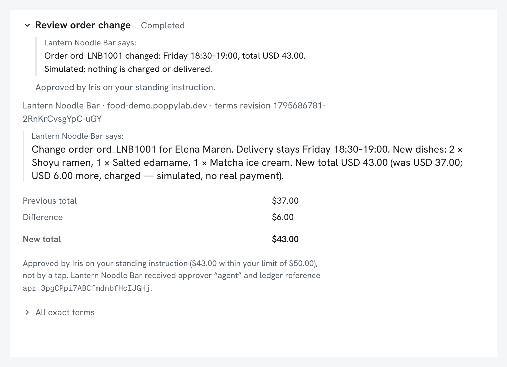
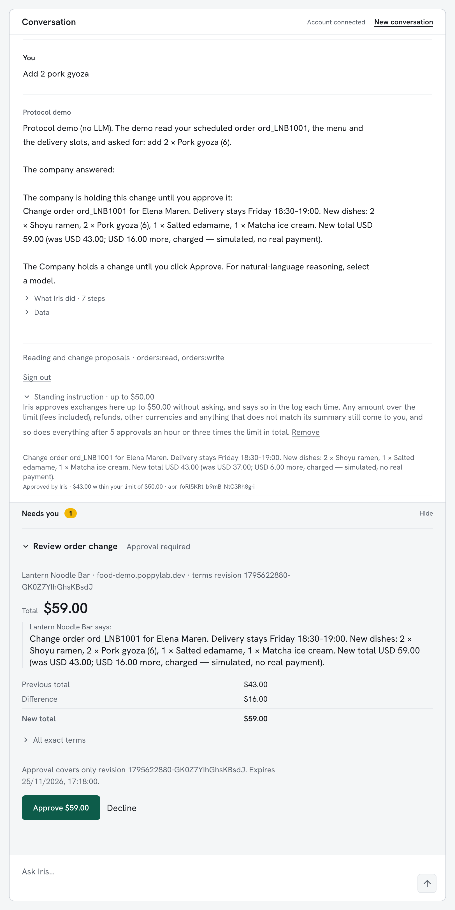
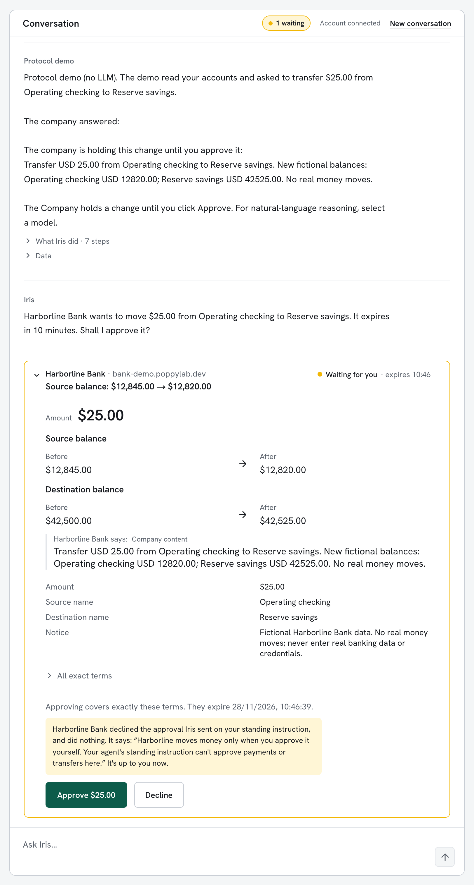
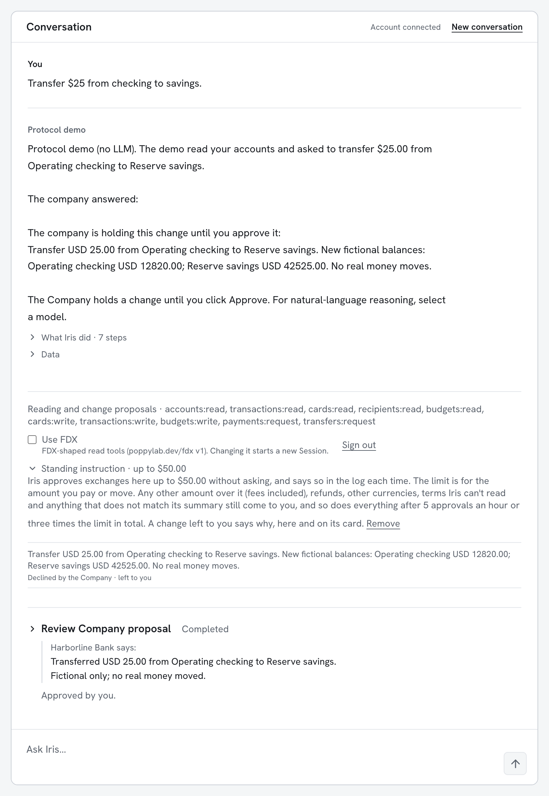
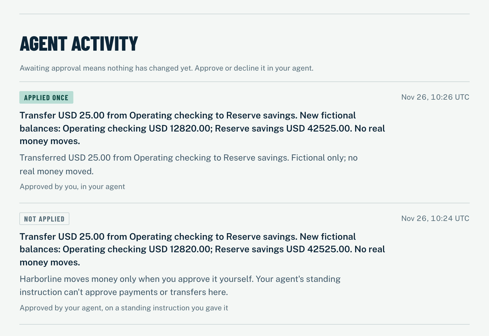
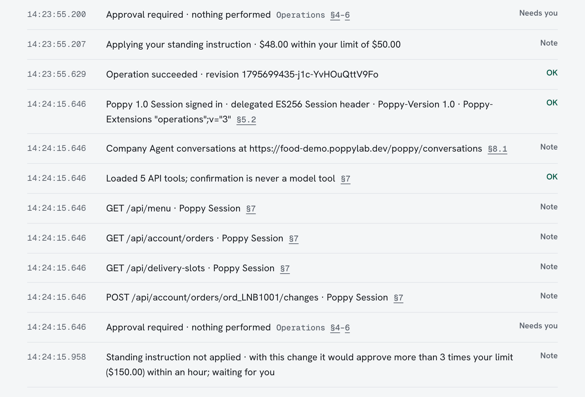

# Letting the agent approve for you

Elena has a noodle order scheduled for Friday at
[Lantern Noodle Bar](https://food-demo.poppylab.dev). She does not want to be
asked about every small change to it, so she gives Iris, her personal agent, a
standing instruction: approve changes at Lantern up to 50 dollars. Iris then
approves a small change without asking her, tells Lantern that the agent
approved, and still brings her everything the instruction does not cover.

This page follows the instruction screen by screen at Lantern, and then at
[Harborline Bank](https://bank-demo.poppylab.dev), where Iris approves a small
transfer on the same instruction, the bank declines the agent's approval, and
Elena approves the transfer herself. Every screenshot is from the live lab,
taken on 26 November 2026.

## Who does what

| Who                                   | What they do in this process                                                                                                  |
| ------------------------------------- | ----------------------------------------------------------------------------------------------------------------------------- |
| Elena, the customer                   | Writes the instruction and its limit in her own agent, can remove it, and decides everything it does not cover.               |
| Iris, her agent                       | Checks each company's terms against the instruction, approves what it covers, says that the agent approved, and keeps a list. |
| Lantern and Harborline, the companies | Set the terms, learn from each approval who gave it, and decide whether to act on it.                                         |

## Step by step

### 1. Write the instruction



Elena has signed in at Lantern and allowed Iris to propose changes to her
orders, as in [Changing an order](changing-an-order.md). Under the
conversation Iris has a line called Standing instruction. She opens it, types
50 and saves.

The instruction is Elena's, and it lives in her agent. Lantern is not asked
about it. It applies to Lantern only, and another company needs an instruction
of its own.

<details>
<summary>What travelled</summary>

No request was made in this step. Iris keeps the instruction on Elena's side,
under Lantern's address.

</details>

### 2. What the instruction covers


Iris states the rule back. It will approve changes at Lantern up to 50 dollars
without asking and record each one. The limit is for the amount Elena pays or
moves. Any other amount over it, a refund, another currency, terms Iris cannot
read or terms that disagree with their own summary still come to her.

So does everything after five approvals in an hour, or once the approvals of
an hour add up to three times the limit. Iris also says that a change left to
Elena carries the reason, under the instruction and on its card.

For a change to an order, the amount Elena pays is the new total the company
states. A 6-dollar dessert on a 37-dollar order makes a total of 43 dollars,
so it needs a limit of at least 43. Every other amount in the terms, such as
the previous total or a fee, has to be within the limit as well.

### 3. Ask for a small change


Elena types "Add a matcha ice cream". Iris asks Lantern for the change, and
Lantern answers as it does for any change: with the terms it would apply and a
request for approval. The new total would be 43 dollars.

Iris checks those terms against the instruction. The total is within 50
dollars, so Iris approves, and Lantern makes the change. A line under the
instruction records it: approved by Iris, 43 dollars within the limit of 50,
with a reference. The answer above it says that Lantern held the change until
it was approved, that Iris approved it on the standing instruction, and that
there is nothing for Elena to approve.

The check is fixed code that reads the numbers in Lantern's terms. The model
does not decide whether an instruction applies.

<details>
<summary>What travelled</summary>

```text
Started a Poppy Session, signed in
Read /poppy/tasks
Company Agent conversations at https://food-demo.poppylab.dev/poppy/conversations
Found 5 API tools at the Company
Read /api/menu
Read /api/account/orders
Sent a request to /api/account/orders/ord_LNB1001/changes
Asked for your approval; nothing was done yet
```

The terms in Lantern's answer, which Iris compared with the limit:

```json
{
  "order_id": "ord_LNB1001",
  "order_version": 1,
  "from_slot": "fri-1830",
  "to_slot": "fri-1830",
  "lines": { "shoyu-ramen": 2, "edamame": 1, "matcha-ice": 1 },
  "before_total_cents": 3700,
  "new_total_cents": 4300,
  "price_difference_cents": 600,
  "currency": "USD",
  "payment": "Simulated card on file — no real charge"
}
```

Iris then sent the same request again with an approval that names the agent
as the approver, and wrote two more lines in its log:

```text
Applying your standing instruction · $43.00 within your limit of $50.00
Operation succeeded
```

[Approvals with Operations](../operations.md#who-approves) describes the two
kinds of approval.

</details>

### 4. What Iris tells Elena



The card for the change reads Completed, and under Lantern's confirmation it
says "Approved by Iris on your standing instruction". Opened, it shows the
terms and how the change was approved: by Iris on the standing instruction,
and without a tap from Elena. It also says what Lantern received: the approver
"agent" and the reference of the entry in Iris's list.

Iris does not pass its own approval off as Elena's. The company is told which
of the two approved.

### 5. What Lantern recorded


Lantern's website shows the change under Your agent's activity, with the line
"Approved by your agent, on a standing instruction you gave it". Lantern knew
who approved and chose to act on it.

That choice belongs to the company. Lantern takes an agent's approval for a
change to an order. Another company can ask for the customer's own, as
Harborline does in step 9.

### 6. A change over the limit



Elena types "Add 2 pork gyoza". Lantern's terms put the new total at 59
dollars, which is over the limit, so Iris does not approve. The change waits
in the Needs you panel, and the panel says why: the new total, 59 dollars, is
over her limit of 50. Elena declined this one, and the order stayed as it was.

A refund also came to her. When she asked to remove the ice cream, 6 dollars
would come back and the new total was 37 dollars, under the limit. Iris still
waited for her approval, because the instruction does not cover money coming
back. The panel gave that reason: the price difference, minus 6 dollars, is
below zero, and the instruction approves only amounts Elena pays or moves.

When a change lowers the total, the panel has no amount in large type, and
its button reads Approve this change.

### 7. A limit on the whole hour


Within the hour Iris approved three changes on the instruction, with totals
of 43, 43 and 48 dollars. Elena then asks to move the delivery to Sunday
lunchtime. The total stays at 48 dollars, within the limit of 50, and the
change still waits for her. Its button reads Approve this change, because the
total does not rise.

The approvals of one hour may add up to three times the limit, which is 150
dollars here, and this one would bring them to 182. The limit on one change
cannot be used many times in a row to approve a large amount. The panel gives
that reason above its buttons.

### 8. The list of what Iris approved


Under the instruction Iris keeps a list of every approval it gave on it:
Lantern's description of the change, the amount against the limit, and the
reference Lantern received with the approval. Elena can compare it with
Lantern's record in step 5. A change that waits for her is in the list too,
with the reason Iris left it to her.

The refund she approved herself and the change she declined are not in the
list.

### 9. The same instruction at Harborline



Elena writes the same instruction for Harborline Bank and asks Iris to
transfer 25 dollars from checking to savings. Harborline answers with terms,
as in [Moving money](moving-money.md). The amount she moves is 25 dollars, so
the instruction covers it, and Iris sends an approval of its own.

Harborline declines it. The bank moves money only when the customer approves
herself, and it says so in its answer. It does nothing, and the transfer comes
back to Elena: the panel shows the same terms, the bank's reason and an
Approve button.

Harborline's terms also hold the balances of both accounts, which are far
above 50 dollars. Iris does not compare a balance with the limit. It compares
what the transfer does to each balance, which is 25 dollars here.

<details>
<summary>What travelled</summary>

```text
Read /api/account/accounts
Sent a request to /api/account/transfers
Asked for your approval; nothing was done yet
```

Iris then sent the same request again with an approval that names the agent,
and Harborline declined it. Iris's log has a line for each:

```text
Applying your standing instruction · $25.00 within your limit of $50.00
Company declined the approval on your standing instruction · waiting for you
```

[Approvals with Operations](../operations.md#declines) describes a decline. It
is final for that approval, and the agent does not send it again.

</details>

### 10. Elena approves it herself



Elena presses Approve $25.00. Iris sends the same request once more, this time
with her approval, and Harborline makes the transfer. The entry reads
Completed and "Approved by you".

Under the instruction, the line for this transfer says that the company
declined and that it was left to her. Iris does not try the instruction on it
again.

### 11. What Harborline recorded



Harborline's website lists both attempts under Agent activity. One is marked
Not applied, with the bank's reason and the line "Approved by your agent, on a
standing instruction you gave it". The other is the transfer, applied once and
approved by Elena in her agent.

Whatever the instruction does not cover, or a company does not take from an
agent, arrives in the same panel as before, where Elena can approve or decline
it.

## What Lantern and Harborline control

Each company stays in charge of what an agent's approval is worth to it.

- It sets the terms. Iris compared its limit with the total Lantern stated and
  could not raise or lower that total.
- It learns from the approval who gave it, the customer or the agent on her
  instruction, and it keeps that in its own record.
- It decides whether to act on an agent's approval. Lantern did. Harborline
  declined, did nothing and gave its reason, and Iris did not send that
  approval again. [Approvals with Operations](../operations.md#declines)
  explains declines.
- It can still refuse a request for its own reasons, whoever approves, as
  Harborline does in [Moving money](moving-money.md).

## For the technical reader



The Inspector view of the playground has a line for each approval Iris gave
on the instruction, a line when the hour's total leaves a change to Elena,
and a line when a company declines the agent's approval.
[Approvals with Operations](../operations.md#who-approves) describes user
and agent approvals, and how Iris checks an instruction against the exact
terms before it approves.
