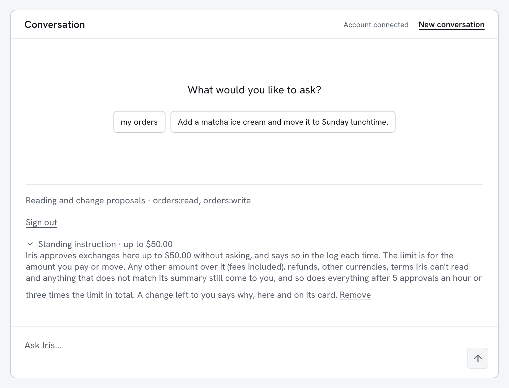
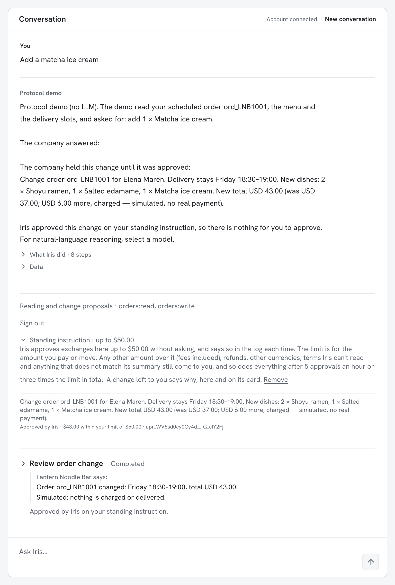
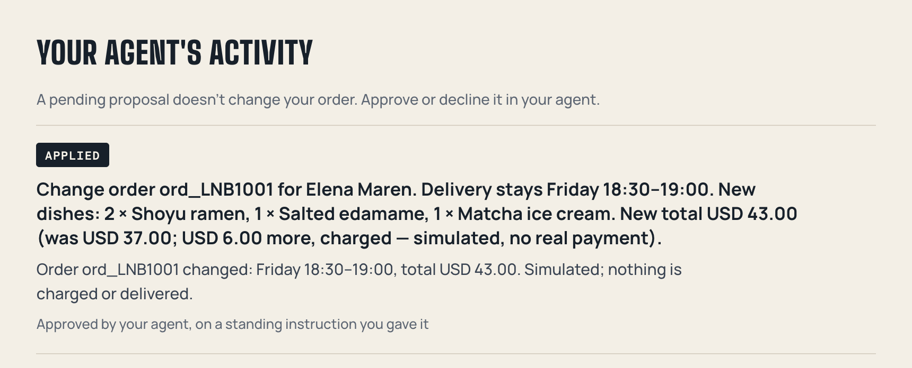
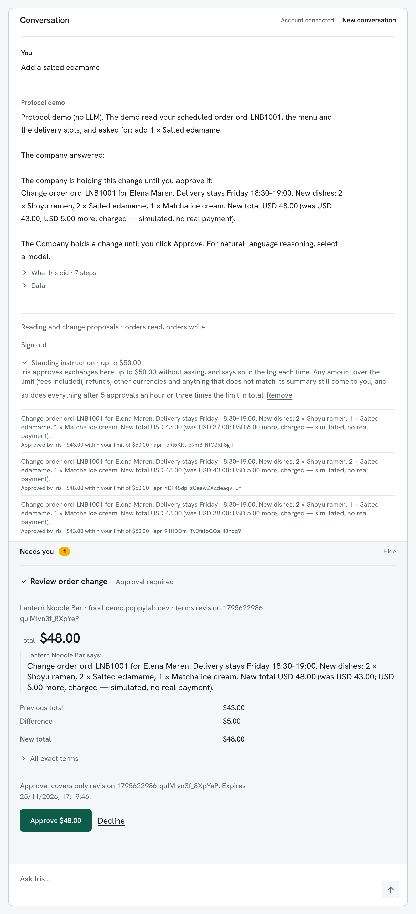
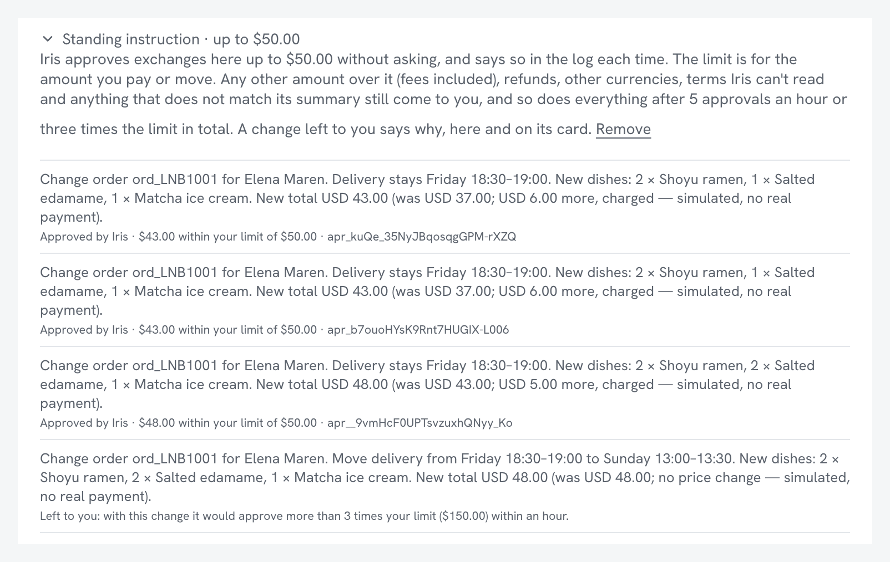
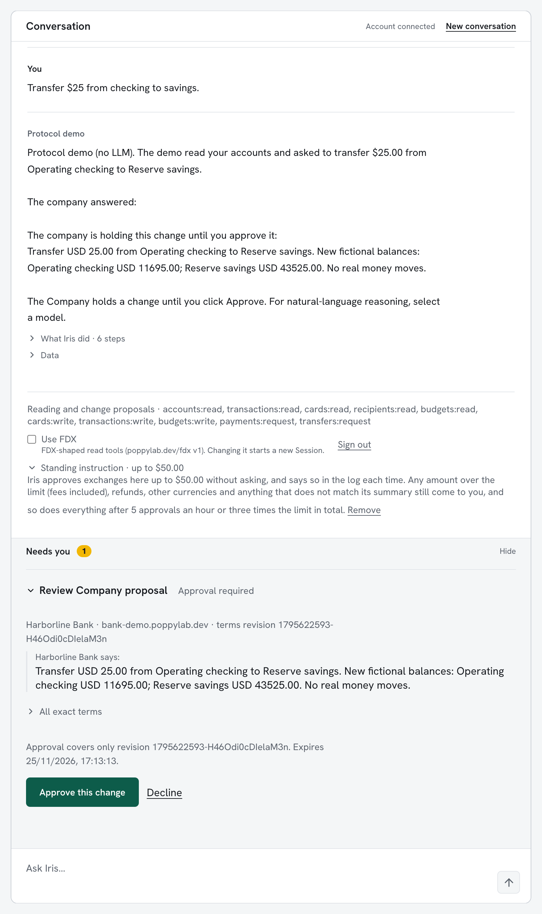
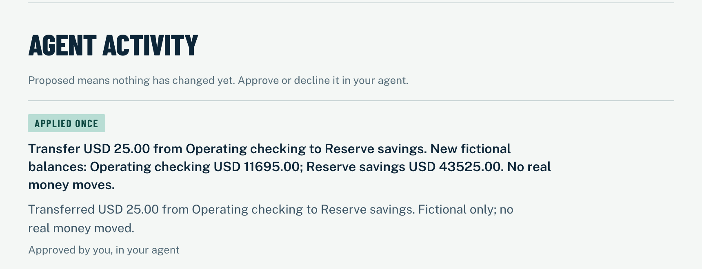
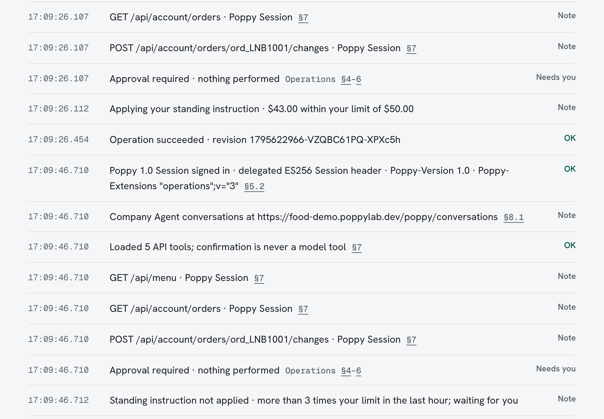

# Letting the agent approve for you

Elena has a noodle order scheduled for Friday at
[Lantern Noodle Bar](https://food-demo.poppylab.dev). She does not want to be
asked about every small change to it, so she gives Iris, her personal agent, a
standing instruction: approve changes at Lantern up to 50 dollars. Iris then
approves a small change without asking her, tells Lantern that the agent
approved, and still brings her everything the instruction does not cover.

This page follows the instruction screen by screen at Lantern, and then at
[Harborline Bank](https://bank-demo.poppylab.dev), where the same instruction
approved nothing and Elena decided herself. Every screenshot is from the live
lab, taken on 25 November 2026.

## Who does what

| Who                                   | What they do in this process                                                                                                  |
| ------------------------------------- | ----------------------------------------------------------------------------------------------------------------------------- |
| Elena, the customer                   | Writes the instruction and its limit in her own agent, can remove it, and decides everything it does not cover.               |
| Iris, her agent                       | Checks each company's terms against the instruction, approves what it covers, says that the agent approved, and keeps a list. |
| Lantern and Harborline, the companies | Set the terms, learn from each approval who gave it, and decide whether to act on it.                                         |

## Step by step

### 1. Write the instruction


Elena has signed in at Lantern and allowed Iris to propose changes to her
orders, as in [Changing an order](changing-an-order.md). Under the
conversation Iris has a line called Standing instruction. She opens it, types
50 and saves.

The instruction is Elena's, and it lives in her agent. Lantern is not asked
about it. It applies to Lantern only, and another company needs an instruction
of its own.

<details>
<summary>What travelled</summary>

No request was made in this step. Iris keeps the instruction on Elena's side,
under Lantern's address.

</details>

### 2. What the instruction covers



Iris states the rule back. It will approve changes at Lantern up to 50 dollars
without asking and record each one. Any amount over the limit, a refund,
another currency or terms that disagree with their own summary still come to
Elena. So does everything after five approvals in an hour, or once the
approvals of an hour add up to three times the limit.

The limit is compared with the whole amount the company states for the
changed order, and with any fee. A 6-dollar dessert on a 37-dollar order makes
a total of 43 dollars, so it needs a limit of at least 43. With a limit of 20
dollars the same dessert waited for Elena.

### 3. Ask for a small change



Elena types "Add a matcha ice cream". Iris asks Lantern for the change, and
Lantern answers as it does for any change: with the terms it would apply and a
request for approval. The new total would be 43 dollars.

Iris checks those terms against the instruction. The total is within 50
dollars, so Iris approves, and Lantern makes the change. A line under the
instruction records it: approved by Iris, 43 dollars within the limit of 50,
with a reference. The answer above it was written a moment earlier, while the
change was still waiting, which is why it still mentions Approve.

The check is fixed code that reads the numbers in Lantern's terms. The model
does not decide whether an instruction applies.

<details>
<summary>What travelled</summary>

```text
Read /api/menu
Read /api/account/orders
Sent a request to /api/account/orders/ord_LNB1001/changes
Asked for your approval; nothing was done yet
Applying your standing instruction · $43.00 within your limit of $50.00
Operation succeeded
```

The terms in Lantern's answer, which Iris compared with the limit:

```json
{
  "order_id": "ord_LNB1001",
  "order_version": 1,
  "from_slot": "fri-1830",
  "to_slot": "fri-1830",
  "lines": { "shoyu-ramen": 2, "edamame": 1, "matcha-ice": 1 },
  "before_total_cents": 3700,
  "new_total_cents": 4300,
  "price_difference_cents": 600,
  "currency": "USD",
  "payment": "Simulated card on file — no real charge"
}
```

Iris then sent the same request again with an approval that names the agent
as the approver. [Approvals with Operations](../operations.md#who-approves)
describes the two kinds of approval.

</details>

### 4. What Iris tells Elena


The card for the change reads Completed. Below Lantern's confirmation, Iris
says how the change was approved: by Iris on the standing instruction, and
without a tap from Elena. It also says what Lantern received: the approver
"agent" and the reference of the entry in Iris's list.

Iris does not pass its own approval off as Elena's. The company is told which
of the two approved.

### 5. What Lantern recorded



Lantern's website shows the change under Your agent's activity, with the line
"Approved by your agent, on a standing instruction you gave it". Lantern knew
who approved and chose to act on it.

That choice belongs to the company. Lantern takes an agent's approval for a
change to an order. Another company can ask for the customer's own.

### 6. A change over the limit


Elena types "Add 2 pork gyoza". Lantern's terms put the new total at 59
dollars, which is over the limit. Iris does not approve. The change waits in
the Needs you panel, and Elena decides. She declined this one, and the order
stayed as it was.

A refund also came to her. When she asked to remove a dish, the new total was
38 dollars, under the limit, and Iris still waited for her approval, because
the instruction does not cover money coming back.

### 7. A limit on the whole hour



Within the hour Iris approved three changes on the instruction, with totals
of 43, 48 and 43 dollars. Elena then asks for one more small change, to a
total of 48 dollars. It is within the limit of 50, and it still waits for her.

The approvals of one hour may add up to three times the limit, which is 150
dollars here, and this one would bring them to 182. The limit on one change
cannot be used many times in a row to approve a large amount. The panel does
not say why the change is waiting. Iris's log does, and it is shown at the end
of this page.

### 8. The list of what Iris approved



Under the instruction Iris keeps a list of every approval it gave on it:
Lantern's description of the change, the amount against the limit, and the
reference Lantern received with the approval. Elena can compare it with
Lantern's record in step 5.

The refund she approved herself and the change she declined are not in the
list. It holds only what the instruction approved.

### 9. The same instruction at Harborline



Elena writes the same instruction for Harborline Bank and asks Iris to
transfer 25 dollars from checking to savings. The amount is under the limit,
and Iris still does not approve it. The transfer waits in the Needs you
panel.

Iris applies an instruction only to terms it can settle against the limit: a
total stated by the company, with every other amount in the terms within the
limit too. Harborline's terms for a transfer hold the amount and the balances
of both accounts, which are far above 50 dollars, and no total. Iris cannot
settle them, so the decision goes to Elena.

Harborline also has a rule of its own for this case.
[Approvals with Operations](../operations.md#declines) describes it: the
bank declines an agent's approval for a payment or a transfer and asks for the
customer's own. In this run Iris sent no approval of its own to Harborline, so
that rule was not put to the test.

<details>
<summary>What travelled</summary>

```text
Read /api/account/accounts
Sent a request to /api/account/transfers
Asked for your approval; nothing was done yet
```

Harborline's terms hold `amount_cents`, the four balances before and after as
`source_balance_before_cents` and the like, and no `total_cents`. Iris sent no
approval until Elena pressed the button.

</details>

### 10. Elena approves it herself



Elena presses Approve, and Harborline makes the transfer. Its website records
it as approved by her, in her agent.

Whatever the instruction does not cover arrives in the same panel as before,
where Elena can approve or decline it.

## What Lantern and Harborline control

Each company stays in charge of what an agent's approval is worth to it.

- It sets the terms. Iris compared its limit with the total Lantern stated and
  could not raise or lower that total.
- It learns from the approval who gave it, the customer or the agent on her
  instruction, and it keeps that in its own record.
- It decides whether to act on an agent's approval. Lantern did. A company
  may decline one and do nothing, and an agent that was declined does not
  send that approval again. [Approvals with Operations](../operations.md#declines)
  explains declines.
- It can still refuse a request for its own reasons, whoever approves, as
  Harborline does in [Moving money](moving-money.md).

## For the technical reader



The Inspector view of the playground logs each use of the instruction and
the reason when it is not applied.
[Approvals with Operations](../operations.md#who-approves) describes user
and agent approvals, and how Iris checks an instruction against the exact
terms before it approves.
