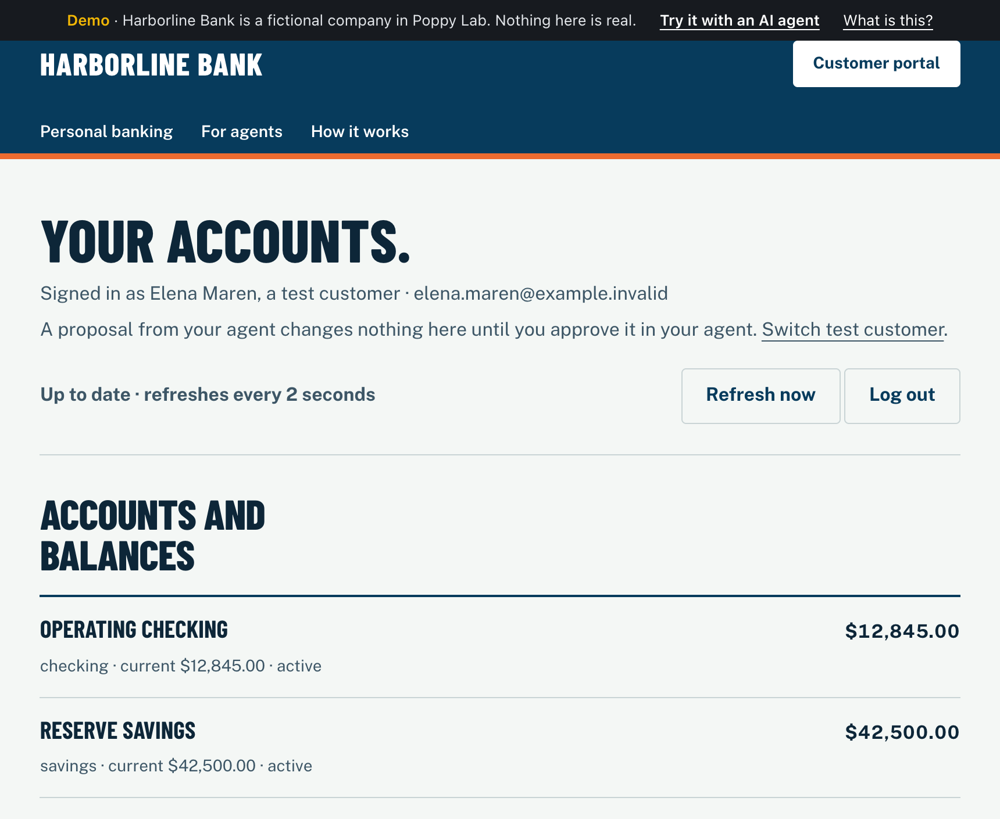
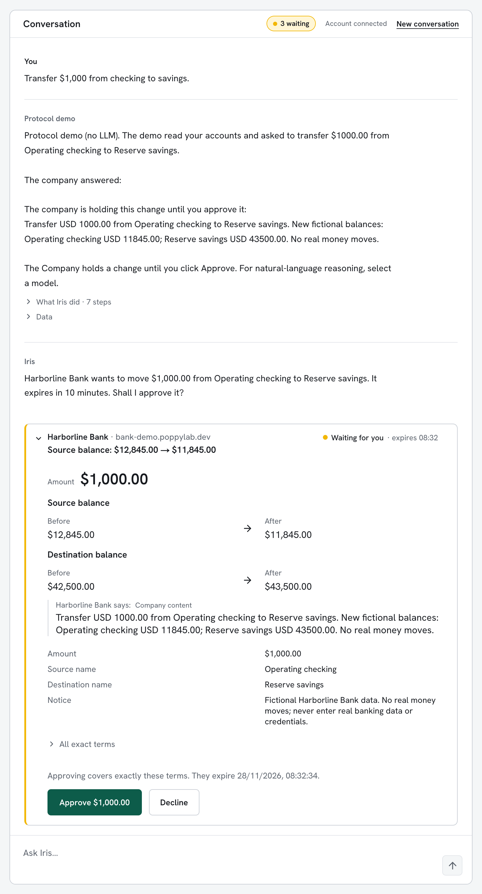
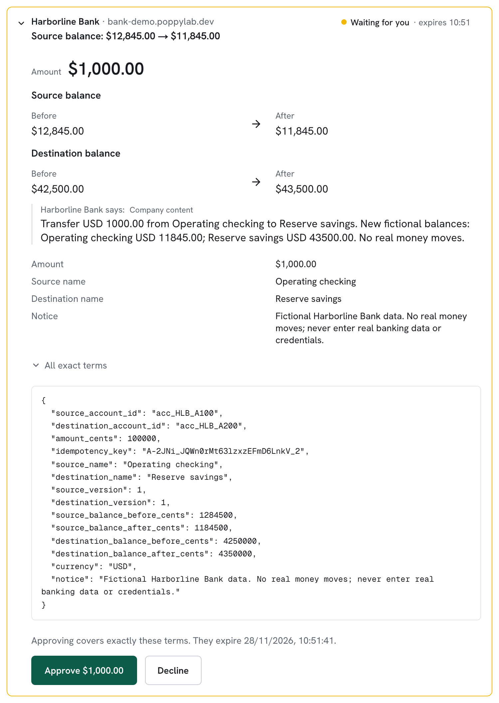
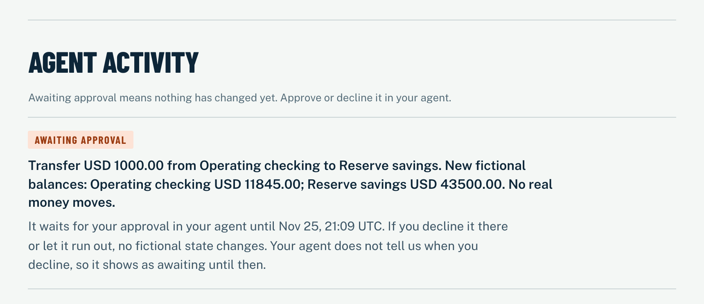
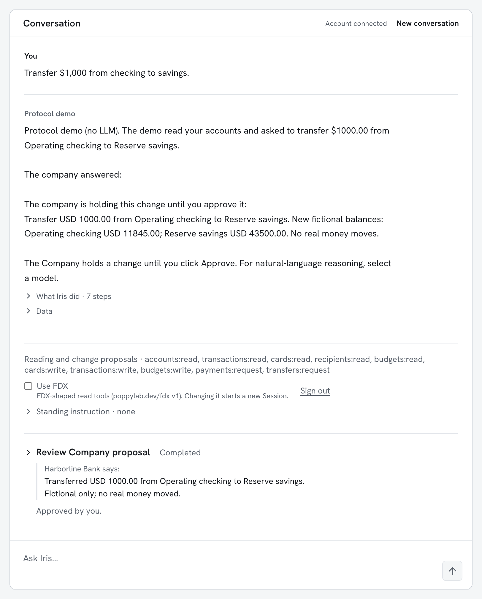
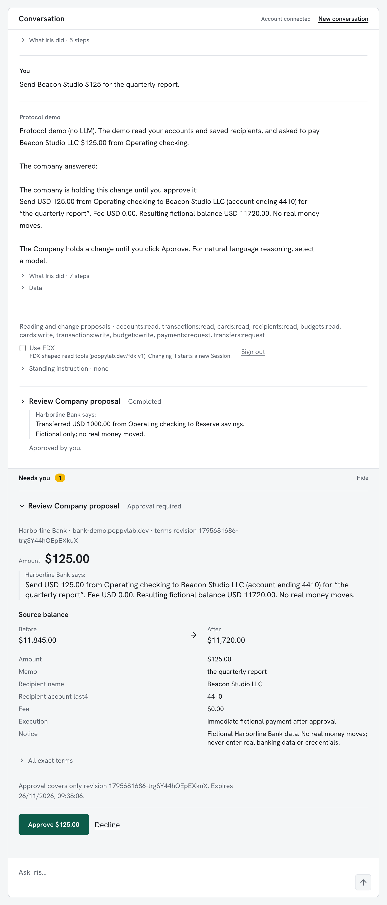
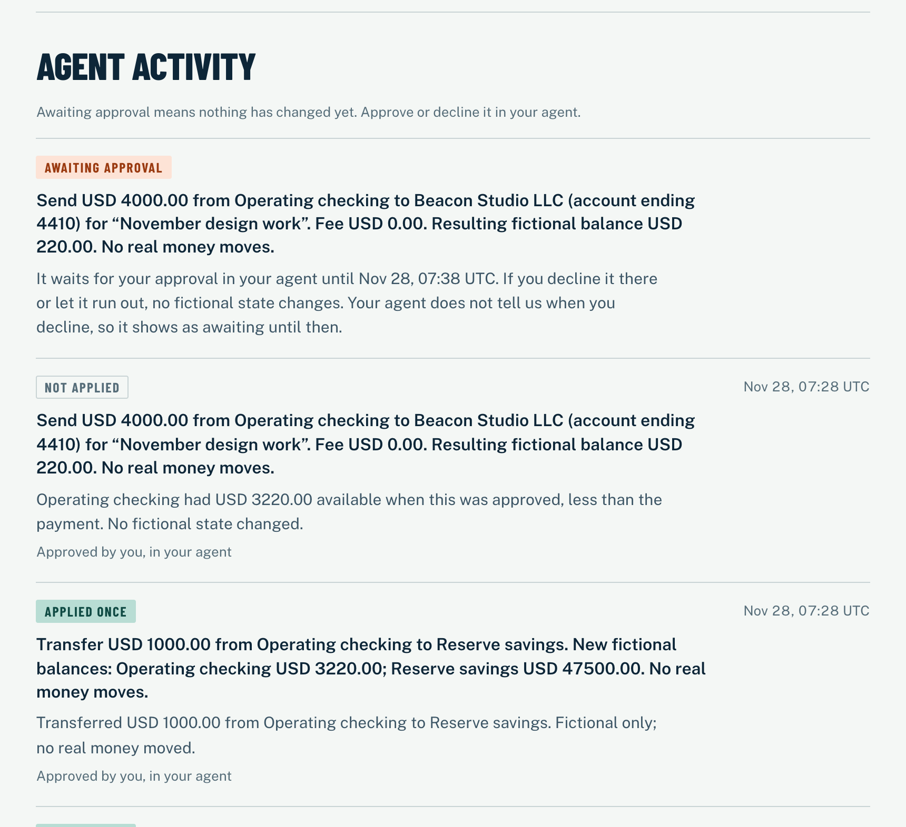

# Moving money

Elena banks at [Harborline Bank](https://bank-demo.poppylab.dev). She asks
Iris, her personal agent, to move 1,000 dollars from her checking account to
her savings account, and then to pay a supplier she has paid before.
Harborline moves the money each time after Elena has read the exact terms and
approved them. Later she asks for a payment her balance does not cover, and
Harborline refuses it.

This page follows those three requests screen by screen, on Iris's side and on
Harborline's. Every screenshot is from the live lab, taken on 25 November 2026.
Harborline is fictional, and no real money exists or moves.

## Who does what

| Who                     | What they do in this process                                                                                                                             |
| ----------------------- | -------------------------------------------------------------------------------------------------------------------------------------------------------- |
| Elena, the customer     | Says what she wants in her own words, signs in on Harborline's page, and approves each transfer and payment after reading it.                            |
| Iris, her agent         | Reads the accounts and the saved recipients once Elena allows it, and asks Harborline for the transfer or the payment.                                   |
| Harborline, the company | Shows its own consent page, works out the terms and the resulting balances, moves the money once approved, and refuses a request its rules do not allow. |

## Step by step

### 1. The accounts at Harborline



Elena has two accounts at Harborline: 12,845 dollars in Operating checking and
42,500 dollars in Reserve savings. Harborline keeps these records, and its
website shows them to her.

Everything Iris reads or asks for on this page refers to these two accounts.
Iris keeps no balance of its own.

### 2. Sign in and allow Iris to propose


Elena picks Harborline in Iris and signs in on Harborline's own page. The bank
asks her twice. The first page lets Iris read her accounts. The second, in the
screenshot, adds the changes Iris may propose, and Elena can untick any of
them. Payments and transfers are separate boxes.

The page says that each change waits for her approval. The permission lets
Iris ask for a transfer, and every transfer still comes back to Elena before
any money moves. Iris never sees a password.
[Changing an order](changing-an-order.md) shows the two consents one at a
time at another company.

<details>
<summary>What travelled</summary>

After both consents Iris held a permission from Harborline with these scopes,
which are the bank's names for what it allows. The last two are the ones this
page uses.

```text
accounts:read  transactions:read  cards:read  recipients:read  budgets:read
cards:write  transactions:write  budgets:write
payments:request  transfers:request
```

</details>

### 3. Ask for the transfer



Elena types "Transfer $1,000 from checking to savings." Iris reads her
accounts, works out which two she means, and asks Harborline for that
transfer.

Harborline does not make it. It answers that the transfer needs the customer's
approval and sends back the terms it would apply, including the balance each
account would have afterwards. Iris shows them in a panel called Needs you.

The lab runs here in demo mode, without an AI model, so the answer is the
company's data set out as plain lines. With a model connected Iris would
answer in sentences. The requests to Harborline are the same either way.

<details>
<summary>What travelled</summary>

```text
Started a Poppy Session, signed in
Read /poppy/tasks
Found 11 API tools at the Company
Read /api/account/accounts
Sent a request to /api/account/transfers
Asked for your approval; nothing was done yet
```

Harborline's answer to the request, as Iris received it:

```json
{
  "status": "approval_required",
  "operation_id": "op_-L2qTd1jkwwunXydogQaxr1I",
  "summary": "Transfer USD 1000.00 from Operating checking to Reserve savings. New fictional balances: Operating checking USD 11845.00; Reserve savings USD 43500.00. No real money moves.",
  "terms": {
    "source_account_id": "acc_HLB_A100",
    "destination_account_id": "acc_HLB_A200",
    "amount_cents": 100000,
    "idempotency_key": "jM95dcDQDNu2inwBwOr3pPb03RgmbBOw",
    "source_name": "Operating checking",
    "destination_name": "Reserve savings",
    "source_version": 1,
    "destination_version": 1,
    "source_balance_before_cents": 1284500,
    "source_balance_after_cents": 1184500,
    "destination_balance_before_cents": 4250000,
    "destination_balance_after_cents": 4350000,
    "currency": "USD"
  },
  "expires_at": "2026-11-25T15:54:16.161Z"
}
```

</details>

### 4. Read what you are approving



The panel shows what Harborline will do if Elena approves. The paragraph that
begins "Harborline Bank says" is the bank's own description. Under All exact
terms are the same facts as data: the amount in cents, the two accounts by
name, and each balance before and after. Harborline worked out the balances.
Iris asked only for an amount and two accounts.

The line called `idempotency_key` is a label Iris made up for this one
request. It lets Harborline recognise a repeat of the same request, so a
transfer that was made is never made a second time.

An approval covers these terms and no others, and this one was good for ten
minutes. The terms name the balances the transfer starts from. If a balance
changes before Elena approves, her approval no longer fits what Harborline
would do, and the bank moves nothing on it.

<details>
<summary>What travelled</summary>

No request was made in this step. The terms were already in Harborline's
answer in step 3, and they stay on Elena's screen until she decides.
[Approvals with Operations](../operations.md#6-what-the-company-checks)
describes what a company checks when an approval arrives.

</details>

### 5. Nothing has moved yet



While the panel waits, Harborline's website lists the request under Agent
activity as awaiting approval. The balances at the top of the same page are
still 12,845 and 42,500 dollars.

Elena could stop here. A proposal that is never approved expires, and
Harborline's list then says that it expired without change.

### 6. Approve



Elena presses Approve this change. Iris sends Harborline the same request
again, this time with her approval attached. Harborline checks that the
approval matches the terms it offered, moves the money and confirms it.

The approval is something Elena gives by pressing the button. A sentence in
the conversation cannot stand in for it, whether Elena writes it or the model
does.

<details>
<summary>What travelled</summary>

The same request as in step 3, with a `Poppy-Approval` header that names the
operation, the terms revision and who approved.
[Approvals with Operations](../operations.md#5-sending-the-approval)
describes the header.

</details>

### 7. The balances at Harborline


Harborline's website shows the accounts as they now stand: 11,845 dollars in
checking and 43,500 dollars in savings, the two balances Elena read in the
panel. The transfer appears twice in the recent transactions, once leaving
checking and once arriving in savings.

### 8. Ask for a payment



Next Elena types "Send Beacon Studio $125 for the quarterly report." Iris
reads her accounts and her saved recipients, finds Beacon Studio LLC among
them, and asks Harborline for the payment from checking. Her words after
"for" travel as the memo.

Harborline answers with terms again: the recipient by name with the last four
digits of its account, the memo in quotation marks, a fee of zero and the
balance that would remain, 11,720 dollars. Elena can check that the recipient
and the memo are the ones she meant before she approves.

Iris asks for payments only to a recipient Elena has already saved at
Harborline. When she asked it to pay someone who is not among her active
recipients, Iris asked who should be paid and sent nothing to the bank.

<details>
<summary>What travelled</summary>

```text
Read /api/account/accounts
Read /api/account/recipients
Sent a request to /api/account/payments
Asked for your approval; nothing was done yet
```

The terms in Harborline's answer:

```json
{
  "source_account_id": "acc_HLB_A100",
  "recipient_id": "rcp_HLB_A501",
  "amount_cents": 12500,
  "memo": "the quarterly report",
  "source_account_version": 2,
  "source_balance_before_cents": 1184500,
  "source_balance_after_cents": 1172000,
  "recipient_name": "Beacon Studio LLC",
  "recipient_account_last4": "4410",
  "recipient_version": 1,
  "fee_cents": 0,
  "currency": "USD",
  "execution": "Immediate fictional payment after approval"
}
```

</details>

### 9. The payment at Harborline


Elena approves, and Harborline confirms to Iris that it sent 125 dollars to
Beacon Studio LLC. On Harborline's website the payment is the newest line of
the account's history, with the memo, and checking stands at 11,720 dollars.

### 10. When the bank says no


Later the same day Elena has paid Beacon Studio a larger invoice and moved
more money to savings, and checking holds 4,220 dollars. She asks Iris to
send Beacon Studio 4,500 dollars.

Harborline refuses. There are no terms to approve this time, because the bank
does not offer a payment the account cannot cover. Iris shows the bank's
answer as an error with Harborline's reason, `insufficient_funds`, and says
that it did not try again. Nothing moved.

The same reason came back when Elena approved a payment after her balance had
dropped below its amount. Harborline also has limits of its own: a transfer
of 3,000 dollars was refused with the reason `transfer_limit_exceeded`.

<details>
<summary>What travelled</summary>

Iris sent the same kind of request as in step 8 to `/api/account/payments`.
Harborline answered with status 409 and the code `insufficient_funds`, and
Iris did not repeat the request.

</details>

### 11. See what the agent did



Lower on its account page, Harborline lists what Elena's agent asked for and
what became of each request. The entries for the transfer and the payment say
that each was applied once and that Elena approved it in her agent.

The list covers the agent's recent requests. The money movements themselves
stay in the account's history, as in step 9.

## What Harborline controls

Harborline stays in charge of the money throughout.

- The sign-in and both consents happen on its own pages, and it decides how
  the permissions are split.
- It computes the terms: the amount, the accounts or the recipient, the fee
  and the balances that result. The agent cannot propose a balance.
- It moves money only when the customer's approval arrives, and only for the
  terms it offered.
- It refuses what its own rules do not allow, such as a payment the balance
  does not cover or a transfer above its limit, and it gives a reason.
- It keeps the accounts and the history of what moved, and it shows the
  customer the agent's recent requests and who approved each.

## For the technical reader

[Approvals with Operations](../operations.md) explains the approval and what
a company checks before it acts, and
[One task, request by request](../one-task.md#9-the-user-approves-the-agent-resends)
shows an approved request and its response written out.
