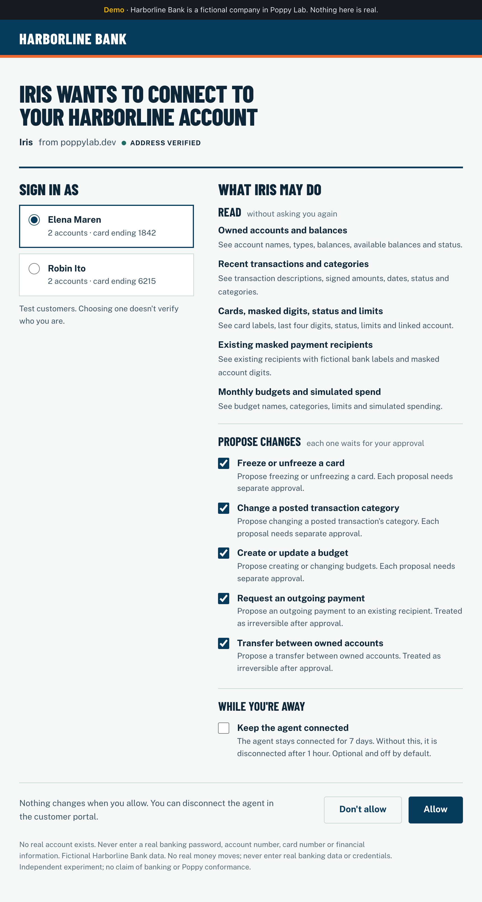
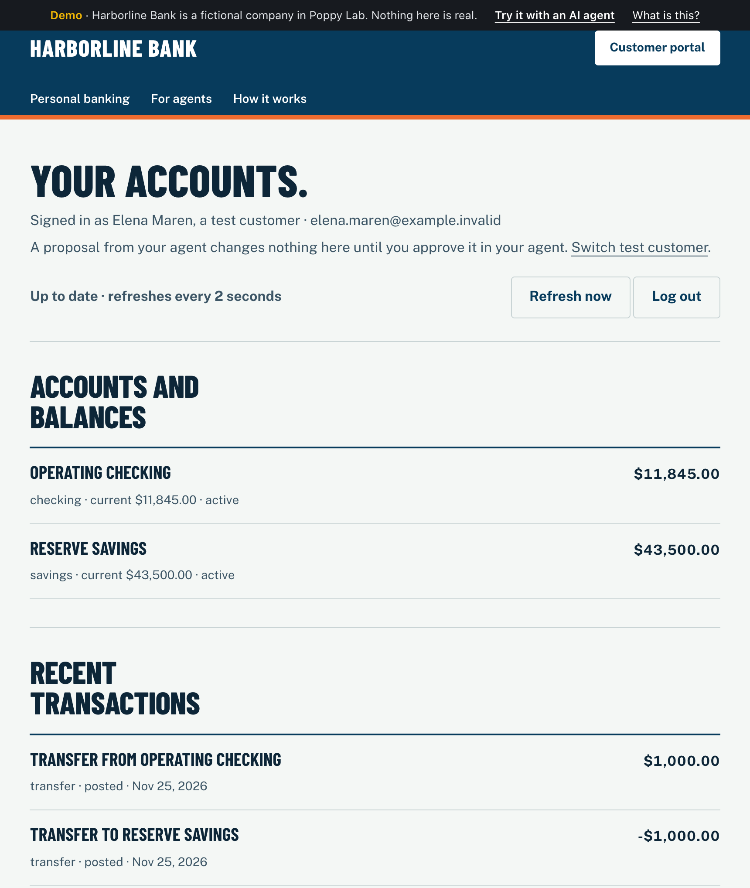
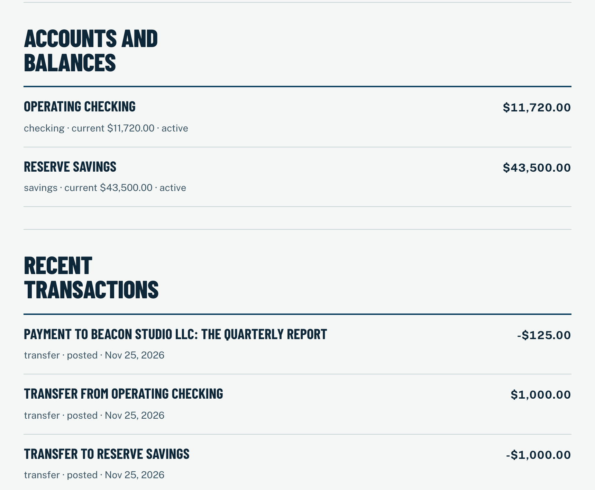
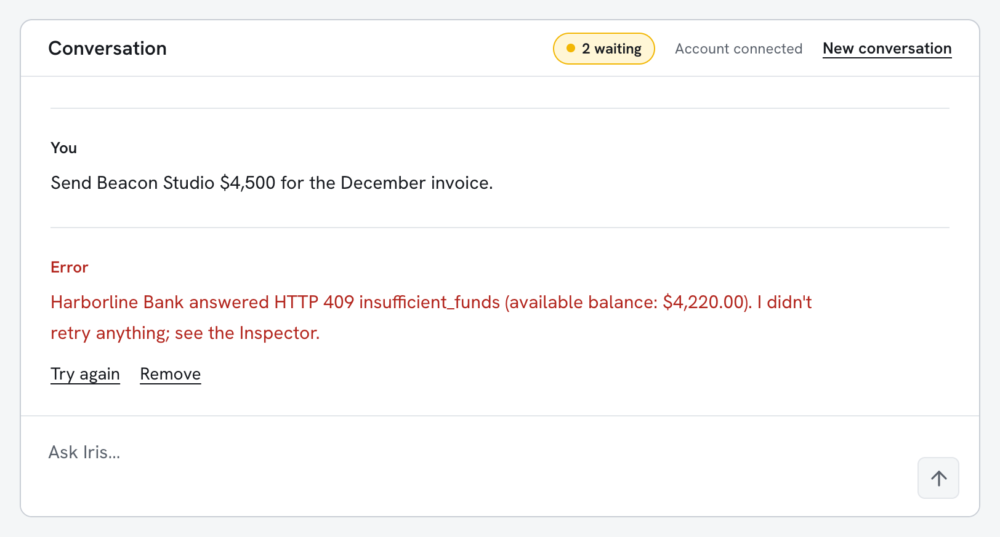

# Moving money

Elena banks at [Harborline Bank](https://bank-demo.poppylab.dev). She asks
Iris, her personal agent, to move 1,000 dollars from her checking account to
her savings account, and then to pay a supplier she has paid before.
Harborline moves the money each time after Elena has read the exact terms and
approved them. Later she asks for a payment her balance does not cover, and
Harborline refuses it.

This page follows those three requests screen by screen, on Iris's side and on
Harborline's. Every screenshot is from the live lab at
[poppylab.dev](https://poppylab.dev), taken on 26 and 28 November 2026. Harborline is fictional, and no real money exists or moves.

## Who does what

| Who                     | What they do in this process                                                                                                                             |
| ----------------------- | -------------------------------------------------------------------------------------------------------------------------------------------------------- |
| Elena, the customer     | Says what she wants in her own words, signs in on Harborline's page, and approves each transfer and payment after reading it.                            |
| Iris, her agent         | Reads the accounts and the saved recipients once Elena allows it, and asks Harborline for the transfer or the payment.                                   |
| Harborline, the company | Shows its own consent page, works out the terms and the resulting balances, moves the money once approved, and refuses a request its rules do not allow. |

## Step by step

### 1. The accounts at Harborline


Elena has two accounts at Harborline: 12,845 dollars in Operating checking and
42,500 dollars in Reserve savings. Harborline keeps these records, and its
website shows them to her.

Everything Iris reads or asks for on this page refers to these two accounts.
Iris keeps no balance of its own.

### 2. Sign in and allow Iris to propose



Elena picks Harborline in Iris and signs in on Harborline's own page. The bank
asks her twice, and the first page lets Iris read her accounts. The second, in
the screenshot, opens with Elena already chosen and adds the changes Iris may
propose. Elena can untick any of them, and payments and transfers are separate
boxes.

The page says that each change waits for her approval. The permission lets
Iris ask for a transfer, and every transfer still comes back to Elena before
any money moves. Iris never sees a password.

A last box, unticked, would keep Iris connected for seven days. Without it
Harborline disconnects the agent after an hour.
[Changing an order](changing-an-order.md) shows the two consents one at a
time at another company.

<details>
<summary>What travelled</summary>

After both consents Iris held a permission from Harborline with these scopes,
which are the bank's names for what it allows. The last two are the ones this
page uses.

```text
accounts:read  transactions:read  cards:read  recipients:read  budgets:read
cards:write  transactions:write  budgets:write
payments:request  transfers:request
```

</details>

### 3. Ask for the transfer


Elena types "Transfer $1,000 from checking to savings." Iris reads her
accounts, works out which two she means, and asks Harborline for that
transfer.

Harborline does not make it. It answers that the transfer needs the customer's
approval and sends back the terms it would apply, including the balance each
account would have afterwards. Iris shows them as a card in the
conversation, where the proposal arrived, with the amount first and each
balance before and after. Iris asks in its own words, from the terms:
"Harborline Bank wants to move $1,000.00 from Operating checking to Reserve
savings. It expires in 10 minutes. Shall I approve it?"

The lab runs here in demo mode, which answers its guided examples without an
AI model, so the answer is the company's data set out as plain lines. With a model connected Iris would
answer in sentences. The requests to Harborline are the same either way.

<details>
<summary>What travelled</summary>

```text
Started a Poppy Session, signed in
Read /poppy/tasks
Company Agent conversations at https://bank-demo.poppylab.dev/poppy/conversations
Found 11 API tools at the Company
Read /api/account/accounts
Sent a request to /api/account/transfers
Asked for your approval; nothing was done yet
```

Harborline's answer to the request, as Iris received it:

```json
{
  "status": "approval_required",
  "operation_id": "op_FCLXWbEyRrj51RgRibpjDNJe",
  "summary": "Transfer USD 1000.00 from Operating checking to Reserve savings. New fictional balances: Operating checking USD 11845.00; Reserve savings USD 43500.00. No real money moves.",
  "terms": {
    "source_account_id": "acc_HLB_A100",
    "destination_account_id": "acc_HLB_A200",
    "amount_cents": 100000,
    "idempotency_key": "KqH1PkPA_IZCQzErKNyH3h-GdE51Xlrr",
    "source_name": "Operating checking",
    "destination_name": "Reserve savings",
    "source_version": 1,
    "destination_version": 1,
    "source_balance_before_cents": 1284500,
    "source_balance_after_cents": 1184500,
    "destination_balance_before_cents": 4250000,
    "destination_balance_after_cents": 4350000,
    "currency": "USD",
    "notice": "Fictional Harborline Bank data. No real money moves; never enter real banking data or credentials."
  },
  "expires_at": "2026-11-26T08:29:56.868Z"
}
```

</details>

### 4. Read what you are approving


The card shows what Harborline will do if Elena approves, and it leads with
the amount. The paragraph that begins "Harborline Bank says" is the bank's own
description, and the rows below it give each balance before and after and the
two accounts by name. Harborline worked out the balances. Iris asked only for
an amount and two accounts. The Approve and Decline buttons are at the foot
of the card, under the terms.

Under All exact terms are the same facts as data, with the amount in cents.
The line called `idempotency_key` is a label Iris made up for this one
request. It lets Harborline recognise a repeat of the same request, so a
transfer that was made is never made a second time.

An approval covers these terms and no others, and this one was good for ten
minutes. The terms name the balances the transfer starts from. If a balance
changes before Elena approves, her approval no longer fits what Harborline
would do. The bank moves nothing on it and answers with new terms for her to
read.

<details>
<summary>What travelled</summary>

No request was made in this step. The terms were already in Harborline's
answer in step 3, and they stay on Elena's screen until she decides.
[Approvals with Operations](../operations.md#what-the-company-checks)
describes what a company checks when an approval arrives.

</details>

### 5. Nothing has moved yet


While the card waits, Harborline's website lists the request under Agent
activity as awaiting approval, and says until when it waits. The balances at
the top of the same page are still 12,845 and 42,500 dollars.

Elena could stop here. If she declines in Iris or lets the time run out,
nothing changes at Harborline. Iris does not report a decline to the bank, so
the website shows a declined proposal as awaiting until that time, and then as
expired without change.

### 6. Approve


Elena presses Approve $1,000.00, or answers "yes" to Iris's question. Iris
sends Harborline the same request again, this time with her approval
attached. Harborline checks that the
approval matches the terms it offered, moves the money and confirms it. The
card shows the bank's confirmation and who approved, and Iris says: "Done. You
approved the $1,000.00 transfer at Harborline Bank, and Harborline Bank has
carried it out."

The approval is something only Elena gives: the button, or her own answer
to the question Iris asked about these terms. Iris reads that answer by fixed
words, before any model sees the message. Nothing a model or the bank writes
can stand in for it.

<details>
<summary>What travelled</summary>

The same request as in step 3, with a `Poppy-Approval` header that names the
operation, the terms revision and who approved.
[Approvals with Operations](../operations.md#what-an-approval-carries)
describes the header.

</details>

### 7. The balances at Harborline



Harborline's website shows the accounts as they now stand: 11,845 dollars in
checking and 43,500 dollars in savings, the two balances Elena read on the
card. The transfer appears twice in the recent transactions, once leaving
checking and once arriving in savings.

### 8. Ask for a payment


Next Elena types "Send Beacon Studio $125 for the quarterly report." Iris
reads her accounts and her saved recipients, finds Beacon Studio LLC among
them, and asks Harborline for the payment from checking. Her words after
"for" travel as the memo.

Harborline answers with terms again, and Iris says: "Harborline Bank wants
to pay Beacon Studio LLC $125.00. It expires in 10 minutes. Shall I approve
it?" The card sets the terms out as rows: the
amount, the balance before and after, the memo, the recipient by name with the
last four digits of its account, and a fee of zero. The balance that would
remain is 11,720 dollars. Elena can check that the recipient and the memo are
the ones she meant before she approves.

Iris asks for payments only to a recipient Elena has already saved at
Harborline. When she asked it to pay someone who is not among her active
recipients, Iris asked who should be paid and sent nothing to the bank.

<details>
<summary>What travelled</summary>

```text
Started a Poppy Session, signed in
Company Agent conversations at https://bank-demo.poppylab.dev/poppy/conversations
Found 11 API tools at the Company
Read /api/account/accounts
Read /api/account/recipients
Sent a request to /api/account/payments
Asked for your approval; nothing was done yet
```

The terms in Harborline's answer:

```json
{
  "source_account_id": "acc_HLB_A100",
  "recipient_id": "rcp_HLB_A501",
  "amount_cents": 12500,
  "memo": "the quarterly report",
  "idempotency_key": "lPcA6J-4Q9sHf-AsKdJXVVJkLdLpy2oi",
  "source_account_version": 2,
  "source_balance_before_cents": 1184500,
  "source_balance_after_cents": 1172000,
  "recipient_name": "Beacon Studio LLC",
  "recipient_account_last4": "4410",
  "recipient_version": 1,
  "fee_cents": 0,
  "currency": "USD",
  "execution": "Immediate fictional payment after approval",
  "notice": "Fictional Harborline Bank data. No real money moves; never enter real banking data or credentials."
}
```

</details>

### 9. The payment at Harborline



Elena approves, and Harborline confirms to Iris that it sent 125 dollars to
Beacon Studio LLC. On Harborline's website the payment is the newest line of
the account's history, with the memo, and checking stands at 11,720 dollars.

### 10. When the bank says no



By now Elena has paid Beacon Studio a larger invoice and moved more money to
savings, and checking holds 4,220 dollars. She asks Iris to send Beacon
Studio 4,500 dollars.

Harborline refuses. There are no terms to approve this time, because the bank
does not offer a payment the account cannot cover. Iris shows the bank's
answer as an error that names Harborline, its reason, `insufficient_funds`,
and the balance that was available: "I didn't retry anything; see the
Inspector." Nothing moved. Elena can try the request again herself, or remove
the error.

Harborline has limits of its own too. A payment of 6,000 dollars to Beacon
Studio was refused with the reason `recipient_limit_exceeded` and that
recipient's limit of 5,000 dollars. One transfer moves at most 2,500 dollars,
and Harborline tells agents so. When Elena asked for a transfer of 3,000
dollars, Iris told her the limit and sent nothing to the bank.

<details>
<summary>What travelled</summary>

Iris sent the same kind of request as in step 8 to `/api/account/payments`.
Harborline answered with status 409, the code `insufficient_funds` and the
available balance, and Iris did not repeat the request. The Inspector lists
the refusal:

```text
POST /api/account/payments · refused by the Company · HTTP 409 insufficient_funds
```

Harborline gave the same answer when Elena approved a payment of 4,000
dollars after another transfer had left 3,220 dollars in checking. With the
payment and the transfer both waiting, Iris had asked which one to approve,
and Elena answered "approve the transfer", then "approve the payment". The
proposal stayed waiting, and Iris said:

```text
Harborline Bank refused this request (HTTP 409, insufficient_funds; available balance: $3,220.00). Nothing was performed. The terms still wait for you: approve them again once what stopped it is sorted out, or ask for the change again to get fresh terms.
```

Step 11 shows Harborline's own record of that payment.

</details>

### 11. See what the agent did


Lower on its account page, Harborline lists what Elena's agent asked for and
what became of each request. A request it carried out is marked Applied once,
with the time and the line "Approved by you, in your agent". The transfer of
step 6 and the payment of step 9 are further down the same list, each applied
once.

The screenshot was taken shortly after the refused approval described in
step 10. The payment of 4,000 dollars is there twice. One entry is marked Not
applied, with the time, who approved and the reason in words: checking had
3,220 dollars available when Elena approved, less than the payment. The other
is the proposal itself, which still awaits approval because its terms stay
open until their time runs out. Harborline then marks it Expired without
change.

The money movements themselves stay in the account's history, as in step 9.
[Paying a bill from another company](paying-a-bill-from-another-company.md)
follows a payment whose amount and reference come from a utility's bill.

## What Harborline controls

Harborline stays in charge of the money throughout.

- The sign-in and both consents happen on its own pages, and it decides how
  the permissions are split.
- It computes the terms: the amount, the accounts or the recipient, the fee
  and the balances that result. The agent cannot propose a balance.
- It moves money only when the customer's approval arrives, and only for the
  terms it offered.
- It refuses what its own rules do not allow, such as a payment the balance
  does not cover or one above a recipient's limit, and it gives a reason.
- It sets the limit on a transfer and tells agents what it is.
- It keeps the accounts and the history of what moved, and it shows the
  customer what the agent asked for and who approved each request.

## For the technical reader

[Approvals with Operations](../operations.md) explains the approval and what
a company checks before it acts, and
[One task, request by request](../one-task.md#9-the-user-approves-the-agent-resends)
shows an approved request and its response written out.
