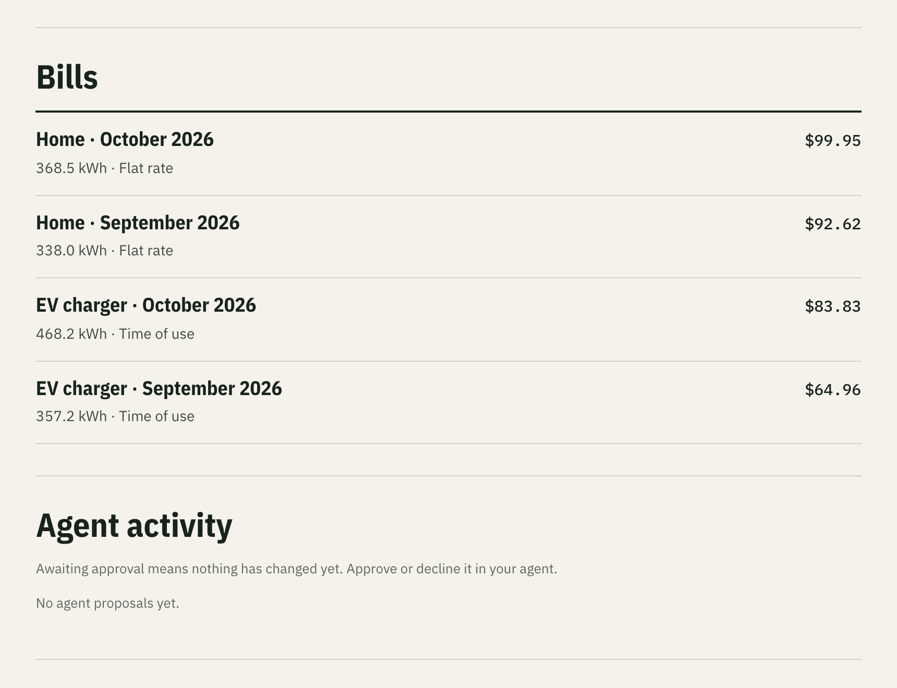
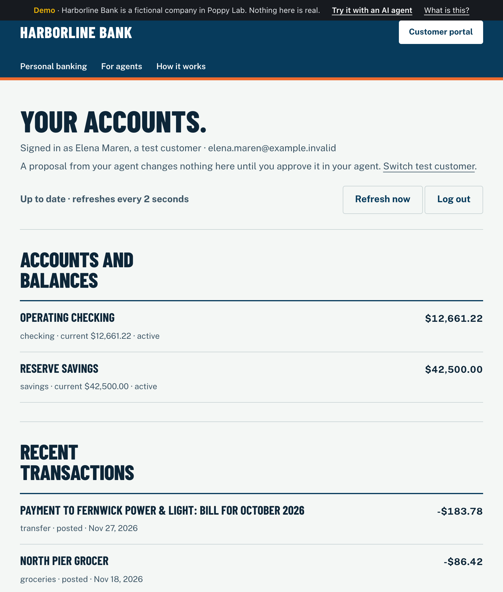
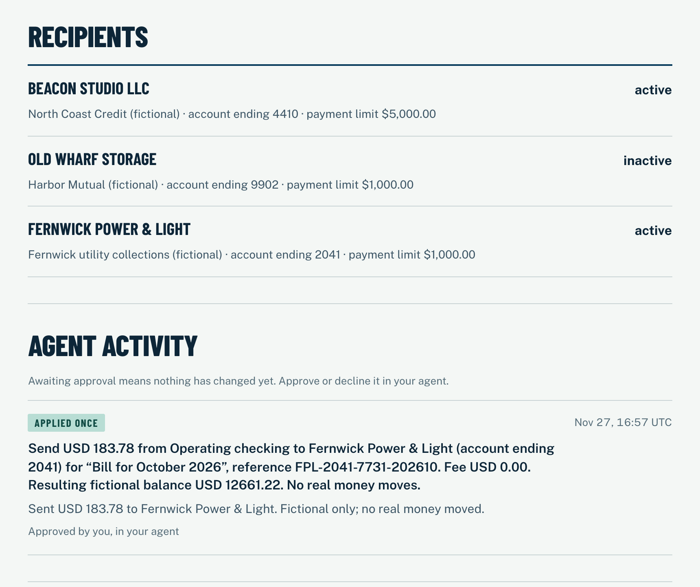

# Paying a bill from another company

Elena's electricity comes from
[Fernwick Power & Light](https://energy-demo.poppylab.dev), and she banks at
[Harborline Bank](https://bank-demo.poppylab.dev). She asks Iris, her personal
agent, to pay her Fernwick bill from her checking account. Iris reads the bill
at Fernwick and asks Harborline for the payment, and Harborline pays once
Elena has approved the exact terms.

This page follows that payment across the two companies, and says what Iris
takes from one to the other. Every screenshot is from the live lab at
[poppylab.dev](https://poppylab.dev), taken on 27 and 28 November 2026. Neither
company is real, and no money or electricity exists.

## Who does what

| Who                   | What they do in this process                                                                                          |
| --------------------- | --------------------------------------------------------------------------------------------------------------------- |
| Elena, the customer   | Signs in at both companies on their own pages, asks for the payment in her own words, and approves it.                |
| Iris, her agent       | Reads the bill at Fernwick, reads her accounts and saved recipients at Harborline, and asks Harborline for a payment. |
| Fernwick, the utility | Issues the bill, with its amount, due date and the reference a payment must quote.                                    |
| Harborline, the bank  | Keeps Fernwick as a saved recipient, checks the reference, works out the terms and pays once Elena approves.          |

## Step by step

### 1. The bill at Fernwick



Elena has two meters at Fernwick, her home and her EV charger, and each has a
monthly bill. October's two bills come to 183.78 dollars. Fernwick's own API
gives each bill a due date, 21 November 2026, and a payment reference that
the two bills of a month share, FPL-2041-7731-202610.

Fernwick keeps the bills. Nothing on this page changes in what follows,
because the payment happens at the bank.

### 2. Ask Iris to pay it


Elena has both companies in one conversation in Iris, and she has signed in
at each on its own page: at Fernwick to read her bills, and at Harborline to
read her accounts and propose payments. She types "Pay my Fernwick bill from
checking."

Iris reads the latest month's bills at Fernwick, then her accounts and her
saved recipients at Harborline. Among the recipients is Fernwick Power &
Light, saved with a payment limit of 1,000 dollars and the shape its
reference must have. Iris asks Harborline to pay that recipient 183.78
dollars from Operating checking, with the bill's reference and "Bill for
October 2026" as the memo.

Harborline does not pay yet. It answers with the terms it would apply, shown
as a card where the proposal arrived, and Iris asks: "Harborline Bank wants to
pay Fernwick Power & Light $183.78. It expires in 10 minutes. Shall I approve
it?" The answer above also says, in one line, what Iris took from Fernwick for
the bank.

<details>
<summary>What travelled</summary>

The steps under the answer, at both companies:

```text
Started a Poppy Session, signed in · Fernwick Power & Light
Read /poppy/tasks · Fernwick Power & Light
Company Agent conversations at https://energy-demo.poppylab.dev/poppy/conversations · Fernwick Power & Light
Found 3 API tools at the Company · Fernwick Power & Light
Read /api/account/bills · Fernwick Power & Light
Started a Poppy Session, signed in · Harborline Bank
Read /poppy/tasks · Harborline Bank
Company Agent conversations at https://bank-demo.poppylab.dev/poppy/conversations · Harborline Bank
Found 11 API tools at the Company · Harborline Bank
Read /api/account/accounts · Harborline Bank
Read /api/account/recipients · Harborline Bank
Sent a request to /api/account/payments · Harborline Bank
Asked for your approval; nothing was done yet · Harborline Bank
```

The request to Harborline, as Iris sent it:

```json
{
  "source_account_id": "acc_HLB_A100",
  "recipient_id": "rcp_HLB_A503",
  "amount_cents": 18378,
  "memo": "Bill for October 2026",
  "reference": "FPL-2041-7731-202610",
  "idempotency_key": "wQFXNkRZbwFeKKKr4urc-CGqRJVghK33"
}
```

Harborline's saved recipient says what a reference must look like. A payment
to it without a reference in that shape is refused with `invalid_reference`:

```json
{
  "id": "rcp_HLB_A503",
  "name": "Fernwick Power & Light",
  "account_last4": "2041",
  "payment_limit_cents": 100000,
  "reference_format": {
    "description": "Your Fernwick account number and the month of the bill, as printed on the bill",
    "pattern": "^FPL-[0-9]{4}-[0-9]{4}-[0-9]{6}$",
    "example": "FPL-2041-7731-202610"
  }
}
```

</details>

### 3. Approve the payment


Elena answers "yes". She could also press the Approve button on Harborline's
terms. Iris sends Harborline the same request again with her approval
attached, Harborline sends the money and confirms it, and Iris says: "Done.
You approved the $183.78 payment at Harborline Bank, and Harborline Bank has
carried it out."

### 4. The payment at Harborline



Harborline's website shows the payment as the newest line of the account's
history, and checking stands 183.78 dollars lower.

### 5. What Harborline records



Lower on the same page, Harborline lists Fernwick among Elena's saved
recipients, and under Agent activity it records the payment: applied once,
with the amount, the memo, the reference and the line "Approved by you, in
your agent". Fernwick matches a payment to its bill by that reference.

## What travels, and what doesn't

Iris carries three things from Fernwick to Harborline: the bill's amount, its
reference and its month, in the memo. Nothing else of Elena's account at
Fernwick reaches the bank. Her meters, her usage, her rate plans and her
address stay with Fernwick.

Nothing travels the other way. Fernwick learns nothing from Iris about her
accounts, her balance or the payment. Iris never hands either company the
other's permission: each company sees only the requests made with its own.

## What the companies control

- Fernwick decides what a bill contains, including the reference a payment
  must quote, and shows its bills only to an agent Elena allowed to read them.
- Harborline decides whom Elena can pay. Iris pays only a recipient she has
  already saved at the bank, and cannot add one.
- Harborline checks the reference's shape and the recipient's limit, works out
  the terms, and pays only when Elena's approval arrives for those terms.

## For the technical reader

[Moving money](moving-money.md) follows payments and transfers at Harborline
on their own, and [Approvals with Operations](../operations.md) explains what
a company checks when an approval arrives.
[Signing in](../sign-in.md) covers the two sign-ins this page needs.
