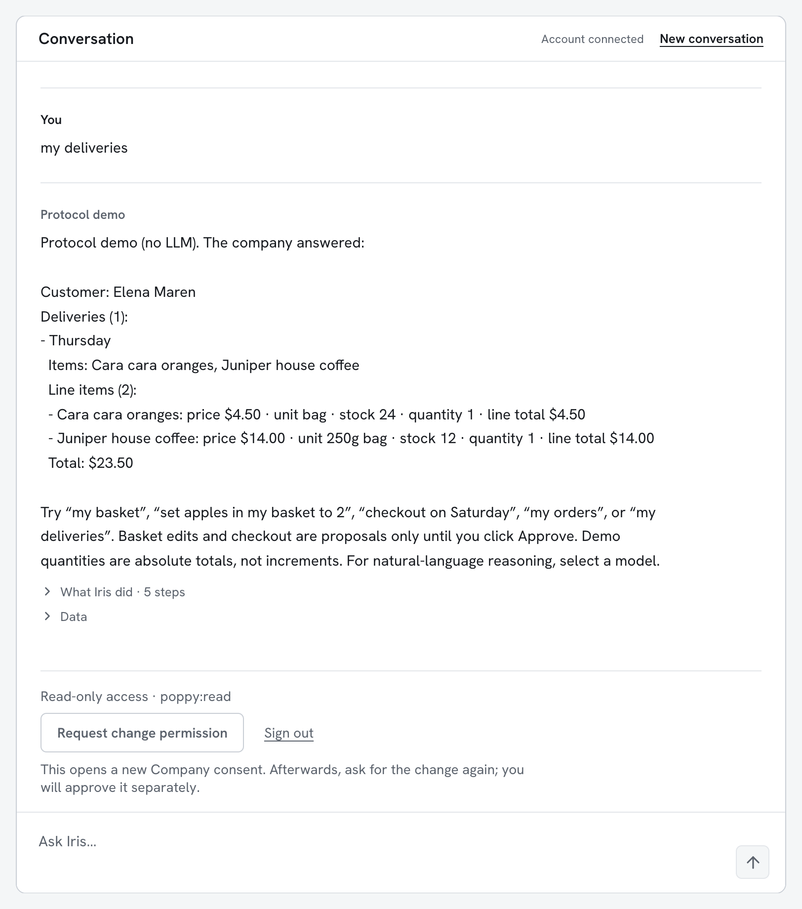
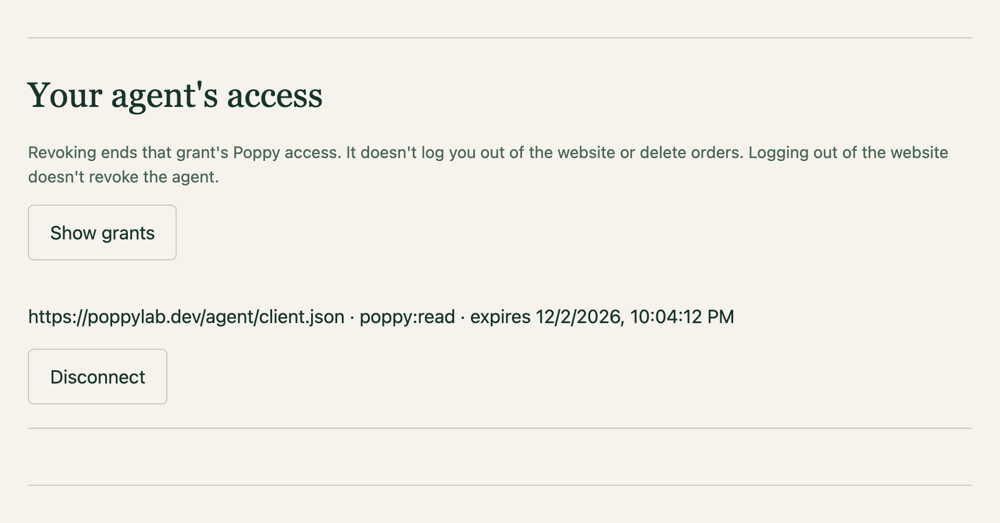
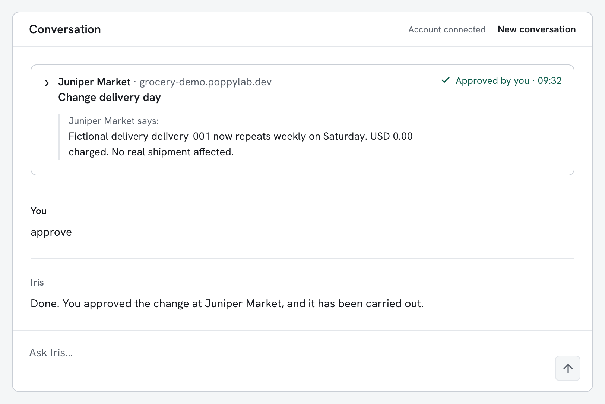
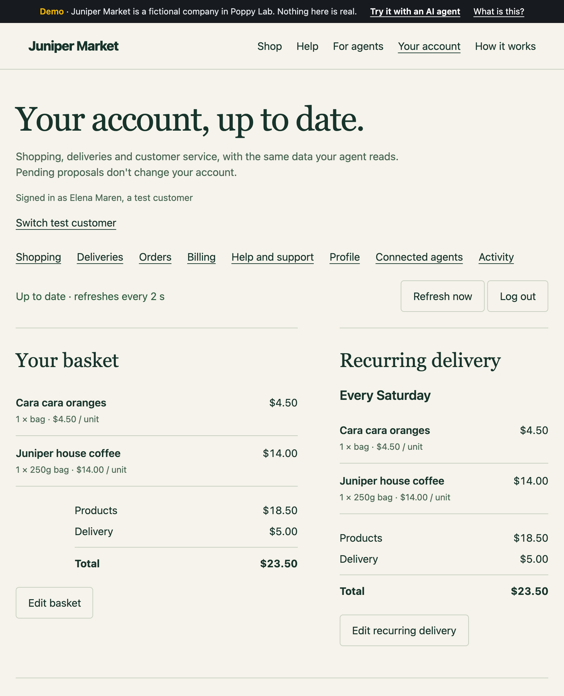
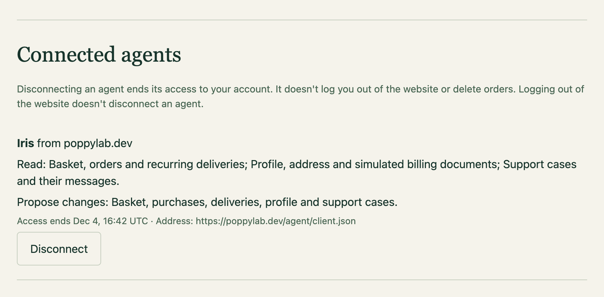
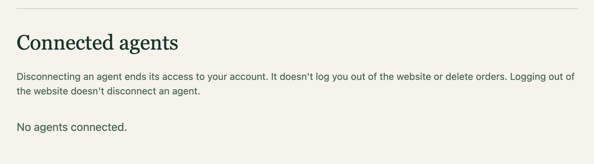

# Signing in and giving permission

Elena has a recurring grocery delivery at
[Juniper Market](https://grocery-demo.poppylab.dev) and wants Iris, her
personal agent, to look after it. For that Iris needs access to her account.
Elena gives it on Juniper's own page, in two separate steps: first to read,
and later to propose changes. At the end she takes it back.

This page follows the access from the first sign-in to the sign-out, in
Iris's conversation and on Juniper's website. Every screenshot is from the
live lab at [poppylab.dev](https://poppylab.dev), taken from 26 to 28 November 2026.

## Who does what

| Who                  | What they do in this process                                                                                         |
| -------------------- | -------------------------------------------------------------------------------------------------------------------- |
| Elena, the customer  | Signs in at Juniper, chooses what Iris may do, approves the one change she asks for, and signs out when she is done. |
| Iris, her agent      | Asks Juniper for a permission, opens Juniper's page for Elena, and works within what Elena allowed.                  |
| Juniper, the company | Shows its own sign-in and consent page, defines the permissions, lists the connected agent, and ends the access.     |

## Step by step

### 1. Before signing in


Iris has found Juniper and can ask what any visitor could ask, such as what
the shop sells. The conversation is marked Public access. Elena's deliveries
and orders belong to her account, and Iris has no access to it.
[Connecting to a company](connecting-to-a-company.md) covers this first
contact.

The sign-in sits in the conversation as a block of its own. Its green button says what Iris will
ask for: access to read, and nothing more. Above the conversation, the lab's
hint says Elena can also answer "yes" when Iris asks her in the chat. Before
she presses it, Elena asks what the shop sells, and Iris answers with
Juniper's four products.

### 2. Sign in at Juniper


The button opens a page on Juniper's website, in Juniper's design and in its
words. At the top it says which agent is asking: Iris, from poppylab.dev,
with a note that the address is verified. On the right it lists what Iris
would be allowed to read, and under Propose changes it says "None". Elena
chooses Allow.

Elena signs in at Juniper and never in Iris, so Iris never sees a password.
What it receives from Juniper is a permission tied to Iris itself. Juniper's
page in the lab asks for no password: it offers two test customers to choose
from. [Signing in](../sign-in.md) says how the lab's sign-in pages work.

<details>
<summary>What travelled</summary>

Iris sent the sign-in request to Juniper directly and opened the consent page
with a reference to it, so the request cannot be altered in the browser. After
Elena allowed it, Juniper sent the browser back to Iris with a one-time code,
and Iris exchanged the code for an access token bound to its own key.

| Request                                | Who makes it |
| -------------------------------------- | ------------ |
| `POST /oauth/par`                      | Iris         |
| `GET /oauth/authorize` and the consent | Elena        |
| `POST /oauth/token`                    | Iris         |

[One task, request by request](../one-task.md#5-ask-the-user-for-access)
shows these requests.

</details>

### 3. Iris reads the account



The tab that held Juniper's page now shows a page of the lab that reads
"Signed in to Juniper Market." and offers to close the tab. Back in the
conversation, Elena asks for her deliveries and Iris reads them from Juniper:
one delivery every Thursday, with oranges and coffee. She asks for her orders
too, and Juniper answers that there are none yet.

The sign-in block at the top now reads "Signed in at Juniper Market · read
only", and the Companies bar above the conversation shows the access: signed
in, read only. Sign out is there too. In the conversation, a new block says
that to ask Juniper for a change Iris needs change permission there, with a
Request change permission button.

<details>
<summary>What travelled</summary>

```text
Started a Poppy Session, signed in
Read /poppy/tasks
Company Agent conversations at https://grocery-demo.poppylab.dev/poppy/conversations
Found 19 API tools at the Company
Read /api/account/deliveries
```

Juniper's answer, trimmed to one of the two products:

```json
{
  "customer": "Elena Maren",
  "deliveries": [
    {
      "id": "delivery_001",
      "day": "Thursday",
      "items": ["Cara cara oranges", "Juniper house coffee"],
      "line_items": [
        {
          "id": "oranges",
          "name": "Cara cara oranges",
          "price": 450,
          "unit": "bag",
          "stock": 24,
          "quantity": 1,
          "line_total_cents": 450
        }
      ],
      "total_cents": 2350,
      "currency": "USD",
      "version": 1
    }
  ]
}
```

The request carried the access token from the sign-in. Juniper checked that
the token allows `poppy:read` before it answered.

</details>

### 4. Juniper lists the agent



Elena opens Juniper's website herself and looks at her account. Under
Connected agents, Juniper lists the agent that has been reading it, in the
words of its consent page: Iris from poppylab.dev, what it may read, and the
date on which the access ends. The agent's address stands next to that date.

The record of who may reach her account is kept by Juniper, where Elena
would look for it. The Disconnect button ends the access from Juniper's side.

### 5. Ask for a change too early


Elena asks Iris to move the delivery to Saturday. Iris does not send the
request. Juniper's API says that proposing a change needs a second
permission, and Elena gave only the one to read. Nothing changed: Juniper's
website still showed Thursday and no proposal from the agent.

The answer says what is missing and what happened: the request needs the
change permission, and Iris didn't send it to Juniper. Then Iris says: "Ask
Juniper Market for change permission to go on with 'Move my recurring
delivery to Saturday'? Juniper Market's page opens again, and nothing changes
until you approve the change itself."

<details>
<summary>What travelled</summary>

The steps under the answer end with the request that Iris did not make. The
Inspector lists it as
"Not sent · POST /api/account/delivery-change · permission not granted".

```text
Started a Poppy Session, signed in
Company Agent conversations at https://grocery-demo.poppylab.dev/poppy/conversations
Found 19 API tools at the Company
Did not send a request to /api/account/delivery-change (permission not granted)
```

The entry in Juniper's API description that names both permissions, trimmed:

```json
{
  "/api/account/delivery-change": {
    "post": {
      "operationId": "propose_delivery_change",
      "summary": "Propose a new recurring delivery day.",
      "x-poppy-scopes": ["poppy:read", "poppy:write"]
    }
  }
}
```

</details>

### 6. Allow Iris to propose changes


Elena presses the button under Iris's question, and Juniper's page opens
again, with her account already selected. Answering "yes" in the chat would
have opened it too. This time the page names one more thing Iris could do:
propose changes to the basket, purchases, deliveries, the profile and support
cases. Elena can untick the box and stay with read-only access.

The page also says what the permission does not do. Each change waits for
Elena's own approval, and the permission confirms no purchase.
Juniper decides how its permissions are split and how each one is described.
A bank or an airline would draw the lines elsewhere.

<details>
<summary>What travelled</summary>

The same three requests as in step 2. Iris asked for both permissions
together, and the new access replaced the old one. Step 11 shows the one
entry Juniper lists for Iris afterwards, with both permissions.

</details>

### 7. Iris asks to go on


Back in the conversation, a block reads "Change permission given at Juniper
Market", and Iris says: "You're signed in at Juniper Market. Shall I go on
with 'Move my recurring delivery to Saturday'?" It does not send the request
by itself.

What was said before the change permission stays in the conversation: her
deliveries, her orders and the request Iris had not sent each carry the label
"From your earlier sign-in at Juniper Market".

### 8. Go on with the request


Elena answers "yes", and Iris sends the request. Juniper does not make the
change. It answers that the change needs the customer's approval and sends
back the terms it would apply: the delivery moves from Thursday to Saturday,
at no charge. Iris shows them as a card in the conversation, where the
proposal arrived, and the heading counts it as waiting.

Iris asks in its own words, from the terms: "Juniper Market wants to change
your recurring delivery day from Thursday to Saturday. There's no fee. It
expires in 10 minutes. Shall I approve it?"

<details>
<summary>What travelled</summary>

```text
Started a Poppy Session, signed in
Read /poppy/tasks
Company Agent conversations at https://grocery-demo.poppylab.dev/poppy/conversations
Found 19 API tools at the Company
Sent a request to /api/account/delivery-change
Asked for your approval; nothing was done yet
```

Juniper's answer to the request, as Iris received it:

```json
{
  "status": "approval_required",
  "operation_id": "op_eV-2oYC-g9rLk80kY4vyLGin",
  "summary": "Move Elena Maren’s fictional delivery delivery_001 from Thursday to Saturday, recurring weekly. No charge (USD 0.00). No real shipment is affected.",
  "terms": {
    "kind": "delivery",
    "delivery_id": "delivery_001",
    "from": "Thursday",
    "delivery_version": 1,
    "to": "Saturday",
    "fee_cents": 0,
    "currency": "USD"
  },
  "expires_at": "2026-11-26T08:39:19.266Z"
}
```

</details>

### 9. Approve



Elena answers "approve". Pressing Approve this change on the card does the
same. Iris sends Juniper the same request again, this time with her approval
attached, and Juniper confirms: the delivery now repeats weekly on Saturday.
Iris says: "Done. You approved the change at Juniper Market, and it has been carried out." The card stays where it arrived and reads
Approved by you.

The permission from step 6 allowed Iris to ask for the change. Elena's
approval is what allowed Juniper to make it. Iris takes that approval only
from Elena's own answer to its question, read by fixed words, and never from
what a model or the company writes.
[Changing an order](changing-an-order.md) follows an approval in detail:
what the terms contain, what the approval covers and when it expires.

### 10. Check the delivery at Juniper



Juniper's website shows the delivery as it now stands: every Saturday, with
the same two products. Lower on the page, Elena opens Your agent's activity.
There Juniper records that the change was applied, at what time, and that
Elena approved it in her agent.

### 11. See what the agent may do now



Under Connected agents, Juniper now lists the same agent with both
permissions, each in the words of its consent page. There is one entry,
because the second consent replaced the first.

### 12. Sign out


Elena opens Juniper Market in the bar above the conversation, where its line
reads "Reading and change proposals", and presses Sign out. The answers Iris
got with her account leave the conversation, and it is marked Public access
again. When she asks for her deliveries, Iris answers as it would have before
she signed in: the request needs her account, she is not signed in, and Iris
didn't send it to Juniper. Iris asks whether to sign in again to go on
with the request.

<details>
<summary>What travelled</summary>

Signing out is a request from Iris to Juniper to revoke the access it was
given (`POST /oauth/revoke`). Juniper lists the address for it on its
[For agents page](https://grocery-demo.poppylab.dev/for-agents), and step 13
shows the effect on Juniper's side.

</details>

### 13. Check at Juniper that the access ended



Elena looks at Juniper's page once more. The list reads "No agents
connected". The delivery she moved stays on Saturday, because signing out
ends the access and undoes nothing.

Elena can also end the access from Juniper's side, with the Disconnect button
on this page. When she does, Juniper refuses Iris's next request. Iris tells
her that Juniper no longer accepts the access, and the answers it got with
her account leave the conversation.

## What Juniper controls

Juniper stays in charge of the customer's account throughout.

- The sign-in and both consents happen on its own pages, with its own
  wording. The agent never handles a password.
- It defines the permissions and keeps reading separate from proposing
  changes.
- It checks the permission on every request for account data.
- The permission to propose changes lets the agent ask. Juniper makes a
  change only when the customer's approval arrives.
- It lists the connected agent for the customer and can end the access
  itself.
- It shows the customer what the agent asked for recently and what was done.

## For the technical reader

The Inspector view of the playground lists each call behind the screens
above, without the secrets.
[One task, request by request](../one-task.md#5-ask-the-user-for-access)
walks through the sign-in requests, and
[Approvals with Operations](../operations.md) describes what the company
checks when an approval arrives.
