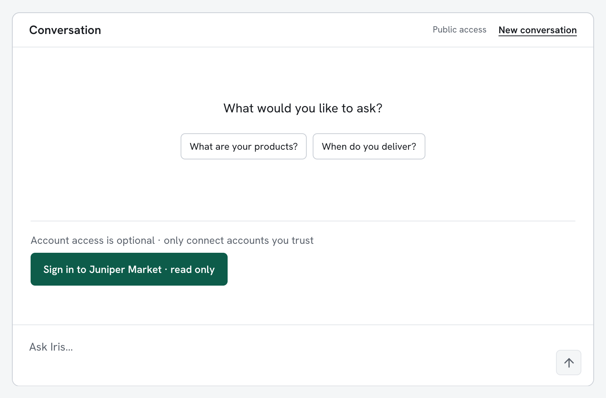
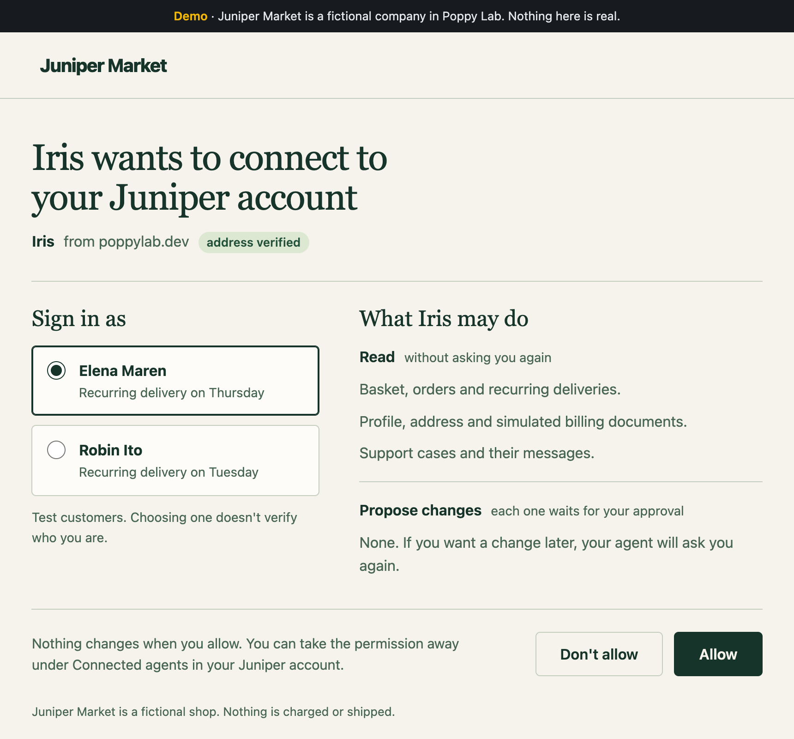
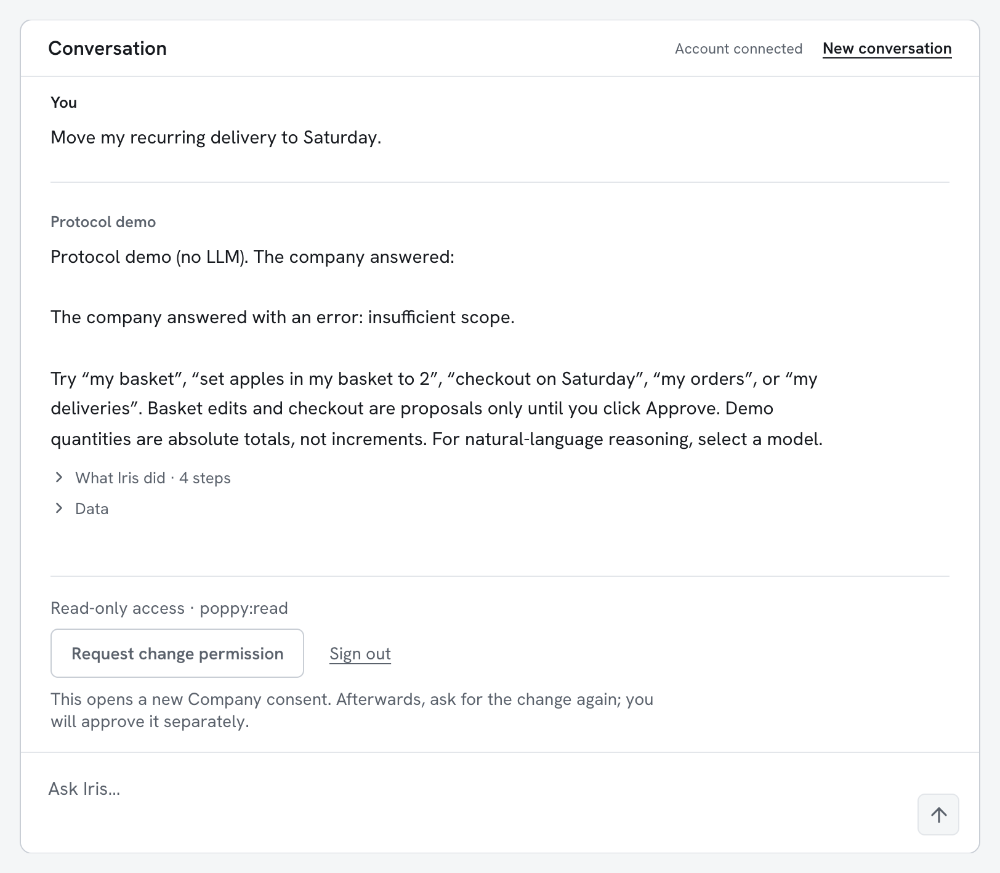
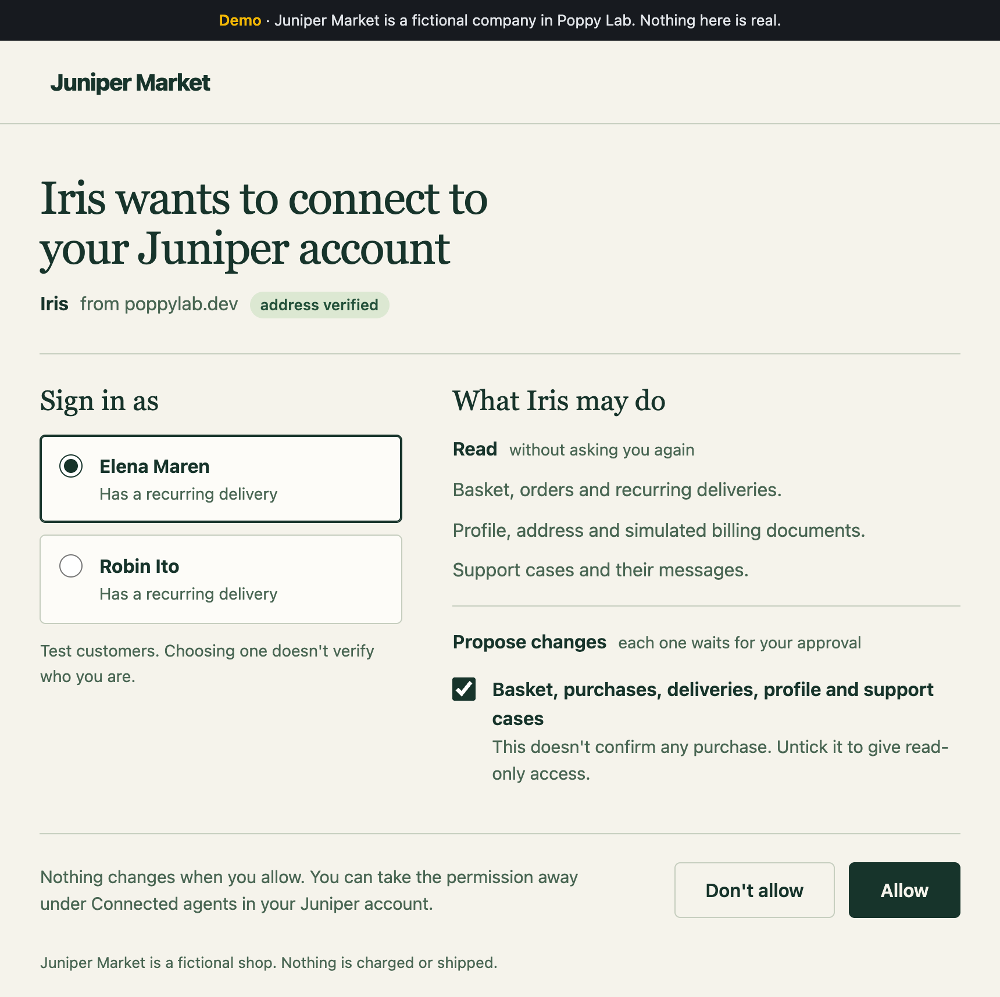
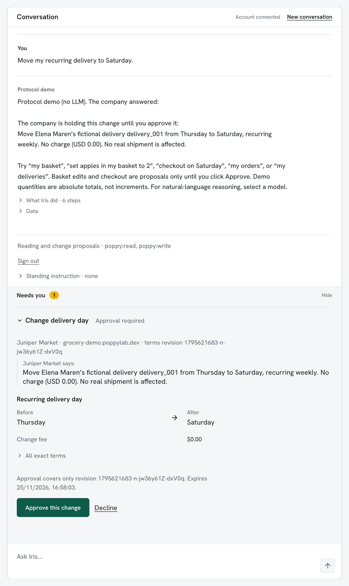
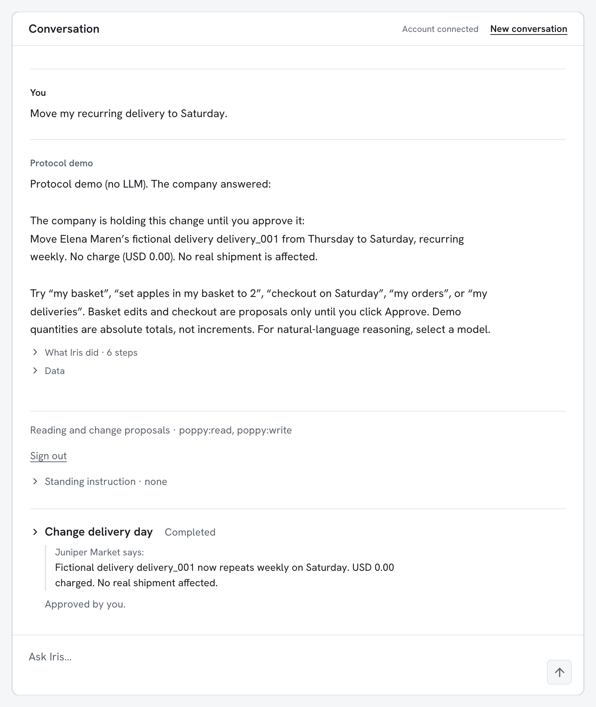
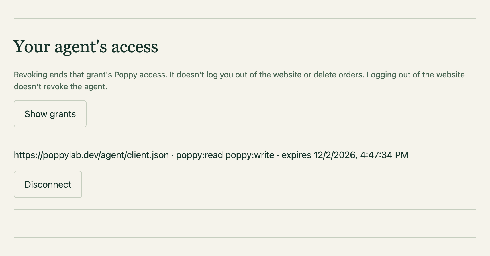
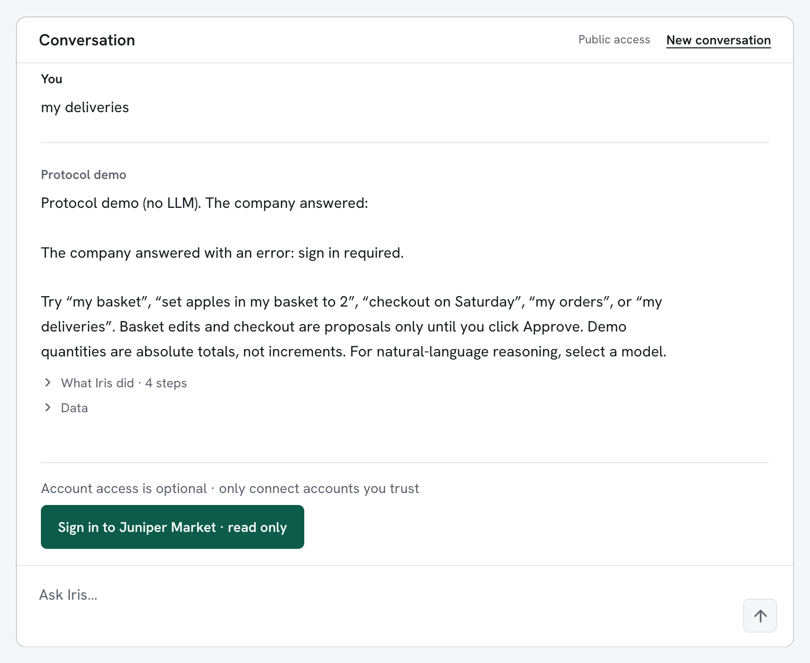
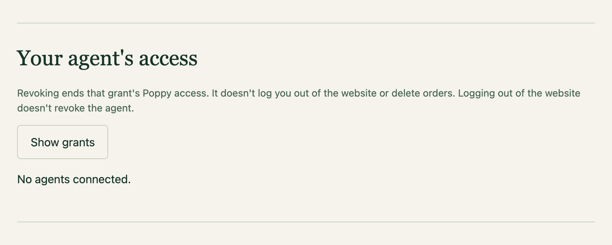

# Signing in and giving permission

Elena has a recurring grocery delivery at
[Juniper Market](https://grocery-demo.poppylab.dev) and wants Iris, her
personal agent, to look after it. For that Iris needs access to her account.
Elena gives it on Juniper's own page, in two separate steps: first to read,
and later to propose changes. At the end she takes it back.

This page follows the access from the first sign-in to the sign-out, in
Iris's conversation and on Juniper's website. Every screenshot is from the
live lab, taken on 25 November 2026.

## Who does what

| Who                  | What they do in this process                                                                                         |
| -------------------- | -------------------------------------------------------------------------------------------------------------------- |
| Elena, the customer  | Signs in at Juniper, chooses what Iris may do, approves the one change she asks for, and signs out when she is done. |
| Iris, her agent      | Asks Juniper for a permission, opens Juniper's page for Elena, and works within what Elena allowed.                  |
| Juniper, the company | Shows its own sign-in and consent page, defines the permissions, lists the connected agent, and ends the access.     |

## Step by step

### 1. Before signing in



Iris has found Juniper and can ask what any visitor could ask, such as what
the shop sells. The conversation is marked Public access. Elena's deliveries
and orders belong to her account, and Iris has no access to it.
[Connecting to a company](connecting-to-a-company.md) covers this first
contact.

The green button says what Iris will ask for: access to read, and nothing
more.

### 2. Sign in at Juniper



The button opens a page on Juniper's website, in Juniper's design and in its
words. At the top it says which agent is asking: Iris, from poppylab.dev. On
the right it lists what Iris would be allowed to read, and it states that
proposing changes or purchases is not allowed. Elena chooses Allow access.

Elena signs in at Juniper and never in Iris, so Iris never sees a password.
What it receives from Juniper is a permission tied to Iris itself. The lab's
companies have test customers and no passwords, which is why the page offers
a list of names.

<details>
<summary>What travelled</summary>

Iris sent the sign-in request to Juniper directly and opened the consent page
with a reference to it, so the request cannot be altered in the browser. After
Elena allowed it, Juniper sent the browser back to Iris with a one-time code,
and Iris exchanged the code for an access token bound to its own key.

| Request                                | Who makes it |
| -------------------------------------- | ------------ |
| `POST /oauth/par`                      | Iris         |
| `GET /oauth/authorize` and the consent | Elena        |
| `POST /oauth/token`                    | Iris         |

[One task, request by request](../one-task.md#5-ask-the-user-for-access)
shows these requests.

</details>

### 3. Iris reads the account


Back in the conversation, Elena asks for her deliveries and Iris reads them
from Juniper: one delivery every Thursday, with oranges and coffee. She asks
for her orders too, and Juniper answers that there are none yet.

The line under the answer states what Iris may do at this point: read-only
access. Next to it are the two things Elena can do about that. She can ask
for change permission, or sign out.

<details>
<summary>What travelled</summary>

```text
Started a Poppy Session, signed in
Read /poppy/tasks
Read /api/account/deliveries
```

Juniper's answer, trimmed to one of the two products:

```json
{
  "customer": "Elena Maren",
  "deliveries": [
    {
      "id": "delivery_001",
      "day": "Thursday",
      "items": ["Cara cara oranges", "Juniper house coffee"],
      "line_items": [
        {
          "id": "oranges",
          "name": "Cara cara oranges",
          "price": 450,
          "unit": "bag",
          "quantity": 1,
          "line_total_cents": 450
        }
      ],
      "total_cents": 2350,
      "currency": "USD",
      "version": 1
    }
  ]
}
```

The request carried the access token from the sign-in. Juniper checked that
the token allows `poppy:read` before it answered.

</details>

### 4. Juniper lists the agent


Elena opens Juniper's website herself and looks at her account. Under Your
agent's access, Juniper lists the agent she connected: its address, the one
permission it holds, and the date on which the access expires.

The record of who may reach her account is kept by Juniper, where Elena
would look for it. The Disconnect button ends the access from Juniper's side.

### 5. Ask for a change too early



Elena asks Iris to move the delivery to Saturday. Iris does not send the
request. Juniper's API says that proposing a change needs a second
permission, and Elena gave only the one to read. Nothing changed: Juniper's
website still showed Thursday and no proposal from the agent.

The answer in demo mode is terse. "Insufficient scope" means that the
permission Iris holds does not cover the request, and the demo words it as
the company's answer although Iris stopped before asking. The note under the
buttons tells Elena what to do: request change permission, then ask again.

<details>
<summary>What travelled</summary>

What Iris showed under Data is its own note. No request for the change
reached Juniper:

```json
{
  "error": "insufficient_scope",
  "instruction": "Ask the user to choose Request change permission. A new Company consent is required; do not retry or propose changes until it completes. Reading remains available."
}
```

The entry in Juniper's API description that names both permissions, trimmed:

```json
{
  "/api/account/delivery-change": {
    "post": {
      "operationId": "propose_delivery_change",
      "summary": "Propose a new recurring delivery day.",
      "x-poppy-scopes": ["poppy:read", "poppy:write"]
    }
  }
}
```

</details>

### 6. Allow Iris to propose changes



Elena presses Request change permission and Juniper's page opens again. This
time it names one more thing Iris could do: propose changes to the basket,
purchases, deliveries, the profile and support cases. Elena can untick the
box and stay with read-only access.

The page also says what the permission does not do. Each change will need
Elena's separate approval in Iris, and the permission confirms no purchase.
Juniper decides how its permissions are split and how each one is described.
A bank or an airline would draw the lines elsewhere.

<details>
<summary>What travelled</summary>

The same three requests as in step 2. Iris asked for both permissions
together, and the new access replaced the old one: afterwards Juniper listed
one entry for Iris, with both permissions.

</details>

### 7. Ask again



The line under the conversation now reads "Reading and change proposals".
Elena asks again for Saturday, and this time Iris sends the request. Iris
does not repeat the earlier request by itself. When the access changed, the
answers that held account data also left the conversation.

Juniper does not make the change. It answers that the change needs the
customer's approval and sends back the terms it would apply: the delivery
moves from Thursday to Saturday, at no charge. Iris shows them in a panel
called Needs you.

<details>
<summary>What travelled</summary>

```text
Started a Poppy Session, signed in
Read /poppy/tasks
Sent a request to /api/account/delivery-change
Asked for your approval; nothing was done yet
```

Juniper's answer to the request, as Iris received it:

```json
{
  "status": "approval_required",
  "operation_id": "op_9xsVEJWrlypnShhBabeh3eSI",
  "summary": "Move Elena Maren’s fictional delivery delivery_001 from Thursday to Saturday, recurring weekly. No charge (USD 0.00). No real shipment is affected.",
  "terms": {
    "kind": "delivery",
    "delivery_id": "delivery_001",
    "from": "Thursday",
    "delivery_version": 1,
    "to": "Saturday",
    "fee_cents": 0,
    "currency": "USD"
  },
  "expires_at": "2026-11-25T15:58:03.517Z"
}
```

</details>

### 8. Approve



Elena presses Approve this change. Iris sends Juniper the same request
again, this time with her approval attached, and Juniper confirms: the
delivery now repeats weekly on Saturday.

The permission from step 6 allowed Iris to ask for the change. Elena's
approval is what allowed Juniper to make it.
[Changing an order](changing-an-order.md) follows an approval in detail:
what the terms contain, what the approval covers and when it expires.

### 9. Check the delivery at Juniper


Juniper's website shows the delivery as it now stands: every Saturday, with
the same two products. Lower on the page, under Your agent's activity,
Juniper records that the change was applied and that Elena approved it in
her agent.

### 10. See what the agent may do now



Under Your agent's access, Juniper lists the same agent with both
permissions. There is one entry, because the second consent replaced the
first.

### 11. Sign out



Elena presses Sign out in the conversation. The conversation is emptied and
marked Public access again. When she asks for her deliveries, the answer is
the one from before she signed in: signing in is required.

<details>
<summary>What travelled</summary>

Signing out is a request from Iris to Juniper to revoke the access it was
given (`POST /oauth/revoke`). Juniper lists the address for it on its
[For agents page](https://grocery-demo.poppylab.dev/for-agents), and step 12
shows the effect on Juniper's side.

</details>

### 12. Check at Juniper that the access ended



Elena looks at Juniper's page once more and presses Show grants to reload
the list. It reads "No agents connected". The delivery she moved stays on
Saturday, because signing out ends the access and undoes nothing.

Elena can also end the access from Juniper's side. In the same run she
signed in again and pressed Disconnect on this page. Iris's next request was
refused, and Iris told her that Juniper no longer accepted the access.

## What Juniper controls

Juniper stays in charge of the customer's account throughout.

- The sign-in and both consents happen on its own pages, with its own
  wording. The agent never handles a password.
- It defines the permissions and keeps reading separate from proposing
  changes.
- It checks the permission on every request for account data.
- The permission to propose changes lets the agent ask. Juniper makes a
  change only when the customer's approval arrives.
- It lists the connected agent for the customer and can end the access
  itself.
- It shows the customer what the agent asked for recently and what was done.

## For the technical reader

The Inspector view of the playground lists each call behind the screens
above, without the secrets.
[One task, request by request](../one-task.md#5-ask-the-user-for-access)
walks through the sign-in requests, and
[Approvals with Operations](../operations.md) describes what the company
checks when an approval arrives.
