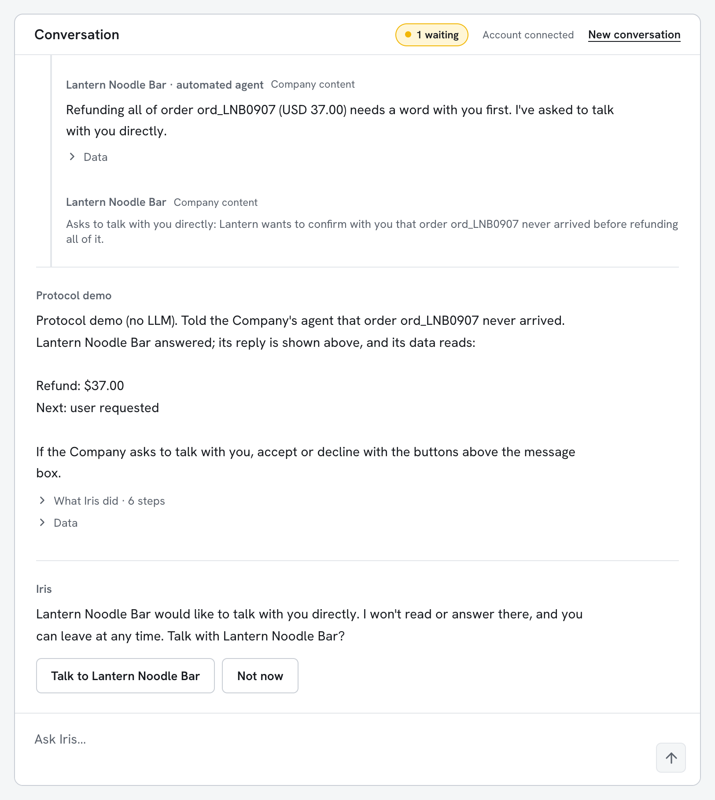
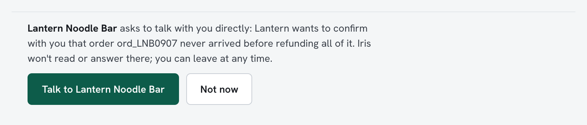
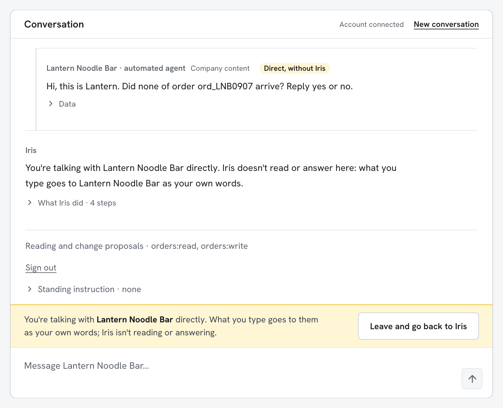
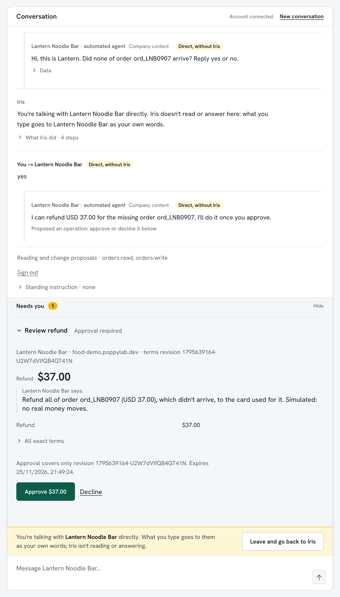
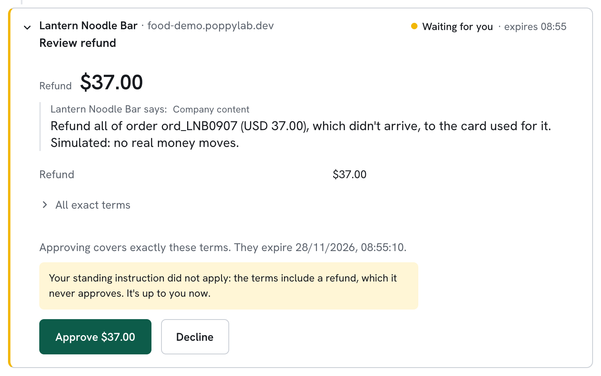
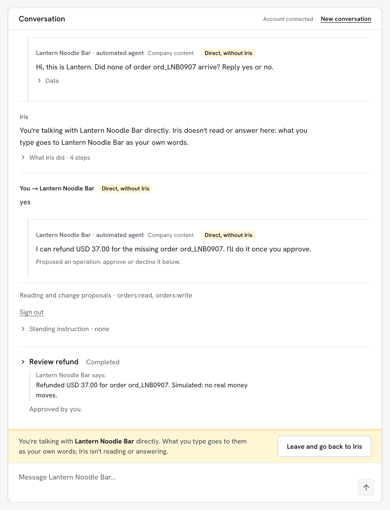
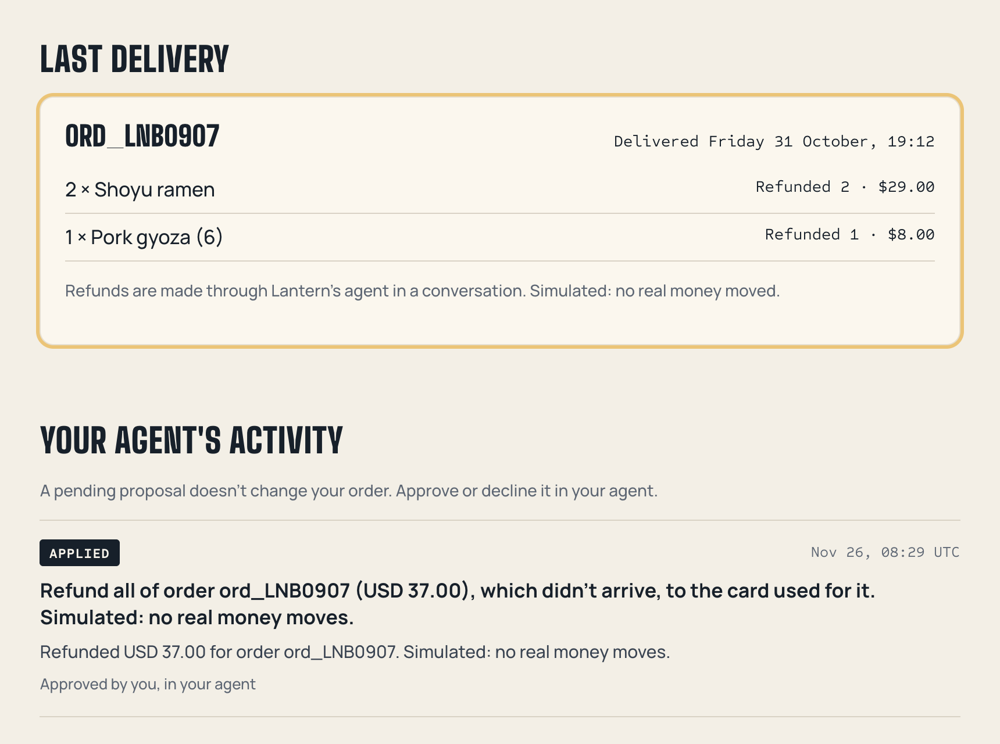

# Talking to the company yourself

Elena tells Iris that her last order from
[Lantern Noodle Bar](https://food-demo.poppylab.dev) never arrived. Refunding
a whole order is something Lantern wants to hear from the customer herself, so
it asks to talk with her directly. In a Direct Conversation Elena's words go
to Lantern as her own. Iris steps aside: it neither reads what she writes nor
answers for her.

This page follows that conversation screen by screen: Lantern's invitation,
Elena's answer, the refund Lantern proposes, her approval, and her return to
Iris. Every screenshot is from the live lab, taken on 25 November 2026. Before
it starts, Elena has signed in at Lantern and allowed Iris to propose changes,
the two consents shown in [Changing an order](changing-an-order.md). The lab
ran in demo mode, without an AI model, so Iris sent a fixed report when Elena
said that her order never arrived.

## Who does what

| Who                  | What they do in this process                                                                                           |
| -------------------- | ---------------------------------------------------------------------------------------------------------------------- |
| Elena, the customer  | Decides whether to talk with Lantern, answers in her own words, approves the refund, and leaves when she is done.      |
| Iris, her agent      | Reports the problem, shows Lantern's invitation, carries Elena's words unchanged, and comes back when she leaves.      |
| Lantern, the company | Asks to talk with the customer, asks its question, proposes the refund and its terms, and pays it once it is approved. |

## Step by step

### 1. Report the order that never arrived



Elena writes: "My last order never arrived." Iris asks Lantern's own agent for
her orders, finds the last delivery, and reports that none of it arrived.
[Getting help from the company](getting-help-from-the-company.md) shows how
that conversation with Lantern's agent starts.

Lantern's agent does not offer a refund yet. It answers that refunding all of
the order, 37 dollars, needs a word with Elena first, and it asks to talk with
her directly. The indented blocks are what came from Lantern: its two
answers, and its request to talk with the reason it gave.

<details>
<summary>What travelled</summary>

In demo mode the words "never arrived" make Iris send two fixed requests to
Lantern's agent: `order_status`, and then `order_not_delivered` with the
number of the last delivery.

```text
Started a Poppy Session, signed in
Talked to the Company's own agent
Talked to the Company's own agent
Conversation · the Company asks to talk with the user
```

Lantern's answer to the report, and the reason that came with its request to
talk:

```json
{
  "text": "Refunding all of order ord_LNB0907 (USD 37.00) needs a word with you first. I've asked to talk with you directly.",
  "data": {
    "order_id": "ord_LNB0907",
    "refund_cents": 3700,
    "next": "user_requested"
  }
}
```

```json
{
  "type": "user_requested",
  "reason": "Lantern wants to confirm with you that order ord_LNB0907 never arrived before refunding all of it."
}
```

</details>

### 2. Lantern asks, Elena decides



The invitation sits above the message box, apart from the conversation. It
gives Lantern's reason and says what accepting means: Iris will not read or
answer there, and Elena can leave at any time.

Lantern can ask for this conversation and cannot open it. It opens when Elena
presses the button, and Iris does not open one without her. If she chooses Not
now, Iris tells Lantern that she is not available, and Lantern's agent answers
with its phone number and the option of reporting the missing dishes one by
one.

### 3. Accept the invitation



Elena presses Talk to Lantern Noodle Bar. Lantern speaks first, with one
question: did none of the order arrive?

The screen changes to show who Elena is writing to. Iris says once that it
doesn't read or answer here. A yellow bar stays above the
message box for as long as the Direct Conversation is open, the box itself
reads "Message Lantern Noodle Bar", and every message in this conversation
carries the label Direct, without Iris.

<details>
<summary>What travelled</summary>

Iris opened a new conversation at Lantern, linked to the first one and to
Lantern's invitation, and sent no message in it. Lantern's question came back
with the answers it reads:

```text
Direct Conversation · accepting the Company's invitation
```

```json
{
  "question": "order_not_delivered",
  "order_id": "ord_LNB0907",
  "answers": ["yes", "no"]
}
```

[The Company asks for the user](../conversations.md#when-the-company-needs-to-hear-from-the-user)
shows the requests.

</details>

### 4. Answer in your own words



Elena types "yes". The line is headed "You → Lantern Noodle Bar": it went to
Lantern as she wrote it, marked as written by a person. Iris did not rephrase
it. With a model connected, the model would have no part in this conversation
either.

Lantern's agent reads one thing here, a yes or a no to the question it asked,
and only from the customer herself. On yes it answers that it can refund the
37 dollars, and that it will do so once she approves. The refund arrives as
terms in a panel called Needs you, the same panel as for a change proposed
through the API.

### 5. Read what you are approving



The panel shows what Lantern will do if Elena approves: refund all of order
ord_LNB0907, both ramen and the gyoza, to the card used for the order. The
amount, 37 dollars, stands at the top in large type. The paragraph that begins
"Lantern Noodle Bar says" is the company's own description, shown as written.
All exact terms is opened in the screenshot.

Talking to Lantern directly changes nothing about approvals. This one covers
this revision of the terms and no other, and it was good for ten minutes.

<details>
<summary>What travelled</summary>

No request was made in this step. The terms came inside Lantern's message in
step 4:

```json
{
  "order_id": "ord_LNB0907",
  "lines": { "shoyu-ramen": 2, "pork-gyoza": 1 },
  "refund_cents": 3700,
  "currency": "USD",
  "method": "Simulated refund to the card used for the order"
}
```

</details>

### 6. Approve



Elena presses Approve $37.00. Iris sends Lantern her approval for exactly
those terms, in the same Direct Conversation. Lantern checks it, makes the
refund and confirms it. The panel becomes an entry marked Completed. Without
being opened, the entry shows Lantern's confirmation and who approved.

The approval is the press of the button. A sentence typed into the
conversation would not count as one, even though Elena herself is writing.

<details>
<summary>What travelled</summary>

A message in the Direct Conversation that carries the approval: the operation,
the revision of its terms and who approved.
[The approval as a message](../conversations.md#the-approval-as-a-message)
shows one, and [Approvals with Operations](../operations.md) describes what
the company checks.

</details>

### 7. Reload the page


Elena reloads the page in the middle of the Direct Conversation. She is still
in it afterwards: the yellow bar is there, the message box still writes to
Lantern, and the next thing she types will again go as her own words.

The conversation is still on the screen as well. Iris keeps a record of what
the page showed and shows it again after a reload: Lantern's question and its
offer, each marked Direct, without Iris; Elena's own line, headed "You →
Lantern Noodle Bar"; Iris's notice; and the Completed refund with Lantern's
confirmation. The Data and What Iris did disclosures open as before. A reload
while the refund is still waiting keeps the approval panel too.

The record has one line that the screen did not show before the reload. Under
Iris's name it notes that the company's operation succeeded, with the
confirmation that the Completed entry already carries. The same record is
what Elena sees if she opens this conversation later from the History view.

### 8. Leave, and Iris comes back


Elena asks one more thing: when will the refund reach her card? Lantern's
agent has had its answer and does not ask its question again. It says that
here it only answers questions it asked, and gives the phone number for
anything else.

Elena presses Leave and go back to Iris. Iris closes the Direct Conversation
at Lantern and says so. The yellow bar is gone and the message box reads "Ask
Iris" again. The link above it lets Elena start a Direct Conversation herself
later, without waiting for Lantern to ask.

<details>
<summary>What travelled</summary>

```text
Direct Conversation · closed by the user
Conversation state · handoff none · responder agent · closed
```

Closing the Direct Conversation reopens the first conversation to Iris.
While Elena was talking, Lantern took no messages from the agent there.

</details>

### 9. Check the refund at Lantern



Lantern's website shows the last delivery with both dishes refunded. Under
Your agent's activity, Lantern lists the refund as applied, with its time in
UTC, the terms it offered, its confirmation, and the line "Approved by you, in
your agent". The entry was still listed a quarter of an hour later, after
Iris had made another request for Elena.

## What Lantern controls

Elena chose whether to talk, what to say, whether to approve and when to
leave. Lantern kept control of the rest.

- It decides when it wants the customer's own word. Here it asked before
  refunding a whole order.
- It decides what it reads in the Direct Conversation: one answer to one
  question, from the customer herself.
- It sets the terms and the amount of the refund.
- It refunds only when the customer's approval arrives, and only for the terms
  it offered.
- It refunds an order once. A second report of the same order gets the answer
  that it was already refunded.
- It keeps the refund on the order and shows the customer who approved it.

## For the technical reader

Each answer in the chat has a What Iris did disclosure with the calls behind
it, and the Inspector view lists the calls made since the page was loaded.
[Conversations with a Company Agent](../conversations.md#when-the-company-needs-to-hear-from-the-user)
shows the invitation, the linked conversation and the customer's message with
each request and response written out.
