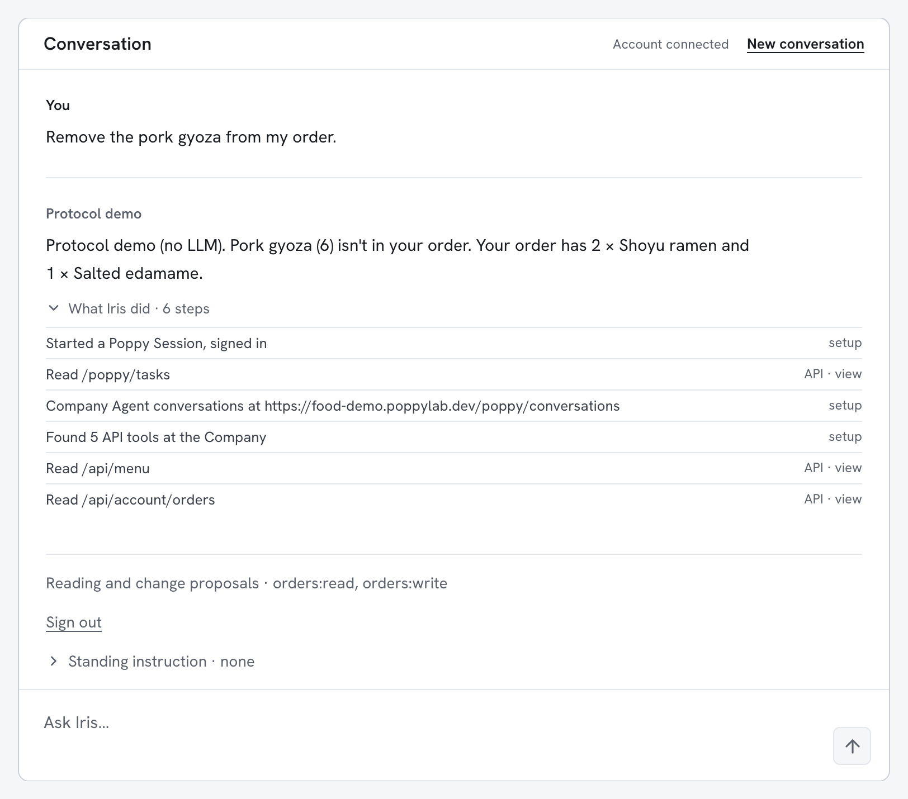
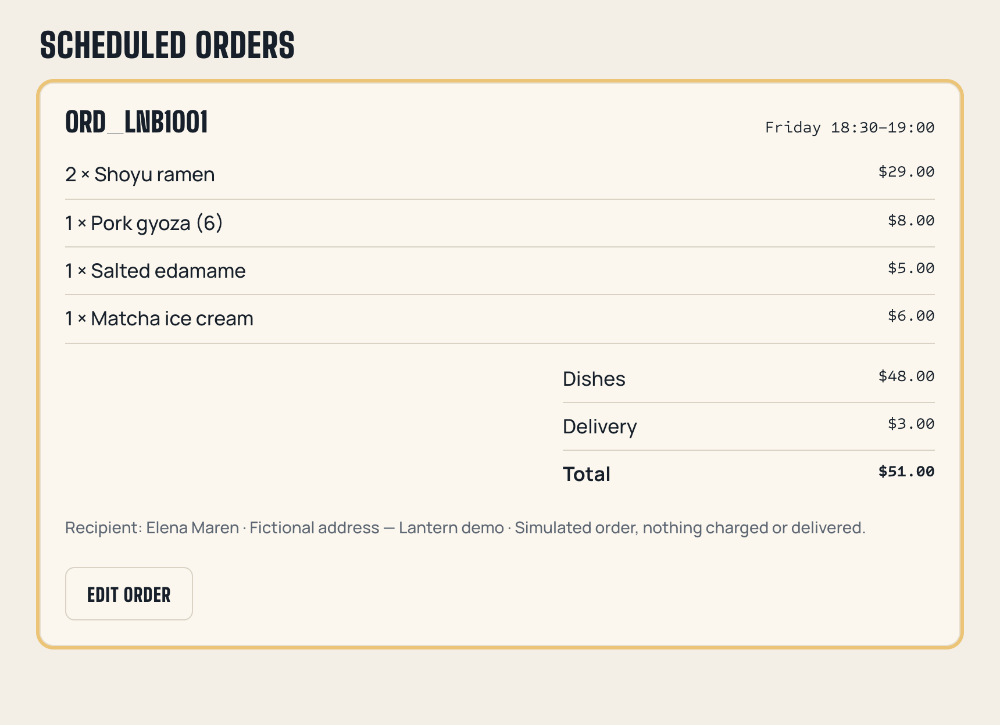
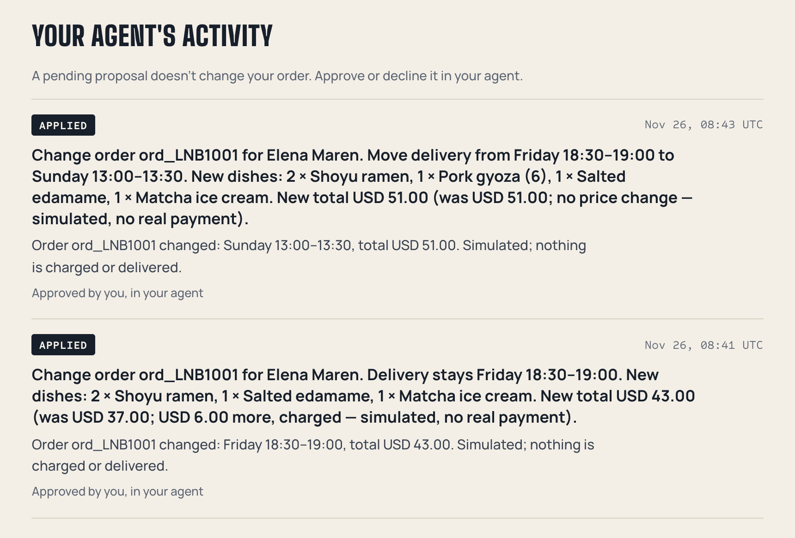
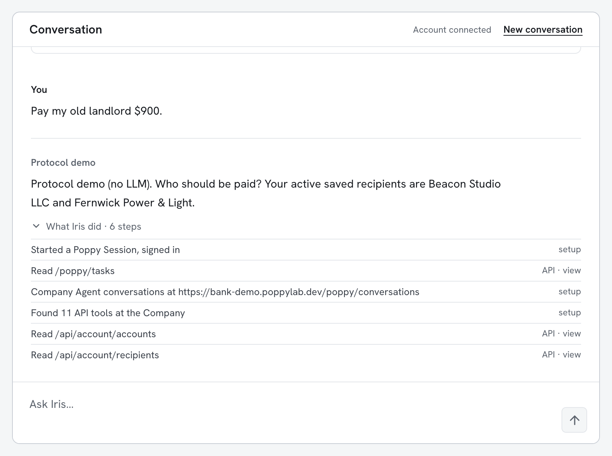
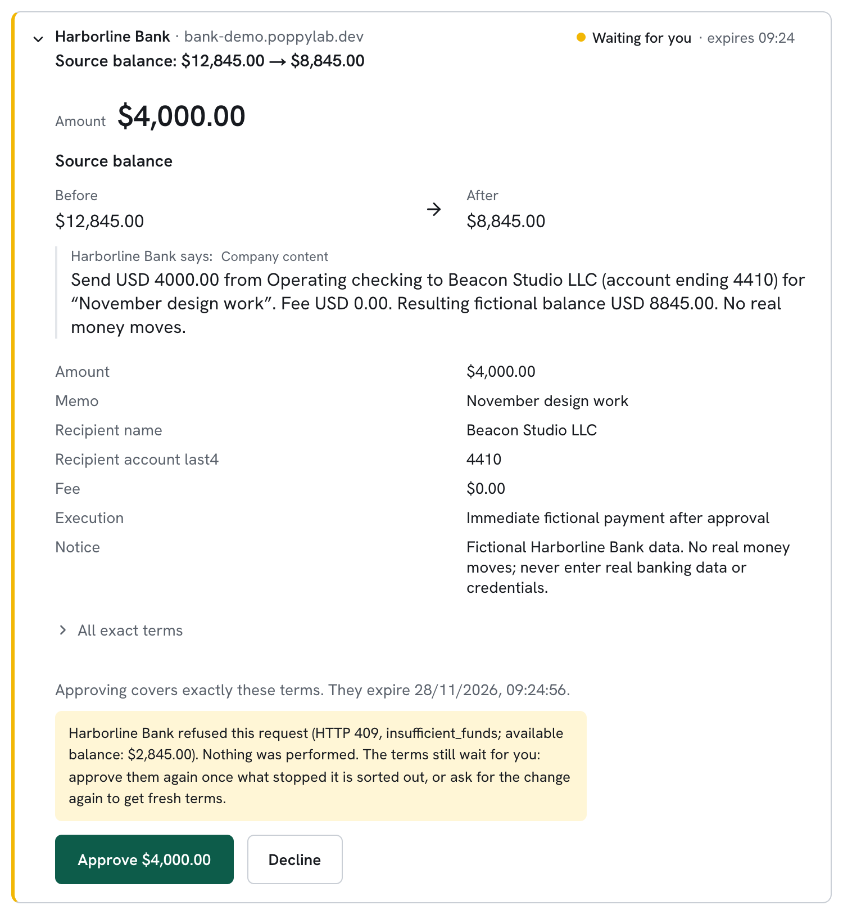

# When something goes wrong

Most requests end with a change the customer approved. This page follows the
ones that end another way. Elena asks Iris, her personal agent, for changes at
[Lantern Noodle Bar](https://food-demo.poppylab.dev) and at
[Harborline Bank](https://bank-demo.poppylab.dev), and each time something
stops the change: she declines it, she waits too long, the order changes
before she approves, or the bank refuses.

The page shows what Elena sees in Iris each time and, where the company keeps
a record of it, what the company's own website says afterwards. Every
screenshot is from the live lab, taken on 26 November 2026.

## Who does what

| Who                                   | What they do in this process                                                                                      |
| ------------------------------------- | ----------------------------------------------------------------------------------------------------------------- |
| Elena, the customer                   | Asks for changes, then approves them, declines them or leaves them waiting.                                       |
| Iris, her agent                       | Says what is wrong when a request cannot be prepared, and shows each answer from the company as it arrives.       |
| Lantern and Harborline, the companies | Check every approval against the terms they offered and against the order or the account as it is at that moment. |

## Step by step

### 1. Ask for a change that cannot be made



Elena asks Iris to remove the pork gyoza from her Friday order at Lantern. The
order has no pork gyoza. Iris reads the menu and the order, sees that, and
tells her what the order does contain.

Iris sends Lantern no request for a change, so there is nothing for Elena to
approve and nothing for Lantern to refuse. The list of steps under the answer
shows two reads and stops there.

<details>
<summary>What travelled</summary>

```text
Started a Poppy Session, signed in
Read /poppy/tasks
Found 5 API tools at the Company
Read /api/menu
Read /api/account/orders
```

</details>

### 2. Decline a proposal


Elena then asks for a change Lantern can make: add a matcha ice cream and move
the order to Sunday lunchtime. Lantern answers with its terms, 43 dollars in
place of 37, and waits. This time Elena presses Decline.

The card closes with the word Declined and says what that means: Elena
declined it, and nothing was sent to Lantern. The line above the conversation
says the same, and both add that she can ask again. Declining happens in Iris.
Lantern had changed nothing while it waited, so there is nothing for it to
undo.

<details>
<summary>What travelled</summary>

No request was made in this step. Lantern is not told about the decline: the
terms it offered stay unused and run out on their own.
[Approvals with Operations](../operations.md#the-life-of-an-operation) shows
where a proposal can end.

</details>

### 3. See what Lantern recorded


On Lantern's website, the order is still for Friday and still costs 37
dollars. Under Your agent's activity Lantern lists the proposal as awaiting
approval, because from Lantern's side that is all that happened: it offered
terms and no approval came.

Lantern explains this to its customer in the paragraph under the proposal. It
gives the time until which the proposal waits, and it says that an agent does
not report a decline, so the proposal shows as awaiting until then. Once that
time has passed, Lantern shows a proposal nobody approved as expired, as in
step 5.

### 4. Let an approval run out


Every proposal carries a time limit set by the company. Elena asks to add a
matcha ice cream, Lantern offers its terms, and she leaves the card open
without deciding. Ten minutes later the card changes by itself, and so does
the line above the conversation. The card reads Expired, the Approve and
Decline buttons are gone, and one line says that the proposal ran out, that
nothing was done and that she can ask again.

An expired proposal cannot be approved late. If Elena still wants the change
she asks for it again, and Lantern answers with fresh terms at whatever the
price is by then. In this run she did, and the second set of terms went
through when she approved it.

<details>
<summary>What travelled</summary>

No request was made when the time ran out. The limit came with the terms, as
`expires_at`, and Iris stopped offering the approval once it had passed.
Lantern checks the time as well: an approval that names expired terms is not
performed.

Lantern answered this request with the `operation_id` it had used in step 2
and a new revision. For Lantern both requests are one pending change to the
same order, so these terms took the place of the ones Elena declined.

</details>

### 5. See the expired proposal at Lantern


Lantern's website shows the same outcome from its side. The proposal is marked
Expired, with the time it ran out, and Lantern adds that it expired without
changing anything.

The list has one entry. The terms from step 4 replaced the ones Elena declined
in step 2, and neither set changed her order.

### 6. Change the order while a proposal waits



The order now has the matcha ice cream and costs 43 dollars. Elena asks Iris
to move it to Sunday lunchtime, and Lantern offers its terms: the same three
dishes on Sunday, still 43 dollars.

Before she approves, Elena opens Lantern's website, presses Edit order and
adds a portion of pork gyoza herself. The order on the website now has four
dishes and costs 51 dollars. The proposal waiting in Iris still describes the
order as it was before her edit.

### 7. Approve terms that are out of date


Back in Iris, Elena presses Approve. Iris sends her approval, and Lantern
compares it with the order as it is now. The terms she approved no longer
describe that order, so Lantern changes nothing and answers with new terms.

Iris replaces the card at once. It is the same move to Sunday, now with the
pork gyoza and a total of 51 dollars. The move does not change the price, so
the button reads Approve this change and names no amount. A note above the
buttons says that Lantern returned new terms and performed nothing, and the
line above the conversation says the same.

Elena's first approval does not carry over. She reads the new terms and
approves them, and only then does Lantern move the order.

<details>
<summary>What travelled</summary>

Lantern's answer to the approval was the same operation with a new revision.
The part of the terms that changed:

| Term                 | Approved revision                      | New revision                                         |
| -------------------- | -------------------------------------- | ---------------------------------------------------- |
| `order_version`      | 2                                      | 3                                                    |
| `lines`              | shoyu-ramen 2, edamame 1, matcha-ice 1 | shoyu-ramen 2, pork-gyoza 1, edamame 1, matcha-ice 1 |
| `before_total_cents` | 4300                                   | 5100                                                 |
| `new_total_cents`    | 4300                                   | 5100                                                 |

[What the Company checks](../operations.md#what-the-company-checks) lists
the checks behind this answer.

</details>

### 8. Check Lantern's record



Lantern's website lists the move once, marked Applied, with the new terms, the
time and the line that Elena approved it in her agent. The terms she approved
first appear nowhere, because Lantern never applied them. The entry below is
the matcha ice cream from step 4.

The pork gyoza has no entry of its own. Elena added it on the website, so her
agent had no part in it.

### 9. Ask the bank to pay someone it does not pay



At Harborline Bank, Elena asks Iris to pay her old landlord 900 dollars. An
agent at Harborline can pay only a recipient the customer has already saved at
the bank, and only one that is active. Iris reads Elena's accounts and her
saved recipients, finds no active one that matches, and asks her who she means.

As in step 1, the list of steps shows reads and no request for a payment.
Iris does not guess a recipient and does not send a request it knows the bank
would refuse.

### 10. Approve a payment the balance no longer covers



Elena asks for a payment of 4,000 dollars to Beacon Studio for November's
design work. Harborline answers with its terms and moves no money. The terms
state the balance the checking account would have afterwards, worked out from
the 12,845 dollars it holds at that moment. Elena leaves the card waiting, and
in the same conversation she asks for two other payments of 5,000 dollars each
and approves those. The account is down to 2,845 dollars.

Then she approves the payment of 4,000 dollars. Iris sends her approval, and
Harborline checks the account as it is now. The balance does not cover the
payment, so the bank refuses and names its reason: `insufficient_funds`. Iris
puts the refusal on the card, above the buttons, with the bank's name, its
code and the balance the bank reported, and adds what it means for Elena:
nothing was performed. She can approve again once there is money in the
account, or let the card run out.

An approval is permission for the company to do what it offered. It does not
oblige the company, which checks again at the moment it would act.

<details>
<summary>What travelled</summary>

The same request as the proposal, this time with Elena's approval attached.
Harborline answered with status 409, the error code `insufficient_funds` and
the balance available in the account. Iris did not send the request again.
The Inspector lists the answer:

```text
POST /api/account/payments · refused by the Company · HTTP 409 insufficient_funds
```

</details>

### 11. Check the bank's record


Harborline's website lists what Elena's agent asked for. The two payments of
5,000 dollars are each marked Applied once, with the time and the line that
Elena approved them in her agent.

The payment of 4,000 dollars has two entries. One is marked Not applied, with
the time of the refusal, the line that Elena approved it in her agent and the
bank's reason in words: the checking account had 2,845 dollars available when
she approved, less than the payment. The other is the proposal itself, which
shows as awaiting approval until its time runs out. After that it leaves the
list, and the Not applied entry stays.

The transfer of 500 dollars is another request from the same conversation, and
it waited in the same panel, which is why the panel in step 10 counts two.
Its first terms quoted a balance that the two payments made out of date. When
Elena approved it, Harborline returned new terms as Lantern did in step 7, and
it made the transfer once she approved those. The list shows it once.

## When the answer is lost

One case cannot be provoked from outside, so it has no screenshot here. Elena
approves a change, Iris sends the approval, and the company's answer never
arrives: the connection drops, or the company is slow to reply. The change may
have been made, or it may not.

Iris does not guess. The card reads Outcome unknown and offers one button,
Retry the same approval. Pressing it sends the identical request with the
identical approval. A company that had already made the change answers with
the original result and does not make it a second time. A company that never
received the first one checks it as it would any approval. Iris does not ask
for the change again to find out what happened: while the outcome is unknown
it puts no new proposal in front of Elena.
[Retries and at most once](../operations.md#retries-and-at-most-once)
describes what each side has to do for this to hold.

## What Lantern and Harborline control

Each company stays in charge of its own records in every one of these cases.

- It sets how long its terms may be approved, and it does nothing once that
  time has passed.
- It checks an approval against the terms it offered. When the order or the
  account has changed since, it sends new terms.
- It checks the account again at the moment it would act, and it can refuse
  for a reason of its own.
- It changes nothing without an approval of its current terms, so a declined,
  expired or refused request leaves the order or the balance as it was.
- It shows the customer on its own website what her agent proposed, what was
  applied and when, and who approved it.

## For the technical reader

[Approvals with Operations](../operations.md) covers revisions, expiry,
declines and retries with the requests and answers written out. The Inspector
view of the playground lists a refusal and an answer with new terms each as a
line of its own. The messages Iris shows for each outcome are set in
[`route.ts`](../../../apps/playground/app/api/account/route.ts),
[`operation-presentation.ts`](../../../apps/playground/lib/operation-presentation.ts)
and [`guide.ts`](../../../apps/playground/lib/guide.ts).
