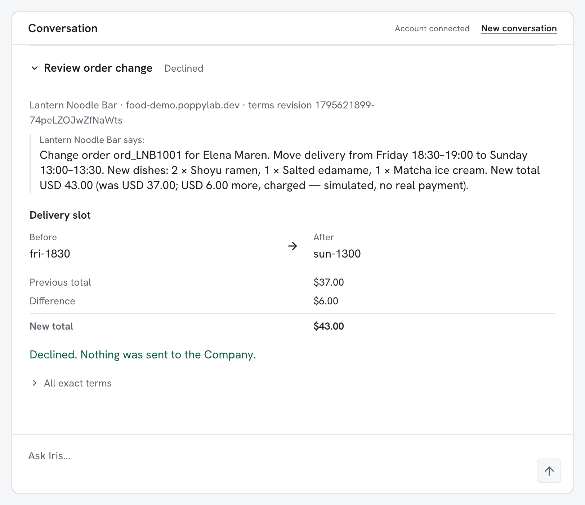
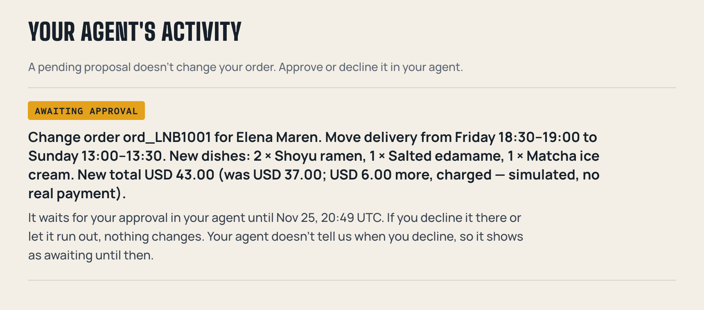
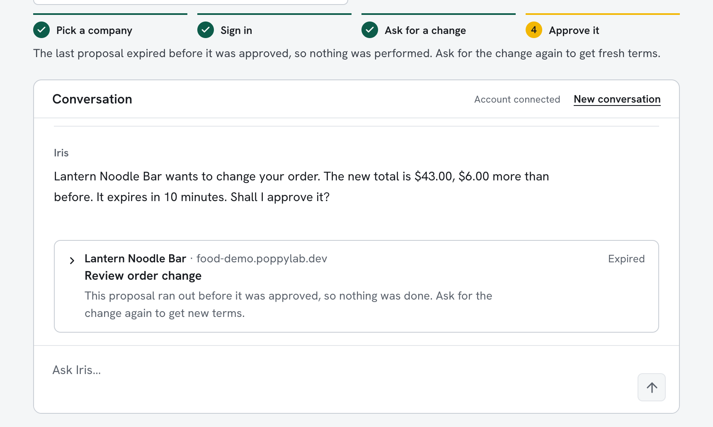
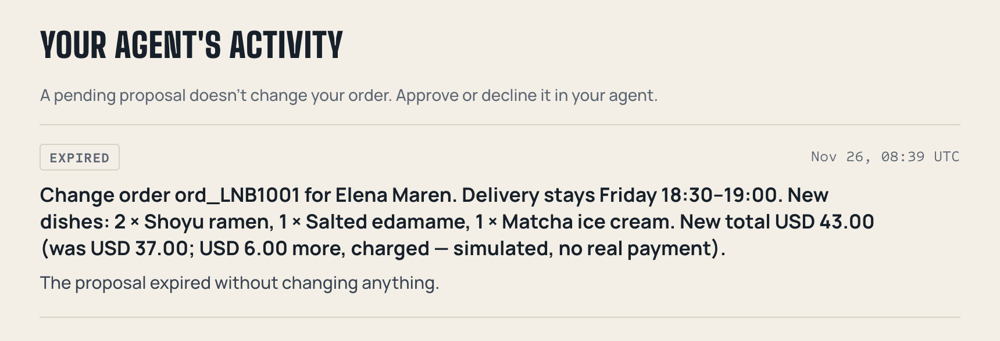
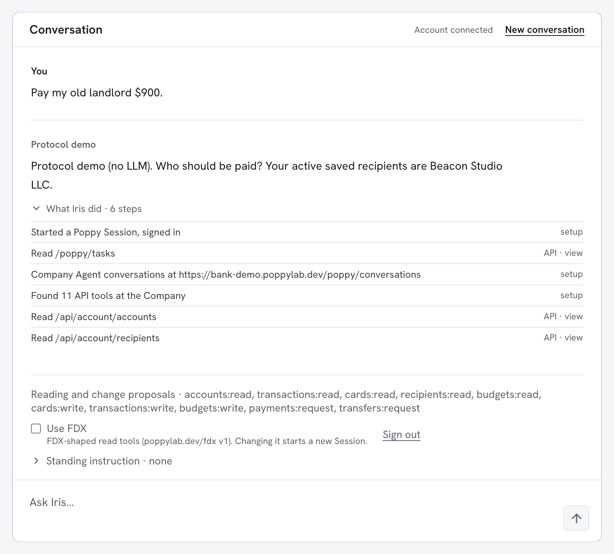
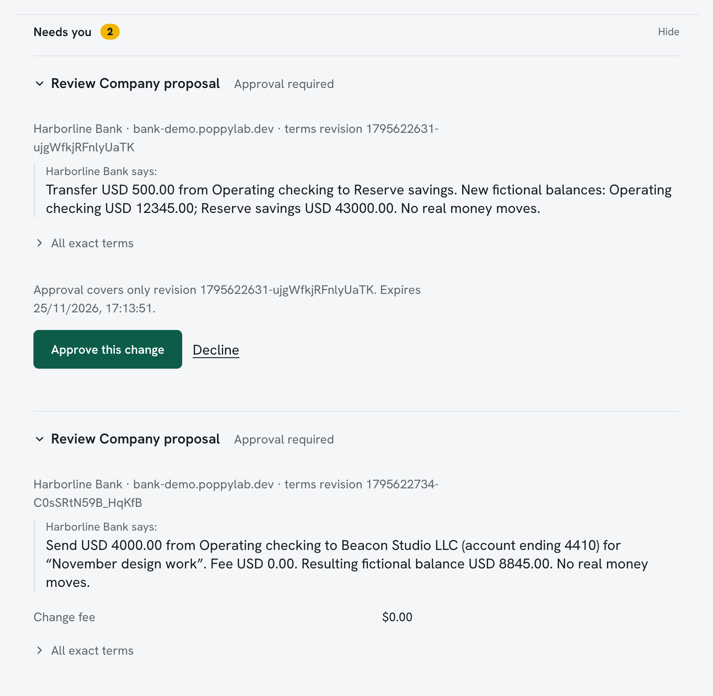
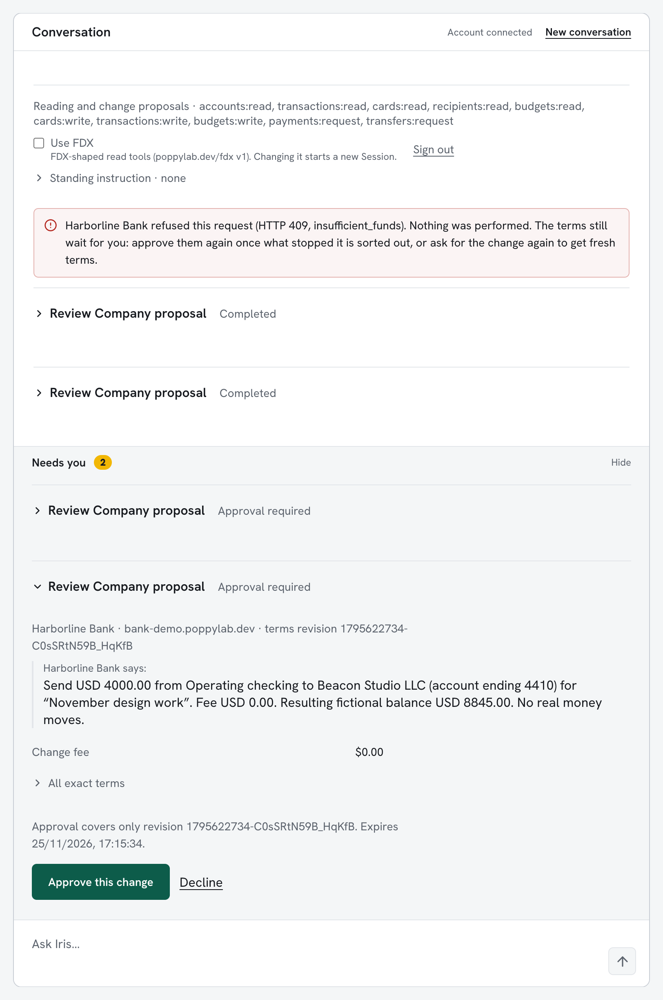
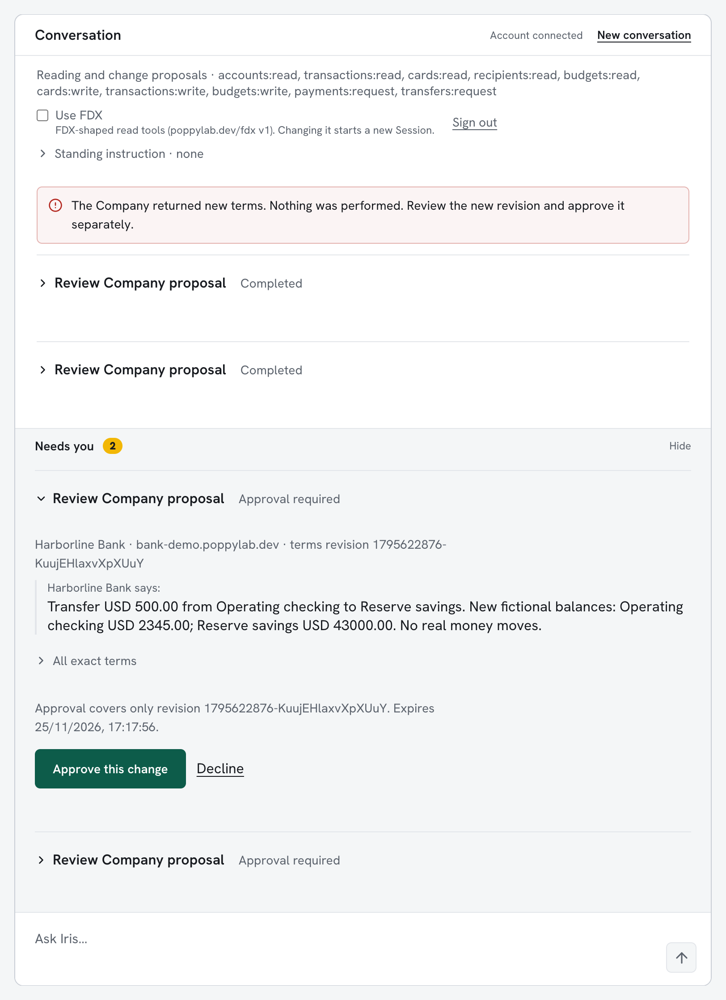
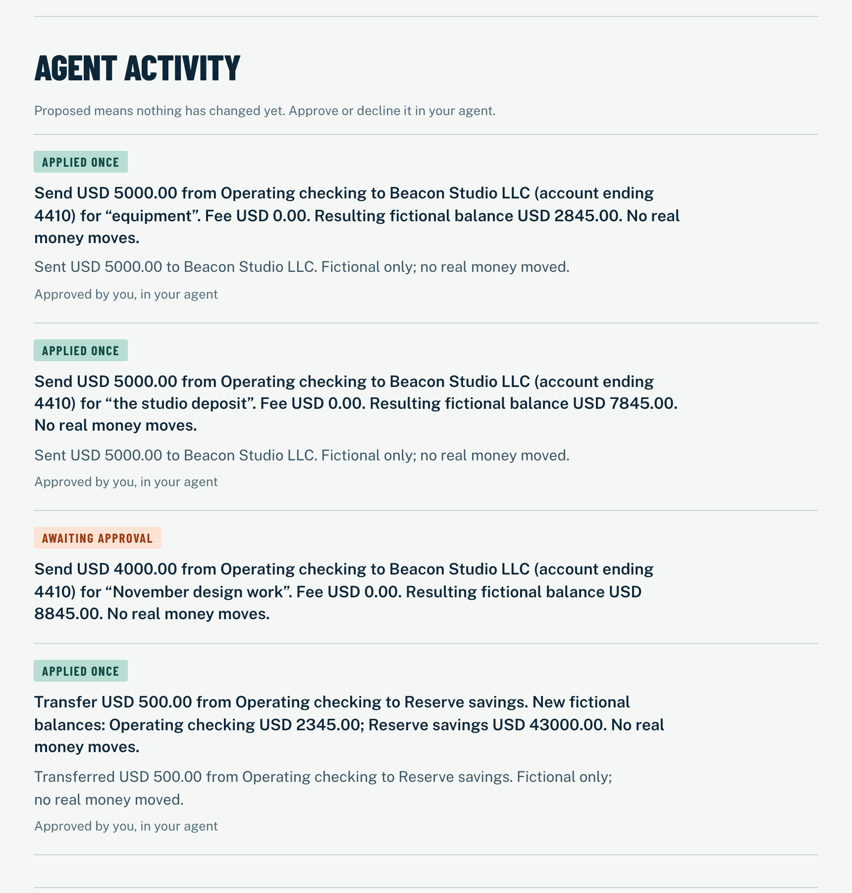

# When something goes wrong

Most requests end with a change the customer approved. This page follows the
ones that end another way. Elena asks Iris, her personal agent, for changes at
[Lantern Noodle Bar](https://food-demo.poppylab.dev) and at
[Harborline Bank](https://bank-demo.poppylab.dev), and each time something
stops the change: she declines it, she waits too long, the bank refuses, or
the facts change before she approves.

The page shows what Elena sees in Iris each time and, where the company keeps
a record of it, what the company's own website says afterwards. Every
screenshot is from the live lab, taken on 25 November 2026.

## Who does what

| Who                                   | What they do in this process                                                                                      |
| ------------------------------------- | ----------------------------------------------------------------------------------------------------------------- |
| Elena, the customer                   | Asks for changes, then approves them, declines them or leaves them waiting.                                       |
| Iris, her agent                       | Says what is wrong when a request cannot be prepared, and shows each answer from the company as it arrives.       |
| Lantern and Harborline, the companies | Check every approval against the terms they offered and against the order or the account as it is at that moment. |

## Step by step

### 1. Ask for a change that cannot be made


Elena asks Iris to remove the pork gyoza from her Friday order at Lantern. The
order has no pork gyoza. Iris reads the menu and the order, sees that, and
tells her what the order does contain.

Iris sends Lantern no request for a change, so there is nothing for Elena to
approve and nothing for Lantern to refuse. The list of steps under the answer
shows two reads and stops there.

<details>
<summary>What travelled</summary>

```text
Started a Poppy Session, signed in
Read /poppy/tasks
Found 5 API tools at the Company
Read /api/menu
Read /api/account/orders
```

</details>

### 2. Decline a proposal



Elena then asks for a change Lantern can make: add a matcha ice cream and move
the order to Sunday lunchtime. Lantern answers with its terms, 43 dollars in
place of 37, and waits. This time Elena presses Decline.

The card closes with the word Declined and one line: nothing was sent to the
company. Declining happens in Iris. Lantern had changed nothing while it
waited, so there is nothing for it to undo.

<details>
<summary>What travelled</summary>

No request was made in this step. Lantern is not told about the decline: the
terms it offered stay unused and run out on their own.
[Approvals with Operations](../operations.md#the-life-of-an-operation) shows
where a proposal can end.

</details>

### 3. See what Lantern recorded



On Lantern's website, the order is still for Friday and still costs 37
dollars. Under Your agent's activity Lantern lists the proposal as awaiting
approval, because from Lantern's side that is all that happened: it offered
terms and no approval came.

Once the ten minutes Lantern gave for these terms have passed, a proposal
nobody approved is shown as expired. Step 5 shows that for another proposal.

### 4. Let an approval run out



Every proposal carries a time limit set by the company. Elena asks to add a
matcha ice cream, Lantern offers its terms, and she leaves the card open
without deciding. Ten minutes later the card changes by itself: it reads
Expired, and the Approve and Decline buttons are gone.

An expired proposal cannot be approved late. If Elena still wants the change
she asks for it again, and Lantern answers with fresh terms at whatever the
price is by then. In this run she did, and the second set of terms went
through when she approved it.

<details>
<summary>What travelled</summary>

No request was made when the time ran out. The limit came with the terms, as
`expires_at`, and Iris stopped offering the approval once it had passed.
Lantern checks the time as well: an approval that names expired terms is not
performed.

</details>

### 5. See the expired proposal at Lantern



Lantern's website shows the same outcome from its side. The proposal is marked
Expired, and Lantern adds that it expired without changing anything.

### 6. Ask the bank to pay someone it does not pay



At Harborline Bank, Elena asks Iris to pay her old landlord 900 dollars. An
agent at Harborline can pay only a recipient the customer has already saved at
the bank, and only one that is active. Iris reads Elena's accounts and her
saved recipients, finds no active one that matches, and asks her who she means.

As in step 1, the list of steps shows reads and no request for a payment.
Iris does not guess a recipient and does not send a request it knows the bank
would refuse.

### 7. Leave two requests waiting



Elena asks for two things: a transfer of 500 dollars from checking to savings,
and a payment of 4,000 dollars to Beacon Studio for November's design work.
Harborline answers each with its terms and moves no money. Both terms state
the balance the checking account would have afterwards, worked out from the
12,845 dollars it holds at that moment.

Elena approves neither yet. In the same conversation she asks for two other
payments of 5,000 dollars each and approves those. The checking account is now
down to 2,845 dollars, and the two earlier proposals are still waiting.

### 8. Approve a payment the balance no longer covers



Elena approves the payment of 4,000 dollars. Iris sends her approval to
Harborline, and Harborline checks the account as it is now. The balance does
not cover the payment, so the bank refuses and names its reason:
`insufficient_funds`.

Iris shows the refusal as it came, with the bank's own code, and adds what it
means for Elena: nothing was performed. The card stays in the panel. She can
approve it again once there is money in the account, or let it run out.

An approval is permission for the company to do what it offered. It does not
oblige the company, which checks again at the moment it would act.

<details>
<summary>What travelled</summary>

The same request as the proposal, this time with Elena's approval attached.
Harborline answered with status 409 and the error code `insufficient_funds`.
Iris did not send the request again.

</details>

### 9. Approve terms that are out of date



Elena then approves the transfer of 500 dollars. The account can cover it, but
the terms she approved said the checking account would hold 12,345 dollars
afterwards, and that is no longer true.

Harborline does not make the transfer on terms that no longer describe the
account. It answers with new terms, and Iris replaces the card with them: the
same transfer, leaving 2,345 dollars. Elena's first approval does not carry
over. She reads the new terms and approves them, and only then does Harborline
move the money.

<details>
<summary>What travelled</summary>

Harborline's answer to the approval was the same operation with a new
revision. The part of the terms that changed:

| Term                          | Approved revision | New revision |
| ----------------------------- | ----------------- | ------------ |
| `source_version`              | 1                 | 3            |
| `source_balance_before_cents` | 1284500           | 284500       |
| `source_balance_after_cents`  | 1234500           | 234500       |

[What the Company checks](../operations.md#6-what-the-company-checks) lists
the checks behind this answer.

</details>

### 10. Check the bank's record



Harborline's website lists what Elena's agent asked for. The two payments of
5,000 dollars and the transfer are each marked Applied once, with the line
that Elena approved them in her agent. The payment of 4,000 dollars is still
awaiting approval: the bank refused it and took nothing from the account.

The transfer appears once, with the new terms. The terms Elena approved first
were never applied.

## When the answer is lost

One case cannot be provoked from outside, so it has no screenshot here. Elena
approves a change, Iris sends the approval, and the company's answer never
arrives: the connection drops, or the company is slow to reply. The change may
have been made, or it may not.

Iris does not guess. The card reads Outcome unknown and offers one button,
Retry the same approval. Pressing it sends the identical request with the
identical approval. A company that had already made the change answers with
the original result and does not make it a second time. A company that never
received the first one checks it as it would any approval. Iris does not ask
for the change again to find out what happened: while the outcome is unknown
it puts no new proposal in front of Elena.
[Retries and at most once](../operations.md#8-retries-and-at-most-once)
describes what each side has to do for this to hold.

## What Lantern and Harborline control

Each company stays in charge of its own records in every one of these cases.

- It sets how long its terms may be approved, and it does nothing once that
  time has passed.
- It checks an approval against the terms it offered. When the order or the
  account has changed since, it sends new terms.
- It checks the account again at the moment it would act, and it can refuse
  for a reason of its own.
- It changes nothing without an approval of its current terms, so a declined,
  expired or refused request leaves the order or the balance as it was.
- It keeps the record of what was proposed, what was applied and who approved
  it, and shows that record to the customer on its own website.

## For the technical reader

[Approvals with Operations](../operations.md) covers revisions, expiry,
declines and retries with the requests and answers written out. The messages
Iris shows for each outcome are set in
[`route.ts`](../../../apps/playground/app/api/account/route.ts).
