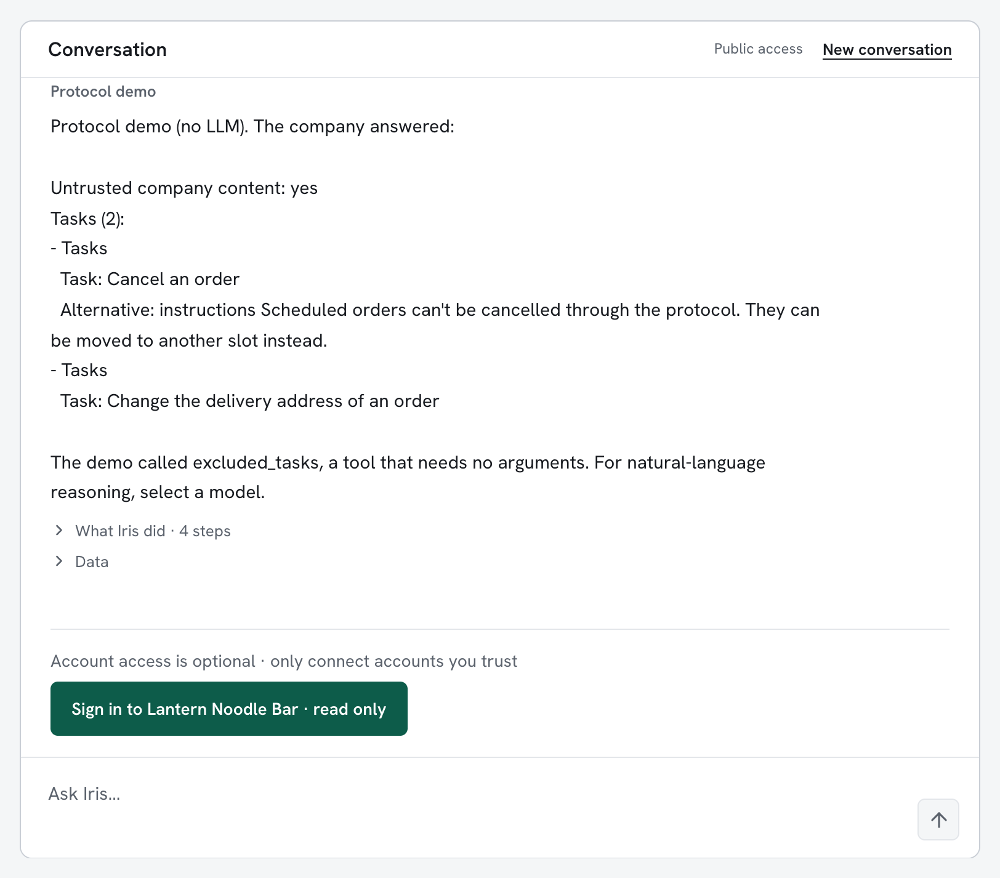
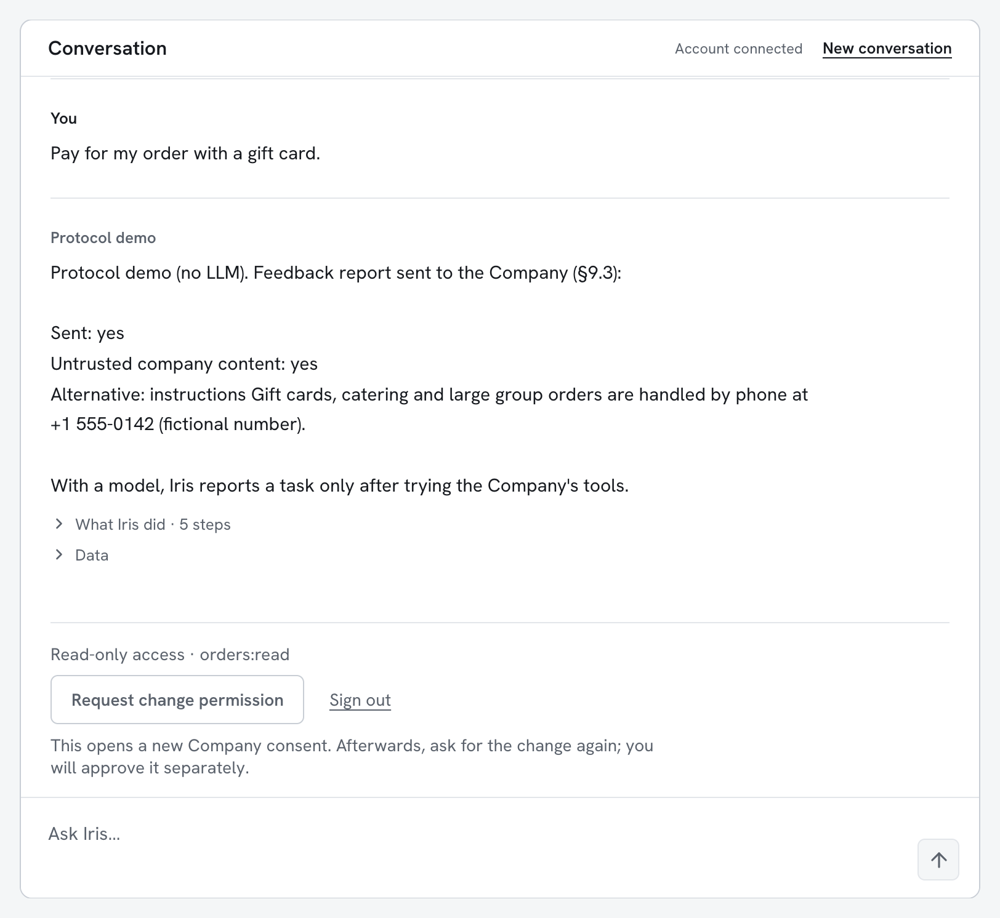
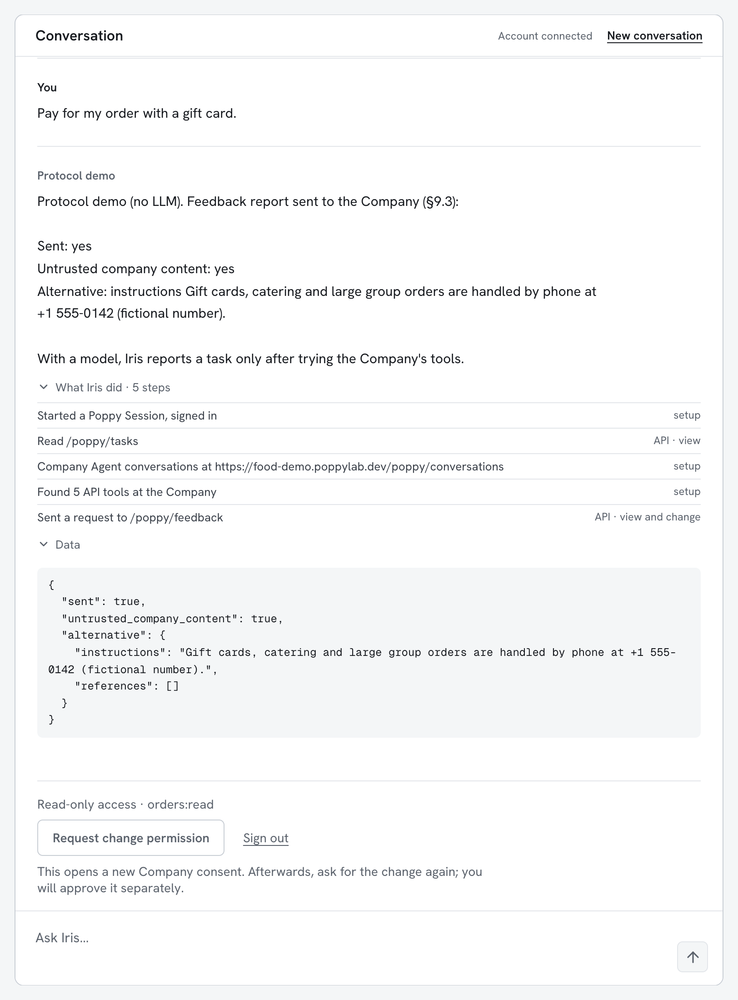
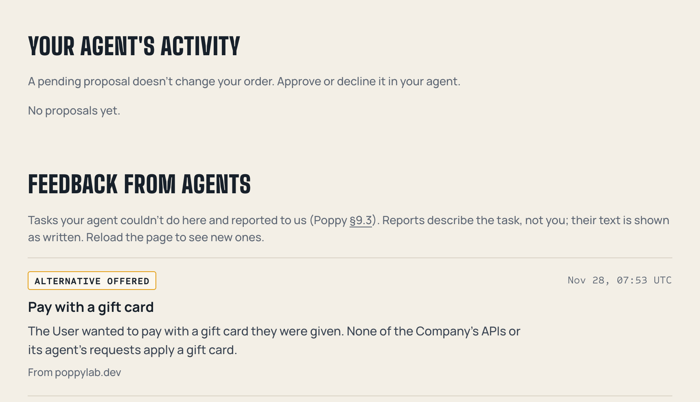
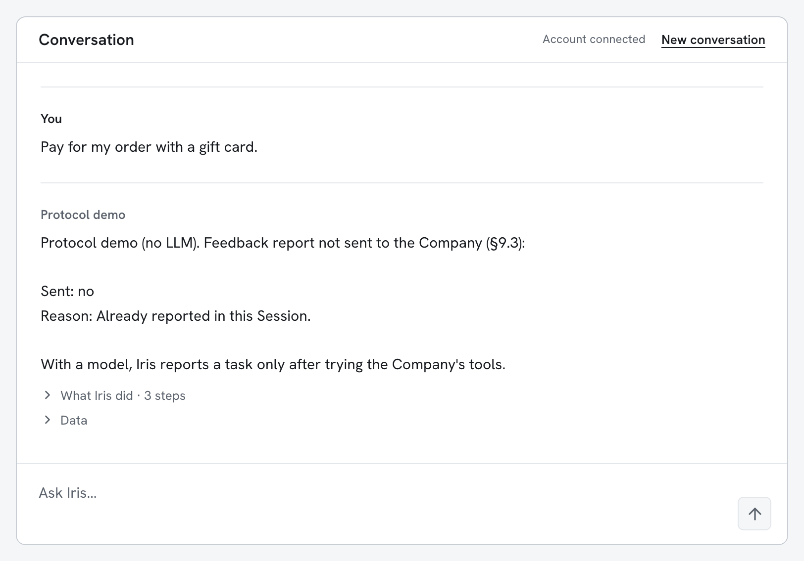
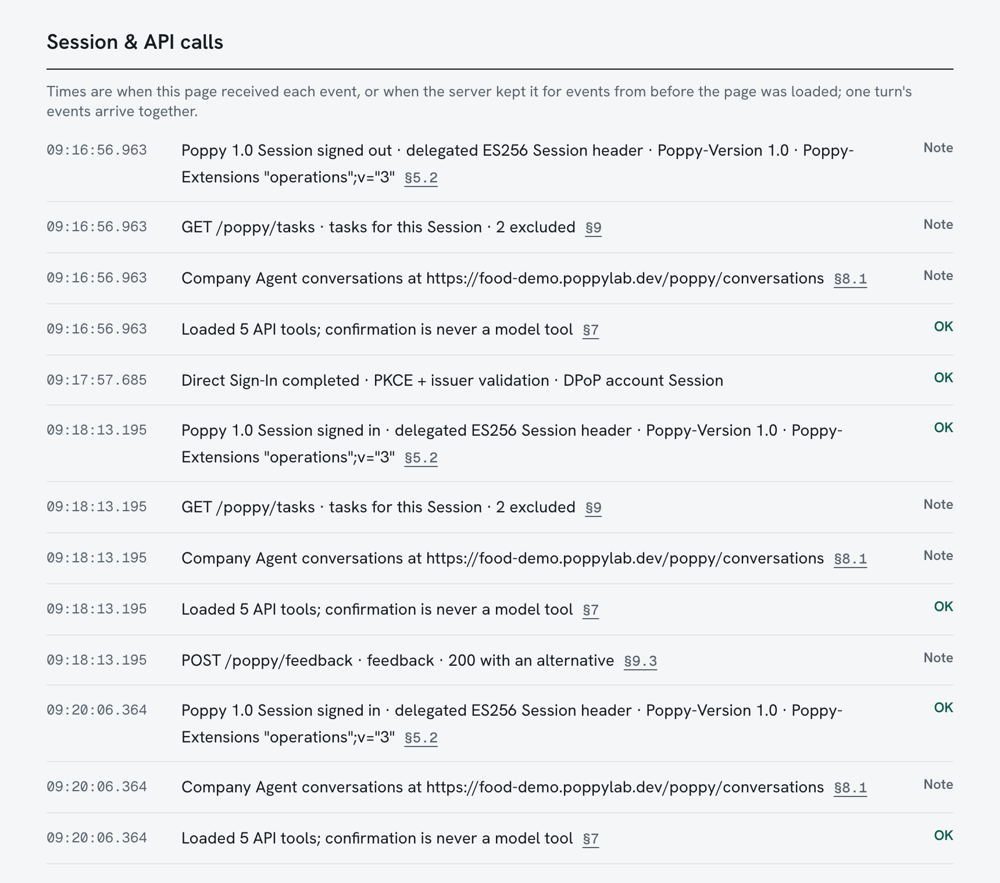

# When the company can't do it

Elena was given a gift card for
[Lantern Noodle Bar](https://food-demo.poppylab.dev) and asks Iris, her
personal agent, to pay for her Friday order with it. Lantern does not offer
that to agents. Iris says so, tells Lantern what its customer wanted, and
passes on the other way Lantern suggests.

This page follows that request screen by screen, on Iris's side and on
Lantern's. Every screenshot is from the live lab, taken on 26 November 2026.

## Who does what

| Who                  | What they do in this process                                                                                    |
| -------------------- | --------------------------------------------------------------------------------------------------------------- |
| Elena, the customer  | Asks for what she wants in her own words and reads the answer.                                                  |
| Iris, her agent      | Reads the list of tasks Lantern leaves out, and reports a task it could not do, described without naming Elena. |
| Lantern, the company | Chooses what agents can do, lists what it leaves out, takes the report and answers with another way to do it.   |

## Step by step

### 1. See what Lantern leaves out



A company decides what a customer's agent can do with it, and it can also say
what it decided to leave out. Lantern lists two such tasks. An order cannot be
cancelled through an agent, and for that one Lantern suggests moving the order
to another slot. The delivery address of an order cannot be changed either,
and Lantern gives no suggestion for it.

Iris reads this list at the start of every session with Lantern, so it knows
the answer to these two requests without trying them. The lab runs here in
demo mode, without an AI model, which is why Elena has to name the list to see
it. With a model connected, Iris checks the list itself before it looks for a
way to do an unusual task.

<details>
<summary>What travelled</summary>

Iris opened a session with Lantern and read the address Lantern publishes for
its tasks. No account was involved, because the list describes Lantern and
says nothing about a customer.

```text
Started a Poppy Session, signed out
Read /poppy/tasks
Found 5 API tools at the Company
```

Lantern's answer, as Iris received it:

```json
{
  "tasks": [
    {
      "task": "Cancel an order",
      "alternative": {
        "instructions": "Scheduled orders can't be cancelled through the protocol. They can be moved to another slot instead.",
        "references": [
          {
            "type": "openapi",
            "url": "https://food-demo.poppylab.dev/openapi.json",
            "operation_id": "change_order"
          }
        ]
      }
    },
    { "task": "Change the delivery address of an order" }
  ]
}
```

[One task, request by request](../one-task.md#3-open-a-session-signed-out)
shows the request itself.

</details>

### 2. Ask for something Lantern can't do



Elena has signed in at Lantern, as in
[Changing an order](changing-an-order.md), and asks Iris to pay for her order
with a gift card. Paying with a gift card is on neither of Lantern's lists:
none of the things Lantern lets an agent do applies one, and Lantern has not
said that it leaves the task out.

Iris does two things. It tells Elena that it cannot do this at Lantern, and it
sends Lantern a short report of the task. Lantern answers the report with
another way to do it: gift cards are handled by phone. Iris shows that answer
as Lantern's words. The line "Untrusted company content" marks it as something
the company wrote, which Iris passes on and does not take as an instruction.

In demo mode the report is a fixed one, sent as soon as the message mentions a
gift card. With a model connected, Iris reports a task only after it has tried
the tools Lantern offers.

### 3. Read what Iris told Lantern



Under each answer Iris lists what it did. The last line here is the report: one
request to an address Lantern gave for this purpose.

The report has two parts, a short name for the task and a description of what
was wanted and why it could not be done. It describes the task and leaves
Elena out: it holds no name, no contact details and no order number. Iris
checks the text before sending, and a report that seems to contain an email
address, a phone number or a reference is held back.

<details>
<summary>What travelled</summary>

The report, as Iris sent it:

```http
POST https://food-demo.poppylab.dev/poppy/feedback
```

```json
{
  "task": "Pay with a gift card",
  "description": "The User wanted to pay with a gift card they were given. None of the Company's APIs or its agent's requests apply a gift card."
}
```

Lantern's reply:

```json
{
  "instructions": "Gift cards, catering and large group orders are handled by phone at +1 555-0142 (fictional number)."
}
```

The request went in Iris's session with Lantern, so Lantern knows which agent
sent it. Elena was signed in, so it also carried her permission for Iris, and
Lantern can file the report under her account.
[Feedback, on the wire](../build-a-company.md#feedback-on-the-wire) lists the
rules for the company, and [Feedback reports](../build-an-agent.md#feedback-reports)
those for the agent.

</details>

### 4. Find the report at Lantern



On Lantern's website, Elena's account page has a section called Feedback from
agents. The report is there as Iris wrote it, with the time, the agent it came
from and a note that Lantern offered an alternative. The section above it
shows that Iris proposed no change to her order.

The report now belongs to Lantern. It tells the company that a customer wanted
to pay with a gift card through an agent and could not. What Lantern does with
that is its own decision: it can offer the task to agents later, or keep
answering with the phone number.

### 5. Ask again



Elena asks the same thing a second time. Iris does not send a second report.
The answer says so in its heading and gives the reason under it: the task was
already reported in this session. The list of steps has no request to
Lantern's feedback address this time.

Within one session Iris reports a task once, however many times Elena asks.
The protocol asks an agent for one report for each task it could not do, and
none for each further attempt.

## What Lantern controls

Lantern decides what its customers' agents can do, and it hears about what
they could not.

- It chooses which tasks an agent can carry out and which need the website,
  the phone or a person.
- It publishes the tasks it left out on purpose, with a suggestion where it
  has one, so that an agent does not spend time looking for a way.
- It decides whether to take reports at all, and where.
- It answers a report with another way to do the task when it knows one, in
  its own words.
- It keeps the reports and decides what to do with them.

## For the technical reader



The Inspector view of the playground lists the read of Lantern's tasks and the
report with its result, "200 with an alternative", each beside the section of
the specification it follows. Its Company profile names the two tasks from
step 1 under Tasks not offered, from the first message of a session on.
[Build a Company](../build-a-company.md#feedback-on-the-wire) shows the
request and both possible answers, and
[section 9 of the specification](https://personalagentprotocol.org/docs/1.0/spec#task-coverage)
defines excluded tasks, alternatives and feedback.
